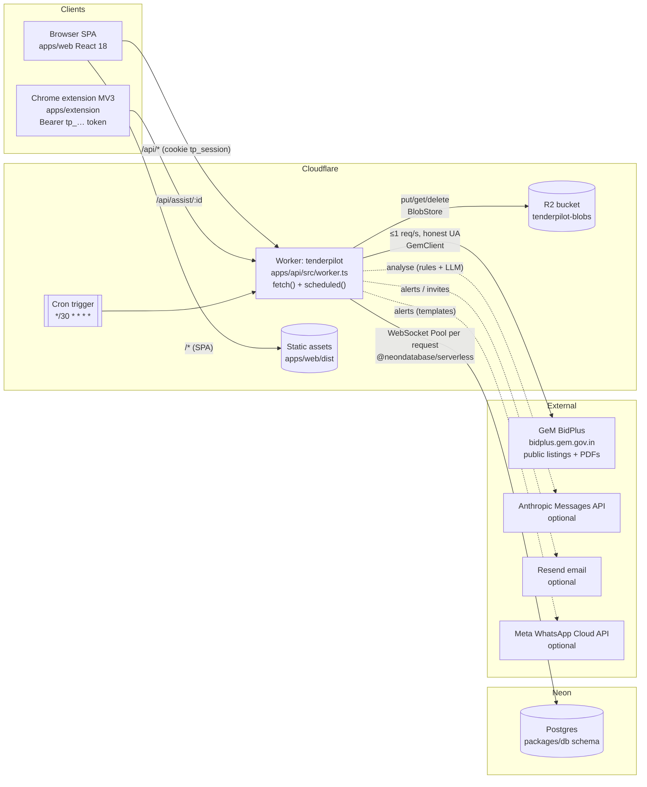
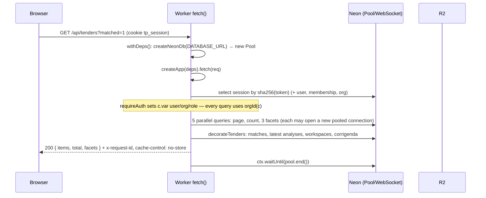
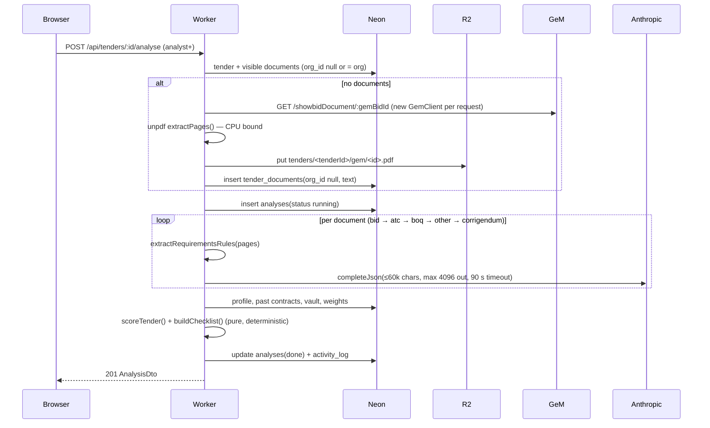
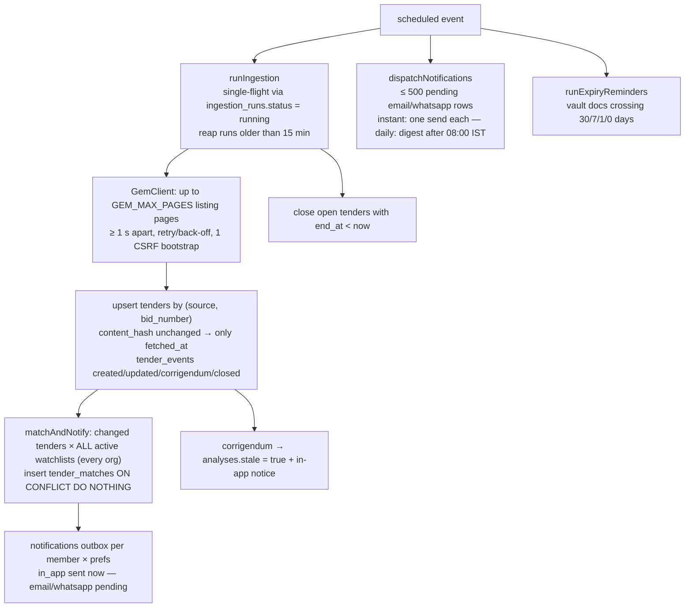
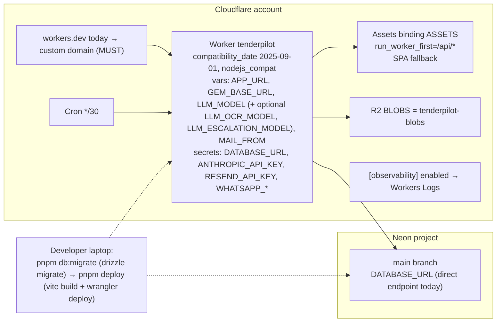

# TenderPilot — Architecture

**Status**: Current state as of 2026-11-05 (all 7 user stories built; 247 core + 145 API tests green), with the
principal-architect assessment for the first paying customers. Decisions and recommended changes are recorded as
ADRs in [`docs/adr/`](./adr/). Priorities used throughout: **MUST** = before the first paying customer,
**SHOULD** = within the first paid quarter, **LATER** = when a stated trigger is reached.

Goal stated by the product owner: *simple but effective, and a bit scalable*. Target scale for this document:
100s of organizations, 10^5–10^6 `tenders` rows, a few thousand active watchlists, tens of analyses per org per day.

---

## 1. System overview

TenderPilot is a single-deployable, multi-tenant SaaS: one Cloudflare Worker serves the JSON API (`/api/*`), the
React SPA (static assets) and the 30-minute cron pipeline; Neon Postgres is the only system of record; R2 holds
files (vault documents, tender PDFs, built packets). The same Hono app runs on plain Node + Postgres + filesystem for
dev, CI and E2E (Constitution VII).

### Code map

| Layer | Path | Responsibility |
|---|---|---|
| Domain (pure, no I/O) | `packages/core/src/{gem,match,analyse,vault,packet,assist,contracts}` | BidPlus parsing + polite client, watchlist matcher, PDF text → requirements (rules, optional LLM), scoring, checklist, annexures, packet merge, extension allow-list, zod DTOs shared with the web app |
| Schema (source of truth) | `packages/db/src/schema.ts`, `packages/db/migrations/` | Drizzle schema, SQL migrations, `createNodeDb` (pg) / `createNeonDb` (neon-serverless), seed + demo data |
| API | `apps/api/src/{app,routes,services,middleware,lib,adapters}` | Hono routers (thin), services (orchestration), auth middleware, adapters for blob/LLM/mail/WhatsApp, `createDeps()` |
| Entrypoints | `apps/api/src/worker.ts` (Cloudflare), `apps/api/src/node.ts` (Node) | Build `AppDeps` per runtime, mount `createApp(deps)`, run `runScheduledJobs(deps)` on cron / interval |
| Web | `apps/web` | SPA, TanStack Query over `/api`, same origin (no CORS) |
| Extension | `apps/extension` | Reads `GET /api/assist/:workspaceId`, fills only allow-listed non-financial GeM fields |
| Local GeM | `tools/mock-gem` | Fixture server for dev/E2E (`GEM_BASE_URL`) |

### Dependency injection

Everything the API touches is behind `AppDeps` (`apps/api/src/deps.ts`): `db`, `blobs`, `llm | null`, `mailer`,
`whatsapp`, `gem` config, `clock`, `config`, `logger`, `fetch`. Missing optional secrets degrade to logged no-ops
(`createLogMailer`, `createLogWhatsApp`, `llm: null` → rules-only). This is the seam every recommendation below
plugs into (rate limiter, usage meter, error reporter are new `AppDeps` members, not globals).

---

## 2. Request flows

### 2.1 Authenticated API request (Worker)

Key properties:
- **Auth**: opaque 256-bit session token, only its SHA-256 stored (`sessions.token_hash`), HttpOnly SameSite=Lax
  cookie, sliding 30-day expiry; API tokens `tp_…` for the extension, hashed, `last_used_at` throttled to 1/min.
  Passwords PBKDF2-SHA256 100k iterations (Workers cap), constant-time compare, dummy hash for unknown emails.
- **Tenancy**: no RLS; isolation is application-level. Every org-owned table has `org_id`; routes call `orgId(c)`
  and services take `org` explicitly; cross-org ids yield 404. Public `tenders`/`tender_documents(org_id null)`
  are shared by design. See ADR-0004.
- **Errors**: `{ error: { code, message, details? } }`; unhandled errors log `rid` + 6 stack lines, never leak.

### 2.2 Analyse a tender (synchronous, heaviest request)

### 2.3 Build a packet (memory-heaviest request)

`POST /workspaces/:id/packets` loads the latest analysis, all vault rows, templates; validates item references
org-scoped; inserts `packets(building)`; for each item loads bytes from R2 into memory, renders annexures with
pdf-lib, merges with cover + index + bookmarks, writes `org/<org>/packets/<id>/<bid>_technical_packet.pdf` to R2;
updates the row to `ready` (or `failed` with the message). Peak memory ≈ 2–3× the sum of input sizes. Vault files
are ≤ 20 MB each and there is no cap on the number of items. See ADR-0007.

### 2.4 Scheduled pipeline (cron every 30 minutes)

Properties worth stating explicitly:
- **Ingestion is global and shared** — `tenders` has no `org_id`; one cron fetches GeM once for every org
  (good: GeM traffic does not scale with customers). Manual "Sync now" (`POST /ingestion/run`, bid_manager+) runs
  the same global job inline in the request.
- Steps are isolated (`runScheduledJobs`): a failing step does not stop the next.
- The GeM throttle lives **inside a `GemClient` instance**; a new instance is created per request/run. On Workers
  every request is its own isolate, so concurrent document fetches from several orgs are *not* throttled against
  each other (ADR-0003).

---

## 3. Data model and storage

- **Postgres (Neon)**: 23 tables in `packages/db/src/schema.ts`. Global: `tenders`, `tender_events`,
  `tender_documents(org_id null)`, `ingestion_runs`, `annexure_templates(org_id null)`. Org-scoped: everything
  else, all with `org_id … on delete cascade`.
- **Indexes** (migration `0000`): unique `(source, bid_number)`, `tenders(end_at)`, `tenders(state)`,
  `tender_matches(org_id, tender_id, watchlist_id)` unique + `(org_id, created_at)`, `analyses(org_id, tender_id)`,
  `notifications(org_id, user_id, created_at)` + dedupe unique, `activity_log(org_id, created_at)`, vault/watchlist
  org indexes. **Missing** for the stated scale: a partial index on open tenders, a text-search index, a partial index
  on pending notifications (ADR-0009).
- **R2 key layout**: `org/<orgId>/vault/<docId>/<file>`, `org/<orgId>/packets/<packetId>/<file>`,
  `tenders/<tenderId>/gem/<id>.pdf` (public, shared), `tenders/<tenderId>/<orgId>/<id>.pdf` (org upload). Files are
  only ever streamed through authorised API routes (`private, no-store`); there are no public R2 URLs and no
  lifecycle rules.
- **Growth drivers**: `tenders.raw` jsonb per tender (~3–8 KB each, never pruned); `notifications` grows by
  matches × members × channels; `tender_events`; `sessions` (never purged); packets (every build is a new file).

---

## 4. Deployment topology

Local/CI: `apps/api/src/node.ts` (`@hono/node-server`, `pg` Pool max 10, filesystem blobs under `.data/blobs`,
optional in-process scheduler via `CRON_INTERVAL_MS`, `AUTO_MIGRATE=1`), `tools/mock-gem`, Playwright E2E.

Runtime limits that shape the design (Cloudflare Workers, as published at the time of writing — re-check before
changing plans): CPU per invocation 10 ms on Free, 30 s default on Paid and configurable up to 5 min with
`[limits] cpu_ms`; 128 MB memory per isolate; 1,000 subrequests per invocation on Paid; cron handlers get 15 min
wall clock; request bodies 100 MB on Free/Pro. **TenderPilot is not runnable on the Free plan** (PDF parsing and
packet building exceed 10 ms CPU by orders of magnitude).

---

## 5. Assessment

Each row: what the code does today → risk at target scale / for paying customers → recommendation and priority.
Concrete file-level changes are in the referenced ADR.

| # | Area | Today (verified in code) | Risk | Recommendation | Priority | ADR |
|---|---|---|---|---|---|---|
| 1 | Tenancy isolation | Application-level `orgId(c)` scoping everywhere; tender docs `org_id null OR = org`; 404 on foreign ids | Demo seed (`packages/db/src/demo.ts`) upserts fake tenders with `source: 'gem'` and realistic bid numbers into the **global** feed — every org sees "Aarav Technologies" demo bids and real watchlists match them. No automated cross-tenant sweep. | `source: 'demo'`, feed/candidate queries show demo rows only to orgs with `onboarding_state.demo`; add the two-org isolation sweep test (spec 002 T052); RLS LATER | **MUST** | 0004 |
| 2 | Auth / session | Hashed opaque tokens, PBKDF2 100k, SameSite=Lax, dummy-hash timing | No rate limit on `/auth/*` (PBKDF2 is CPU-expensive → cost + stuffing), no password reset, no Origin check, no security headers; already specified as gaps in spec 002 (FR-010, FR-011, FR-028, FR-050) | Implement spec 002 gaps; add `apps/web/public/_headers` for CSP/HSTS; custom domain | **MUST** | 0005, 0014 |
| 3 | Worker CPU / time | Analyse: unpdf + sequential LLM calls (90 s timeout each) inline; packet: pdf-lib merge inline; 20 pages max per ingestion run | Default 30 s CPU; a 300-page scan or a 10-item packet of 20 MB scans can hit CPU or 128 MB memory → opaque 500/1102 | `[limits] cpu_ms = 120000`; cap pages per document, LLM budget per analysis, packet input total ≤ 40 MB (pre-flight from `size_bytes`); Queues only when p95 > 60 s | **MUST** (caps) / LATER (queues) | 0001, 0007 |
| 4 | Neon connections | `createNeonDb()` makes a **new Pool per request** over WebSocket; `Promise.all` fan-out opens several connections per request; direct (non-pooled) endpoint | Connection churn (TLS + auth per request ≈ 100–300 ms), Neon compute `max_connections` (≈112 on small computes) exhausted under modest concurrency; two drivers to maintain | Switch `DATABASE_URL` to Neon's pooled endpoint now; adopt Hyperdrive + single `pg` driver next (removes the "two DB drivers" complexity) | **MUST** (pooled URL) / SHOULD (Hyperdrive) | 0002 |
| 5 | Feed queries at 10^5–10^6 | `GET /tenders` = page + count + 3 facet GROUP BYs over the same WHERE; `q` is `ILIKE '%w%'` across 10 columns + `items::text`; default sort `created_at desc` | No `(status, …)` index: every feed call scans the whole table; ILIKE search is a seq scan at 10^6 rows (NFR-001 fails) | Partial indexes `WHERE status='open'` on `created_at`, `end_at`, `estimated_value`; generated `tsvector` column + GIN for `q`; drop `raw` from hot selects | **MUST** (partial idx) / SHOULD (FTS) | 0009 |
| 6 | Matching fan-out | changed tenders (≤ ~200/run) × all active watchlists in JS; `keywordRegex` compiled per (tender, keyword); one INSERT per match | At 3k watchlists × 500 tenders = 1.5M matcher calls + regex compiles per run: seconds of CPU inside the cron; still linear, acceptable to ~10k watchlists | Pre-compile criteria per watchlist once per run; batch match inserts (`values([...])`); `candidateTenders` must not select `raw` (5,000 rows × 5 KB in memory) | SHOULD | 0003 |
| 7 | Cron design | One cron does ingestion → alerts → reminders sequentially; single-flight via check-then-insert on `ingestion_runs` | Lock is racy (two overlapping triggers can both pass the check); manual "Sync now" from any bid manager of any org re-fetches GeM; `scheduled()` does not await the pipeline so failures are invisible to the Cloudflare cron dashboard | Partial unique index on `ingestion_runs WHERE status='running'`; manual-run cooldown (return latest run if < 10 min old); `await` in `scheduled()`; keep one cron (no need for Queues yet) | **MUST** (cooldown, lock) / SHOULD | 0003 |
| 8 | Queues | None | Not needed at current scale; analysis/packet are user-initiated and bounded by caps | Define the trigger: adopt Cloudflare Queues for LLM enrichment when p95 analysis > 60 s or when batch "analyse all matches" ships | LATER | 0007 |
| 9 | R2 | Private keys, streamed through API, no lifecycle | Packets accumulate (each build = new ≤ 20 MB file), orphaned blobs on failures, no storage quota | Keep last 5 packets per workspace (delete older blob + row); R2 lifecycle rule for `org/*/packets/` > 180 d; per-org storage quota by plan | SHOULD | 0012, 0010 |
| 10 | Rate limiting & abuse | None (any member can hammer `/watchlists/preview`, uploads, `fetch-documents`, `ingestion/run`) | CPU/LLM/GeM cost abuse; GeM politeness violated by concurrent `fetch-documents` (per-request client) | Postgres-backed limiter (`lib/rate-limit.ts`, spec 002) reused for `/auth/*`, uploads, preview, fetch-documents; DB lease row `gem_throttle` so **all** GeM calls across isolates stay ≤ 1 req/s | **MUST** | 0014, 0003 |
| 11 | LLM cost control | `deps.llm` used by every analysis, every document, no quota, no metering, no caching; requirements extraction is re-run per org for the same public PDF | Unbounded spend per org; same GeM PDF analysed by N orgs costs N× | `llm_usage` table + per-org monthly analysis quota by plan (402 `plan_limit_reached`); cache extracted requirements on `tender_documents` (public docs) keyed by `extractor_version` | **MUST** (quota + meter) / SHOULD (cache) | 0008 |
| 12 | Observability | `console.*` logger with `[tp]` prefix + JSON meta, `x-request-id`, Workers Logs enabled, `/api/health` checks DB | No error aggregation, no alert when ingestion silently fails for hours, logs retained only days | `/api/health` reports ingestion staleness (503 when last success > 2 h) + external uptime monitor; Sentry (`@sentry/cloudflare`) behind an `ErrorReporter` dep; structured JSON logs | **MUST** (health + monitor) / SHOULD (Sentry) | 0011 |
| 13 | Backups / migrations | Drizzle SQL migrations run from a laptop (`pnpm db:migrate`), deploy from a laptop; Neon default history retention | A deploy can run against an un-migrated DB; no PITR window agreed; no staging | GitHub Actions: typecheck+test → `db:migrate` against Neon → `wrangler deploy`; Neon history retention ≥ 7 days; Neon branch for staging/preview | **MUST** | 0013 |
| 14 | Plan limits & billing | `organizations.plan` (`trial` default) is never read; specs 005/007 declare limits out of scope | Cannot charge, cannot stop a trial, cannot cap seats/watchlists/analyses | `PLAN_LIMITS` in core, `trial_ends_at`, `assertWithinPlan()` helper, 402 error code, usage endpoint; `subscriptions` table; Razorpay later | **MUST** (limits + trial) / SHOULD (subscriptions) / LATER (payments) | 0010 |
| 15 | GeM politeness at scale | Shared global ingestion; `GemClient` serialises + spaces requests ≥ 1 s, honest UA, back-off, 1 CSRF bootstrap | Correct for the cron; broken for per-request clients (see #10); manual sync is unlimited | See #7 and #10 | **MUST** | 0003 |
| 16 | Data retention | Nothing is deleted | Unbounded growth of notifications, sessions, events, `raw`; privacy expectations of paying customers | Weekly housekeeping cron step with explicit retention table; `raw` nulled 90 d after close; org deletion/export procedure documented | SHOULD | 0012 |
| 17 | Secrets | Wrangler secrets + `.dev.vars` (git-ignored); no secrets in logs; `LLM_BASE_URL` overridable | No rotation procedure, no CI secret scanning, `SESSION_SECRET` in plan is unused (fine — tokens are random) | Document rotation; add secret scanning in CI; remove `SESSION_SECRET` from plan.md | SHOULD | 0013 |
| 18 | Licensing | `packages/core/src/gem/*` headers attribute Apache-2.0/MIT sources "see NOTICE" | `NOTICE` file did not exist (constitution constraint) | `NOTICE` added with this document | **MUST** (done) | — |

---

## 6. What stays as it is (deliberately)

- **One Worker, one repo, one schema** (ADR-0001). The monolith is the right size; splitting ingestion into a
  separate Worker or adding Queues/Durable Objects is not justified until the triggers in ADR-0007 fire.
- **Application-level tenancy** with a sweep test instead of RLS (ADR-0004); RLS stays a LATER hardening step.
- **Outbox-table notifications** with a cron dispatcher (ADR-0006) — simple, idempotent, observable in SQL.
- **Rules-first analysis with optional LLM** (Constitution III); the cost work in ADR-0008 does not change the
  verdict path.

## 7. Recommendation summary (feeds spec 008)

| ID | Title | Priority |
|---|---|---|
| ARCH-01 | Demo data must not leak into other tenants' feeds | MUST |
| ARCH-02 | Pooled Neon endpoint now; Hyperdrive + single `pg` driver next | MUST / SHOULD |
| ARCH-03 | Global GeM throttle lease + manual-sync cooldown + atomic ingestion lock | MUST |
| ARCH-04 | Feed indexes (partial, open-only) and full-text search column | MUST / SHOULD |
| ARCH-05 | Pending-notifications partial index | MUST |
| ARCH-06 | Worker limits: `cpu_ms`, page/LLM/packet-size caps | MUST |
| ARCH-07 | LLM metering + per-org quota; shared extraction cache | MUST / SHOULD |
| ARCH-08 | Plan limits, trial expiry, 402 contract, usage endpoint | MUST |
| ARCH-09 | Health with ingestion staleness + external monitor; Sentry | MUST / SHOULD |
| ARCH-10 | CI deploy pipeline with migrations; Neon retention; custom domain; security headers | MUST |
| ARCH-11 | Rate limiting for auth, uploads, preview, fetch-documents | MUST |
| ARCH-12 | Cross-tenant isolation sweep test | MUST |
| ARCH-13 | Matching efficiency (pre-compiled criteria, batched inserts, no `raw` in hot paths) | SHOULD |
| ARCH-14 | Housekeeping/retention cron step; packet retention; R2 lifecycle | SHOULD |
| ARCH-15 | `subscriptions` table + usage events (billing readiness) | SHOULD |
| ARCH-16 | Session management, API-token expiry (spec 002 gaps) | SHOULD |
| ARCH-17 | Cloudflare Queues for analysis/packet when triggers fire | LATER |
| ARCH-18 | Postgres RLS as defence in depth | LATER |
