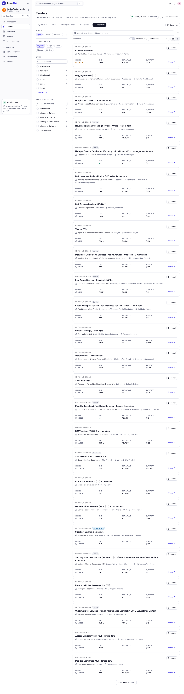

## QA verdict — APPROVED

**Work item:** none (epic #61 hardening; issues #68 #69 #109 #110 #111) · **PR:** #555 · **Reviewer:** qa (claude-code / Sonnet 5.5) · **Session:** https://claude.ai/code/session_01BUi6mGtwn84Qge91FivDUC
**Tested head:** 393f1aa (developer) + QA evidence commit df8a7812a1cca482d5a5e341c0c9b0c74462d2df. Private DBs tp_e2e_hardn, tp_perf_hardn, tp_test_hardn, ports 8997/4997 (dropped afterwards).

### Acceptance criteria

| # | Criterion | Verdict | Evidence |
|---|---|---|---|
| 1 | T003: NOTICE attributes erenmyeager15 (Apache-2.0) with copyright line and licence pointer | met | NOTICE item 1 (copyright line, licence text URL, verified upstream commit) |
| 2 | T003: NOTICE attributes arush15june/gem-search (MIT) with the full permission notice | met | NOTICE item 2 carries the complete MIT text |
| 3 | T003: every adapted file listed exists | met | all in-repo paths exist (client.ts, parse.ts, normalize.ts, changes.ts, http.ts, award.ts, award-result.ts, rules.ts, packet.ts, status.ts, tests, fixtures); `src/routes.ts` etc. are upstream paths; ci.yml/dod.yml are labelled "Planned" |
| 4 | T003: ideas-only section lists the six repos | met | Giridar33, PranavTamada, IshanMaheshwari-777, Mujahid-Alam, Giri-Aayush, rounittxx all present |
| 5 | T004: helpers resetGem, publishOnGem, gemCorrigendum, gemCancel, gemFail, syncNow, evidence003 exist in e2e/support/fixtures.ts | met | fixtures.ts lines 66-117 |
| 6 | T004: each helper WORKS (HARDEN-scaffold.e2e.ts, each once against the mock GeM, one sync, fresh DB) | met | `HARDEN-scaffold.e2e.ts`: 2 passed, 0 failed (desktop). 36+2 published bids synced (tendersCreated 38), cancel visible in feed API, corrigendum 200 and unknown bid rejected, fail modes 503/200, syncNow second call fails fast (<15 s) on the 10-min cooldown.  [video 1](https://github.com/Shashank2577/GEMs/blob/df8a7812a1cca482d5a5e341c0c9b0c74462d2df/qa/evidence/003/HARDEN/harden-scaffold-helpers-drive-the-mock-gem-and-a-real-sync-desktop.webm) [video 2](https://github.com/Shashank2577/GEMs/blob/df8a7812a1cca482d5a5e341c0c9b0c74462d2df/qa/evidence/003/HARDEN/harden-syncnow-fails-fast-when-the-10-minute-cooldown-is-act-desktop.webm) |
| 7 | T004: existing 003 suite not broken by the scaffold change | met (no regression); suite itself is red on main too | Failing set on PR == failing set on `origin/main` 7c4e32c (separate worktree, own DB/ports). See table below and issue #557 |
| 8 | T077: >=10 claims in contracts/api.md + data-model.md hold against the running API/schema | met | 17 checks below |
| 9 | T077: isolation-contract test passes | met | `vitest run test/isolation-contract.test.ts`: 7 passed (saved-view routes now in FOREIGN) |
| 10 | T078: perf re-run on private DB agrees with perf.md and meets budgets | met | worst GET /tenders p95 77.4 ms (perf.md 83.9; budget 400); worst preview p95 307.6 ms (perf.md 275.1; budget 800); all 200, totals match, exit 0 |
| 11 | T079: ticked tasks in 003 tasks.md have code/evidence; no stale (gap) on delivered items | met | 68 ticked, every referenced path exists (136 path refs checked, only the NOTICE upstream basenames unresolved by design); 5 VERDICT.md files US1-US5 exist; remaining `(gap)` = US6 FR-060..064 / plan tables, all undelivered (T066-T076 unticked); T080 unticked (pending) |

### Existing 003 E2E suite (desktop + mobile), one fresh DB per spec file

| Spec | PR #555 | origin/main |
|---|---|---|
| US1 | 3 passed, 1 failed (S1), 11 not run | same (S1) |
| US2 | 20 passed (desktop+1 mobile) | not re-run (identical setup) |
| US3 | 24 passed, 4 failed (S1, S2, S3, S15), 4 skipped (incl. 4 mobile passes) | same 4 failed |
| US4 | 30 passed, 1 skipped (1 mobile) | not re-run |
| US5 | 19 passed, 2 skipped (2 mobile) | not re-run |
| HARDEN | 2 passed | n/a |
| Whole directory in one run (PR) | 21 passed, 7 skipped, 31 not run, 1+ failed (HARDEN sorts first and its sync pollutes US1 setup) | 24 passed, 29 not run, same cascade: fails at US1 S1 |

Why they fail (all pre-existing, #557):
- US1 S1 and US3 S1/S2/S3/S15: locator ambiguity with the global `
`.
- US1 S3 (reached with a local, uncommitted locator patch): cooldown is 10 min, spec expects to wait it out. PR: throws "manual sync cooldown is 597s" in ~5 s; main: times out after 5 min. So the developer's warning is confirmed: S3 (and S4-S11, which are serial and never ran) cannot pass until the spec ages `ingestion_runs` in SQL. S4-S11 are unverified.

### API / unit tests (private DB)
apps/api: 850 passed, 2 skipped (41 files); packages/core: 554 passed (29 files); isolation-contract 7 passed.

### T077 spot checks (live API on :8997, schema in tp_e2e_hardn)
1 pageSize>100 -> 400 validation_error; 2 default pageSize 25 with `{items,total,facets}`; 3 unknown tender 404; 4 GET /views -> `{items,total,limit:20}`; 5 POST /views -> 201 SavedView {id,name,params,position,createdAt,updatedAt}; 6 duplicate name 409 view_exists; 7 name >40 -> 400; 8 /ingestion/runs keys items,lastSuccessAt,lastRun,totalTenders,openTenders,nextManualSyncAt,manualSyncCooldownMin=10; 9 second manual sync 429 sync_cooldown with details.retryAt and "Next manual sync at ... IST" message; 10 /notifications?kind=bogus 400 validation_error listing 9 kinds; 11 ?kind=corrigendum 200 `{items,unreadCount,total}`; 12/13 unsubscribe GET/POST bad token 400 invalid_token; 14 POST /watchlists/preview `{count,sample[+previewReasons]}`; 15 /tenders/:id/result and /insights/competitors 404 (documented as planned); 16 `saved_views` unique (org_id,user_id,name), position, params jsonb; notifications.attempts/next_attempt_at exist; `tender_results` absent and `ingestion_runs.kind` absent (documented as planned); migrations 0015_lyrical_venom.sql and 0021_notification_retries.sql exist; 17 NOTIFICATION_KINDS has the 9 documented kinds. Watchlist limit 409 at 50 and plan limit 402 were not exercised.

### Findings
1. **observation** — E2E suite red on main for reasons unrelated to this PR; filed #557.
2. **observation** — PR body says `packages/core/src/gem/changes.ts` does not exist; it does (US5, T060) and NOTICE lists it correctly. Body text is stale.
3. **observation** — NOTICE copyright line for erenmyeager15 reads "Copyright 2024 Apify Actor" (verbatim from upstream LICENSE appendix, as stated).
4. **observation** — The QA spec HARDEN-scaffold.e2e.ts must run on its own fresh DB like every US spec (it syncs 38 tenders and triggers the cooldown), so it sorts first and breaks a one-shot directory run. Run one spec per DB.

### Not checked
Watchlist-limit 409/plan-limit 402 live; US1 S4-S11 (blocked by #557); Neon latency (perf is local Postgres, as perf.md states); T080 cairn review (pending, lead).

### Bug issues filed
- #557 — 003 E2E: US1 S1/S3 and US3 S1/S2/S3/S15 fail on main

### Verdict
`qa:approved` — criteria 1-11 met; the T004 criterion "did not break US1-US5" holds as no-regression versus main, with the pre-existing red specs tracked in #557.
