## QA verdict — 003/US2: qa:approved

**Work item:** #63 · **PR:** #490 · **Reviewer:** qa (claude-code/Opus 5.5) · **Session:** https://claude.ai/code/session_01BUi6mFXxwtfLeYatLJVi7u
**Evidence commit:** `9e29f1eff83b41de56f1af5fa643474cfcc81325` (branch `story/GEM-63-watchlists`) · spec `specs/003-identify-ingestion-alerts/spec.md` US2 scenarios 1–15, FR-020…FR-028 · task T032

### Test results

- Playwright: `pnpm exec playwright test e2e/003-identify-ingestion-alerts/US2*` → **20 passed, 0 failed** (19 desktop incl. the 375 px `@mobile` builder check, 1 mobile project / Pixel 7). Run three times on fresh databases, stable. Spec: `e2e/003-identify-ingestion-alerts/US2-watchlists.e2e.ts`.
- API: `TEST_DATABASE_URL=postgres://tp:tp@localhost:5433/tenderpilot_test pnpm --filter @tp/api exec vitest run` → **256 passed, 0 failed, 2 skipped** (15 files passed, 2 perf files skipped by design: `dashboard.perf`, `watchlists-preview.perf`).
- Evidence: 37 PNG screenshots (including 4 developer `dev-*.png`), 20 `.webm` videos (one per test), ~11 MB; no trace zips committed.

### Acceptance criteria

| # | Criterion (spec US2 / FR) | Verdict | Evidence | Screenshot / video |
|---|---|---|---|---|
| S1 | Empty org, role ≥ Analyst, opens `/watchlists`: empty state "No watchlists yet", **Build a watchlist** button, Quick start grid of 6 templates (IT hardware; CCTV & security systems; Manpower & facility services; Medical equipment; Solar & electrical; Office furniture) | met | Test S1: heading, button and exactly 6 template buttons with the 6 names asserted. | 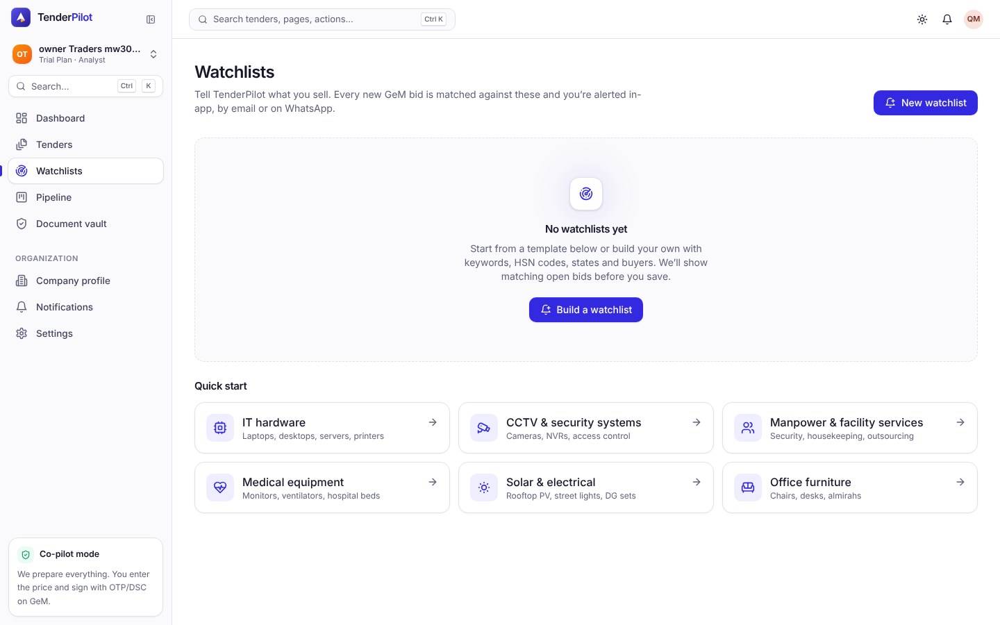 [video](https://github.com/Shashank2577/GEMs/blob/9e29f1eff83b41de56f1af5fa643474cfcc81325/qa/evidence/003/US2/s1-no-watchlists-no-watchlists-yet-build-a-watchlist-button--desktop.webm) |
| S2a | New watchlist sheet with no criteria: preview reads "Add a keyword, state or buyer to see matching open bids." | met | Test S2 (S2a screenshot). | 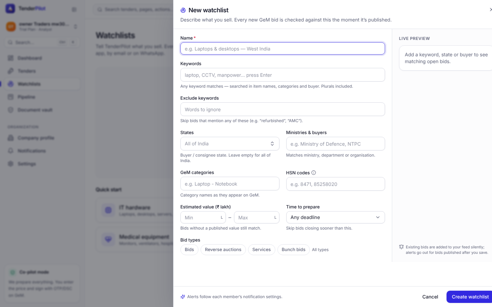 [video](https://github.com/Shashank2577/GEMs/blob/9e29f1eff83b41de56f1af5fa643474cfcc81325/qa/evidence/003/US2/s2-empty-builder-shows-the-prompt-keyword-laptop-state-mahar-desktop.webm) |
| S2b | Keyword chip `laptop` + state Maharashtra: within ~1 s preview shows `2`, "open GeM bids match right now", two sample cards with bid number, countdown, buyer · state and badges `Keyword “laptop”`, `State: Maharashtra` | met | Test S2: count 2 after 1.47 s (debounce 400 ms + request); 2 cards = GEM/2026/B/6421001 and 6421010, each with bid number, countdown, Maharashtra and both badges. API `POST /api/watchlists/preview` → `{count:2, sample.length ≤ 5}`. Observation: 1.47 s measured vs "~1 s" in the spec (asserted < 2.5 s). | 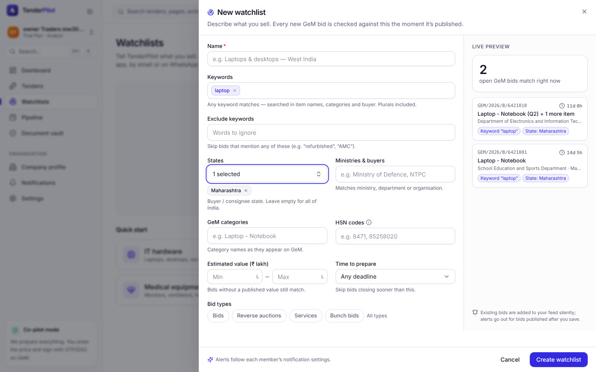 [video](https://github.com/Shashank2577/GEMs/blob/9e29f1eff83b41de56f1af5fa643474cfcc81325/qa/evidence/003/US2/s2-empty-builder-shows-the-prompt-keyword-laptop-state-mahar-desktop.webm) |
| S3 | Keyword `submarine`: preview shows `0` and "Nothing open right now — that’s fine. You’ll be alerted the moment GeM publishes a matching bid." | met | Test S3: count 0 and exact note asserted. | 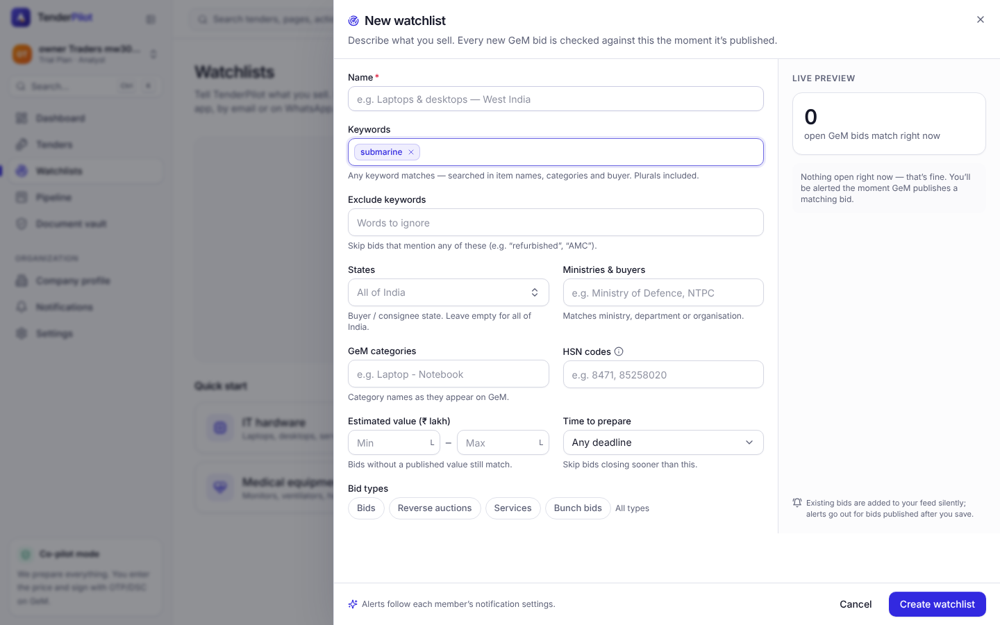 [video](https://github.com/Shashank2577/GEMs/blob/9e29f1eff83b41de56f1af5fa643474cfcc81325/qa/evidence/003/US2/s3-keyword-submarine-0-and-the-nothing-open-right-now-note-desktop.webm) |
| S4a | Create "Laptops — Maharashtra": `POST /api/watchlists` returns `201` with `matchCount:2`, `openCount:2`, `active:true` | met | Test S4: response body matched `{name, matchCount:2, openCount:2, active:true}`. | 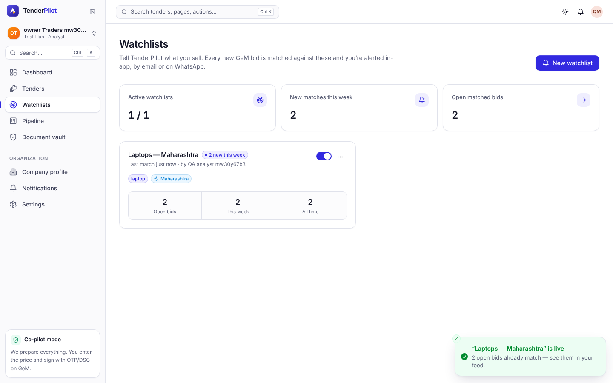 [video](https://github.com/Shashank2577/GEMs/blob/9e29f1eff83b41de56f1af5fa643474cfcc81325/qa/evidence/003/US2/s4-create-201-matchcount-2-opencount-2-active-toast-sheet-cl-desktop.webm) |
| S4b | Toast "“Laptops — Maharashtra” is live" + "2 open bids already match — see them in your feed."; sheet closes | met | Test S4: both toast strings visible, dialog count 0. |  [video](https://github.com/Shashank2577/GEMs/blob/9e29f1eff83b41de56f1af5fa643474cfcc81325/qa/evidence/003/US2/s4-create-201-matchcount-2-opencount-2-active-toast-sheet-cl-desktop.webm) |
| S4c | No notification rows are created for the 2 back-filled matches | met | Test S4: `select count(*) from notifications` = 0 (global and for the org) after create; `tender_matches` = 2. Independent journey: feed `?watchlistId=…&matched=1` lists exactly 6421001 and 6421010. | 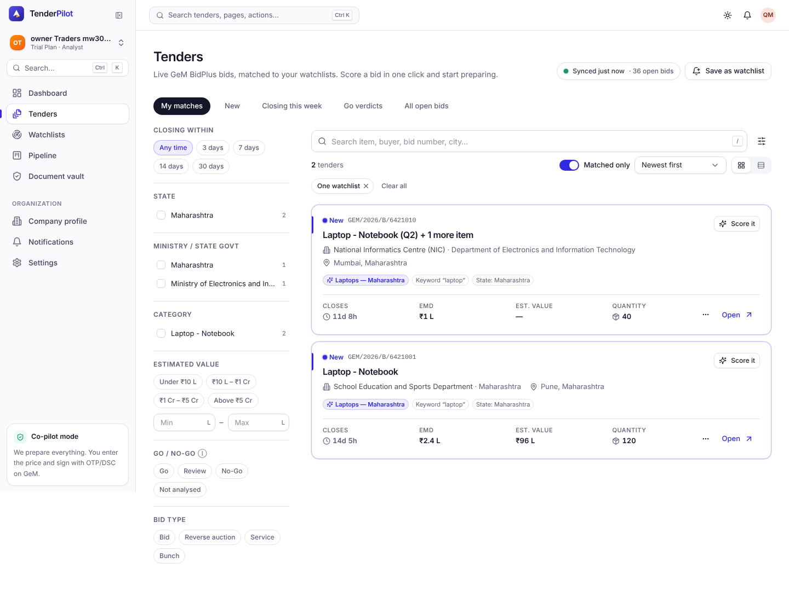 [video](https://github.com/Shashank2577/GEMs/blob/9e29f1eff83b41de56f1af5fa643474cfcc81325/qa/evidence/003/US2/s4-create-201-matchcount-2-opencount-2-active-toast-sheet-cl-desktop.webm) |
| S5a | Empty name / no criterion: inline errors "Give the watchlist a name, e.g. “Laptops — Maharashtra”" and "Add at least one keyword, state, buyer, category, HSN code or value limit" | met | Test S5: both messages visible after clicking Create watchlist. | 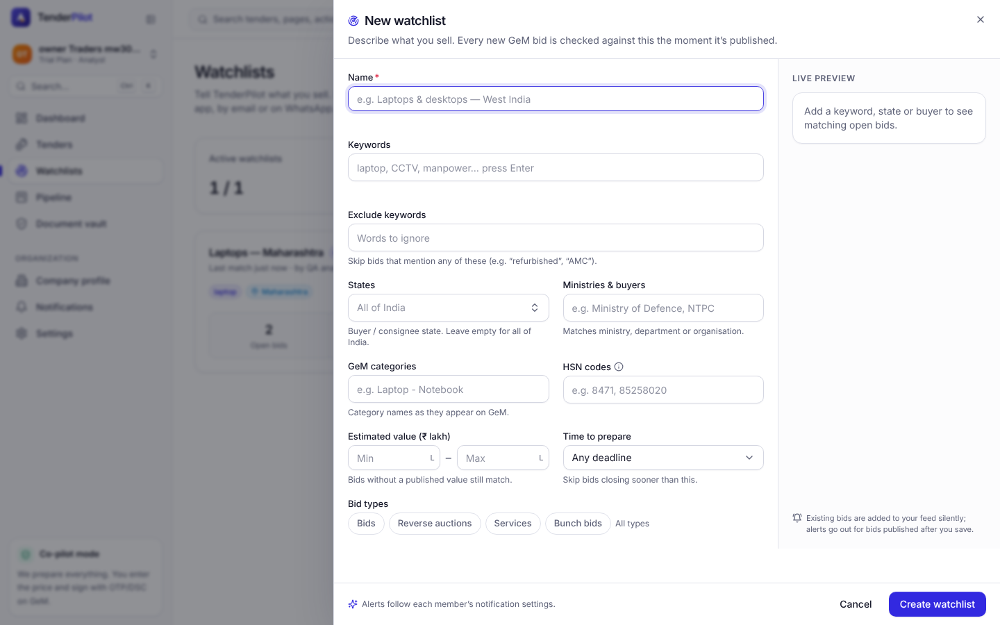 [video](https://github.com/Shashank2577/GEMs/blob/9e29f1eff83b41de56f1af5fa643474cfcc81325/qa/evidence/003/US2/s5-empty-name-no-criterion-inline-errors-api-with-empty-crit-desktop.webm) |
| S5b | API with empty criteria returns `400` `validation_error` "Add at least one keyword, category, HSN code, state, buyer, value limit or bid type" | met | Test S5: `POST /api/watchlists {criteria:{}}` → 400, code `validation_error`, message exact; no row created. |  [video](https://github.com/Shashank2577/GEMs/blob/9e29f1eff83b41de56f1af5fa643474cfcc81325/qa/evidence/003/US2/s5-empty-name-no-criterion-inline-errors-api-with-empty-crit-desktop.webm) |
| S6a | Min 100 L / max 10 L: error "Maximum must be at least the minimum"; API `400` with field `criteria.maxValue` | met | Test S6: message visible in sheet; API 400 with `details.fields["criteria.maxValue"]` = "Maximum value must be at least the minimum". | 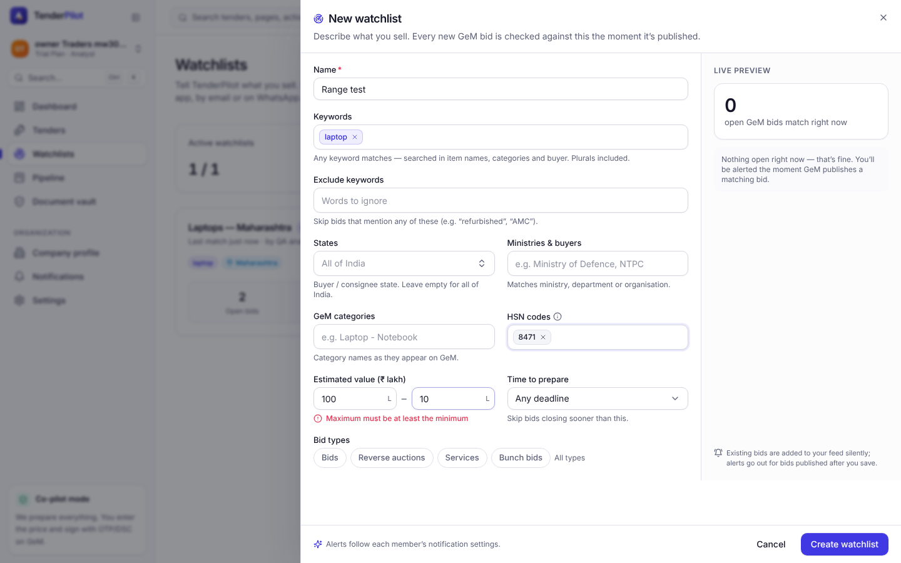 [video](https://github.com/Shashank2577/GEMs/blob/9e29f1eff83b41de56f1af5fa643474cfcc81325/qa/evidence/003/US2/s6-min-100-l-max-10-l-maximum-must-be-at-least-the-minimum-a-desktop.webm) |
| S6b | HSN chip `84A1` is rejected with "HSN codes are 2–8 digits" | met | Test S6: message shown, no `Remove 84A1` chip, `8471` accepted; API preview with `84A1` → 400 with the same text. |  [video](https://github.com/Shashank2577/GEMs/blob/9e29f1eff83b41de56f1af5fa643474cfcc81325/qa/evidence/003/US2/s6-min-100-l-max-10-l-maximum-must-be-at-least-the-minimum-a-desktop.webm) |
| S7a | Keyword `laptop` + exclude `refurbished`: "Refurbished Laptop" is not matched | met | Test S7: with state Goa, `laptop` previews 2 (Refurbished Laptop, Laptops); adding exclude `refurbished` leaves only the plural bid (API too). Bids were arranged via SQL (the mock cannot set titles); the matcher ran through the real preview endpoint. | 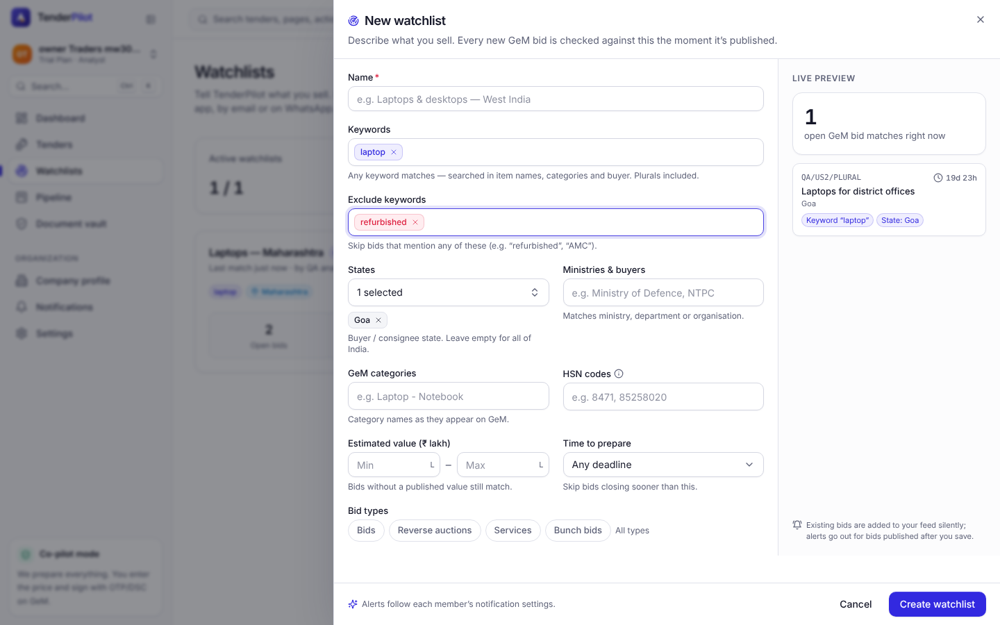 [video](https://github.com/Shashank2577/GEMs/blob/9e29f1eff83b41de56f1af5fa643474cfcc81325/qa/evidence/003/US2/s7-matcher-exclude-keyword-plural-word-boundary-hsn-prefix-u-desktop.webm) |
| S7b | HSN `8471`: a bid with HSN `84713010` matches with reason `HSN 8471` | met | Test S7: preview count 1, `QA/US2/HSN`, `previewReasons` contains `HSN 8471` (API and card badge). | 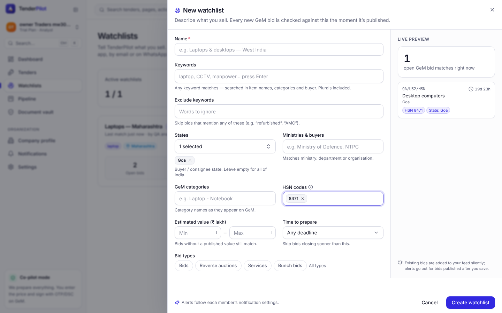 [video](https://github.com/Shashank2577/GEMs/blob/9e29f1eff83b41de56f1af5fa643474cfcc81325/qa/evidence/003/US2/s7-matcher-exclude-keyword-plural-word-boundary-hsn-prefix-u-desktop.webm) |
| S7c | Keyword `laptop`: "Laptops" matches (plural); "Laptopbag" does not (word boundary) | met | Test S7: PLURAL present, BAG absent. | 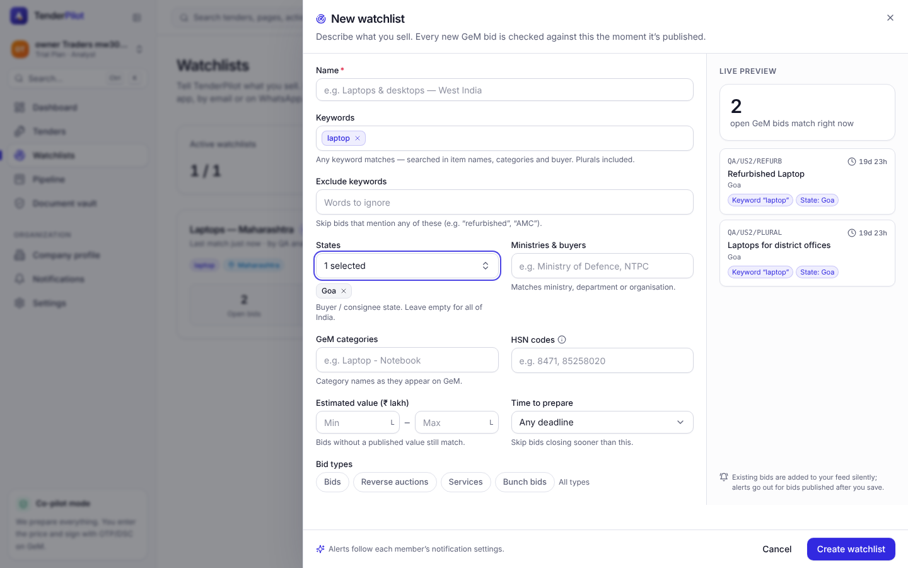 [video](https://github.com/Shashank2577/GEMs/blob/9e29f1eff83b41de56f1af5fa643474cfcc81325/qa/evidence/003/US2/s7-matcher-exclude-keyword-plural-word-boundary-hsn-prefix-u-desktop.webm) |
| S8a | Min value ₹10 L: a matching bid with no published value still matches with reason `Value not published` | met | Test S8: NOVAL card shows `Value not published`; a 5 L bid is excluded; 20 L bids included (count 3). | 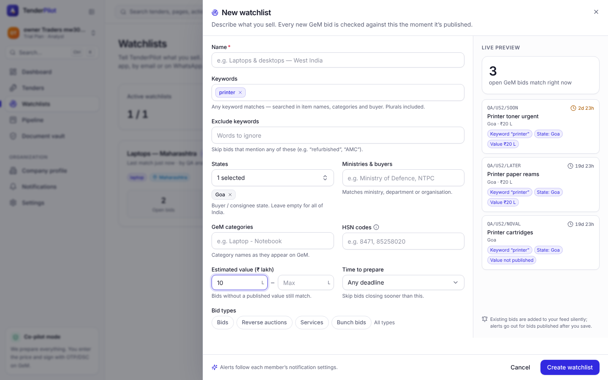 [video](https://github.com/Shashank2577/GEMs/blob/9e29f1eff83b41de56f1af5fa643474cfcc81325/qa/evidence/003/US2/s8-min-value-10-l-still-matches-a-bid-without-a-published-va-desktop.webm) |
| S8b | "Time to prepare: At least a week left": bids closing in < 7 days are not matched | met | Test S8: selecting the option drops the 3-day bid (count 3 → 2); API `minDaysToClose:7` agrees. | 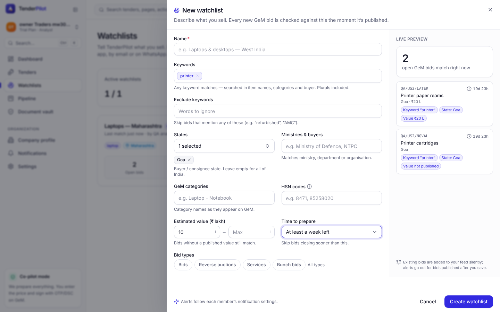 [video](https://github.com/Shashank2577/GEMs/blob/9e29f1eff83b41de56f1af5fa643474cfcc81325/qa/evidence/003/US2/s8-min-value-10-l-still-matches-a-bid-without-a-published-va-desktop.webm) |
| S9a | Toggle switch off: `PATCH /api/watchlists/:id {active:false}` returns `200`; card shows "Paused" badge; toast "“<name>” paused" / "No alerts until you resume it." | met | Test S9: PATCH body `{active:false}` → 200 `active:false`; badge and both toast strings visible. | 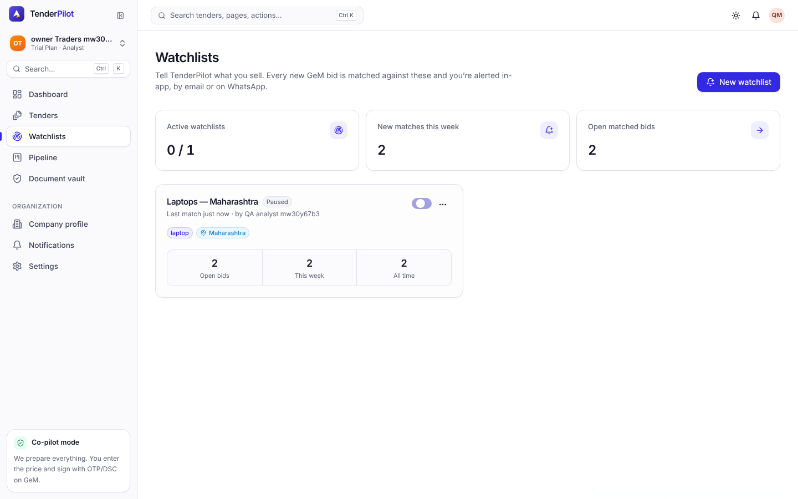 [video](https://github.com/Shashank2577/GEMs/blob/9e29f1eff83b41de56f1af5fa643474cfcc81325/qa/evidence/003/US2/s9-pause-patch-200-paused-badge-toast-no-matches-for-new-ing-desktop.webm) |
| S9b | While paused, subsequent ingestions create no matches | met | Test S9: published 6421101 (Laptop, Maharashtra), real sync (`tendersCreated:1`) → `tender_matches` for the watchlist stays 2, notifications 0. |  [video](https://github.com/Shashank2577/GEMs/blob/9e29f1eff83b41de56f1af5fa643474cfcc81325/qa/evidence/003/US2/s9-pause-patch-200-paused-badge-toast-no-matches-for-new-ing-desktop.webm) |
| S9c | Toggle on: toast "“<name>” resumed"; back-fills silently | met | Test S9: PATCH 200 `active:true`, toast shown, matches become 3 (incl. 6421101), notifications still 0. Matches are unique per (org,tender,watchlist) with reasons and relevance in 0.05–1. | 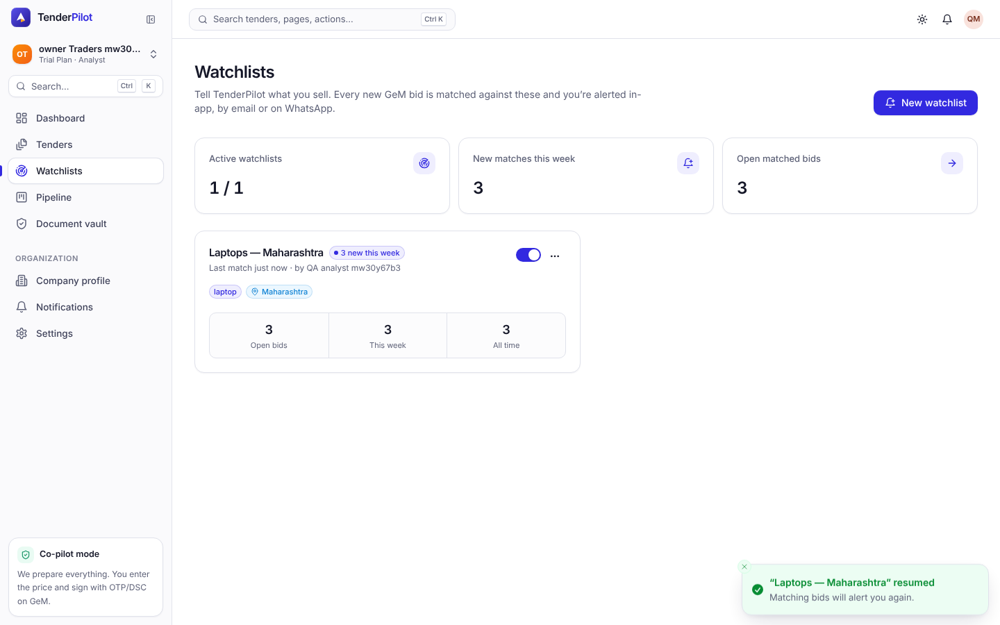 [video](https://github.com/Shashank2577/GEMs/blob/9e29f1eff83b41de56f1af5fa643474cfcc81325/qa/evidence/003/US2/s9-pause-patch-200-paused-badge-toast-no-matches-for-new-ing-desktop.webm) |
| S10 | Edit criteria so a matched bid no longer matches, **Save changes**: toast "Watchlist updated"; the bid disappears from `GET /api/tenders?watchlistId=<id>` | met | Test S10: adding exclude `bag` + Save → PATCH 200, toast, API list no longer has 6421010 (still has 6421001); feed page shows the same. | 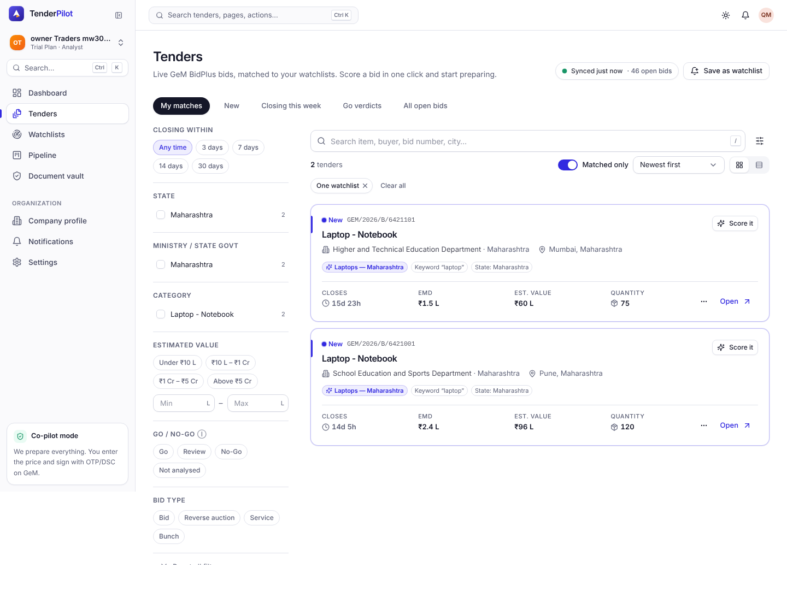 [video](https://github.com/Shashank2577/GEMs/blob/9e29f1eff83b41de56f1af5fa643474cfcc81325/qa/evidence/003/US2/s10-edit-criteria-so-a-matched-bid-no-longer-matches-watchli-desktop.webm) |
| S11a | Delete from the card menu: confirm dialog "Delete “<name>”?" with "Its matches disappear from the feed and no more alerts are sent. Tenders you’ve already analysed or started a bid for are kept." | met | Test S11: title and description strings asserted verbatim. | 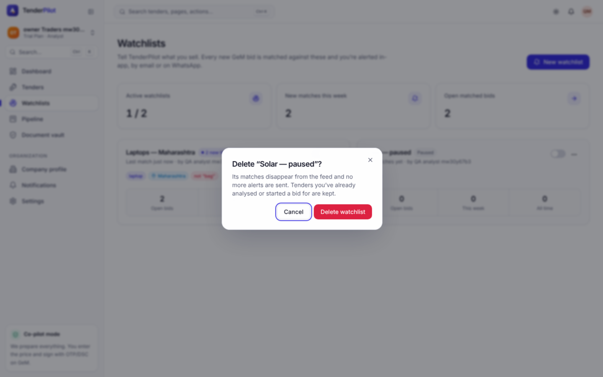 [video](https://github.com/Shashank2577/GEMs/blob/9e29f1eff83b41de56f1af5fa643474cfcc81325/qa/evidence/003/US2/s11-delete-confirm-dialog-copy-200-ok-true-watchlist-deleted-desktop.webm) |
| S11b | Confirming returns `200 {ok:true}`, shows "Watchlist deleted" and removes the card | met | Test S11: DELETE → 200 `{ok:true}`, toast, card count 0, row gone in DB, tenders kept. | 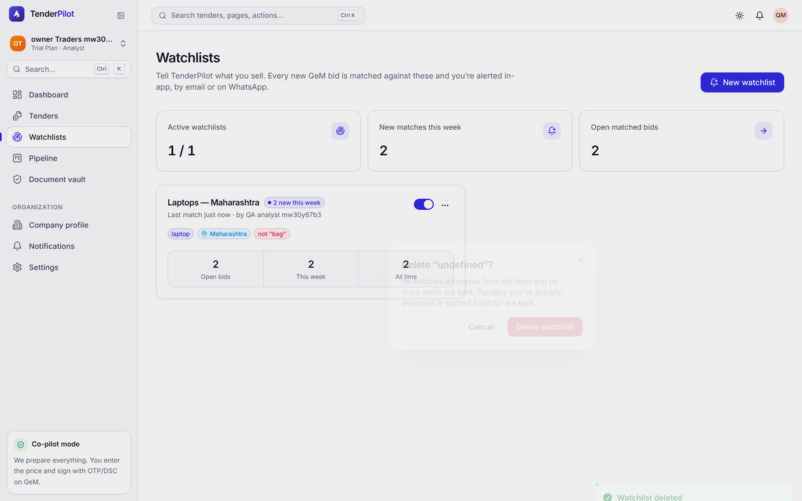 [video](https://github.com/Shashank2577/GEMs/blob/9e29f1eff83b41de56f1af5fa643474cfcc81325/qa/evidence/003/US2/s11-delete-confirm-dialog-copy-200-ok-true-watchlist-deleted-desktop.webm) |
| S12a | Viewer: **New watchlist** button and templates hidden; pause switch disabled | met | Test S12 (empty org): no New watchlist / Build a watchlist / Quick start; with a watchlist present the switch is disabled. | 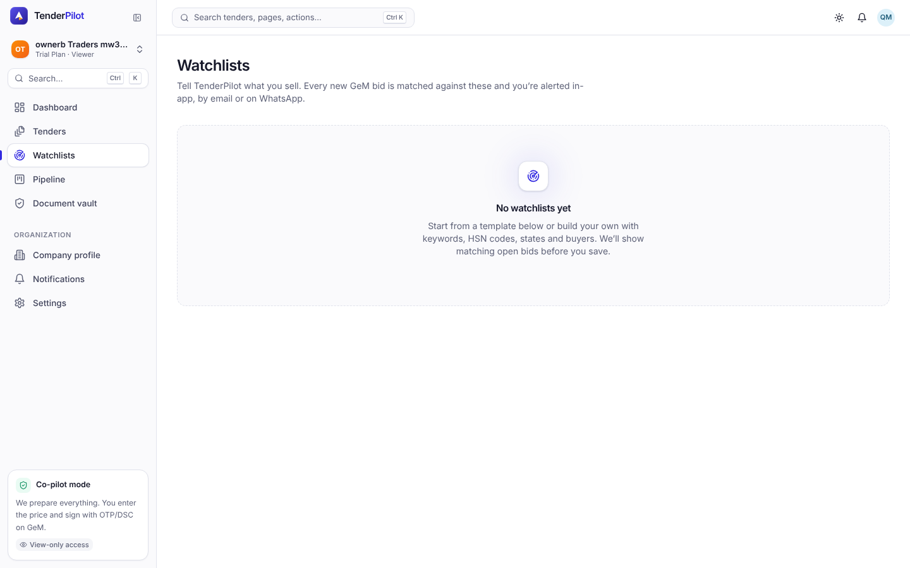 [video](https://github.com/Shashank2577/GEMs/blob/9e29f1eff83b41de56f1af5fa643474cfcc81325/qa/evidence/003/US2/s12-viewer-new-watchlist-templates-hidden-pause-switch-disab-desktop.webm) |
| S12b | Viewer `POST /api/watchlists` returns `403` "You need to be at least an Analyst to do that" | met | Test S12: 403 with exact message in both orgs; viewer PATCH also 403; Analyst, Bid Manager, Owner get 200 on preview. | 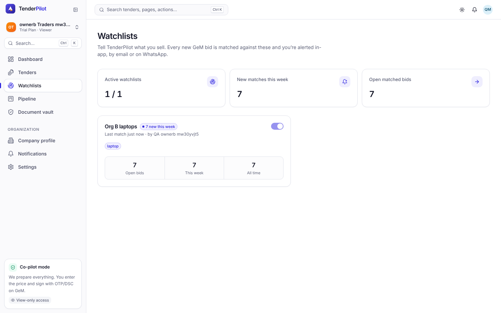 [video](https://github.com/Shashank2577/GEMs/blob/9e29f1eff83b41de56f1af5fa643474cfcc81325/qa/evidence/003/US2/s12-viewer-new-watchlist-templates-hidden-pause-switch-disab-desktop.webm) |
| S12c | Watchlist id of another org: `PATCH`/`DELETE` return `404` "Watchlist not found" | met | Test S12: org B owner PATCH and DELETE on org A id → 404 "Watchlist not found"; row still exists, not in org B list. |  [video](https://github.com/Shashank2577/GEMs/blob/9e29f1eff83b41de56f1af5fa643474cfcc81325/qa/evidence/003/US2/s12-viewer-new-watchlist-templates-hidden-pause-switch-disab-desktop.webm) |
| S13a | `/watchlists` shows 3 stat tiles: "Active watchlists" (`<active> / <total>`), "New matches this week" (→ `/tenders?matched=1&unseen=1`), "Open matched bids" (→ `/tenders?matched=1`) | met | Test S13: tile "1 / 2" with one paused list; week/open values equal the sums from `GET /api/watchlists`; both link hrefs asserted. | 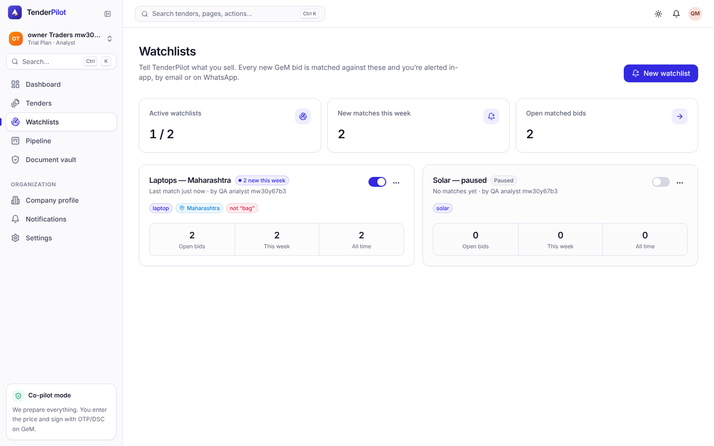 [video](https://github.com/Shashank2577/GEMs/blob/9e29f1eff83b41de56f1af5fa643474cfcc81325/qa/evidence/003/US2/s13-3-stat-tiles-links-cards-show-criteria-chips-open-bids-t-desktop.webm) |
| S13b | Each card shows criteria chips plus "Open bids", "This week", "All time" counts and a **View matches** action linking to `/tenders?watchlistId=<id>&matched=1` | met | Test S13: chips (laptop, Maharashtra, not “bag”), 3 counts equal API values, menu item href asserted, click lands on the feed showing 6421001. |  [video](https://github.com/Shashank2577/GEMs/blob/9e29f1eff83b41de56f1af5fa643474cfcc81325/qa/evidence/003/US2/s13-3-stat-tiles-links-cards-show-criteria-chips-open-bids-t-desktop.webm) |
| S14 | Org with 50 watchlists (paused included): create → `409 watchlist_limit` "You can have up to 50 watchlists — delete one first." | met | Test S14: 50 lists (25 paused) → 51st = 409, code and message exact, no row; builder shows the message inline and stays open; delete one → create works. | 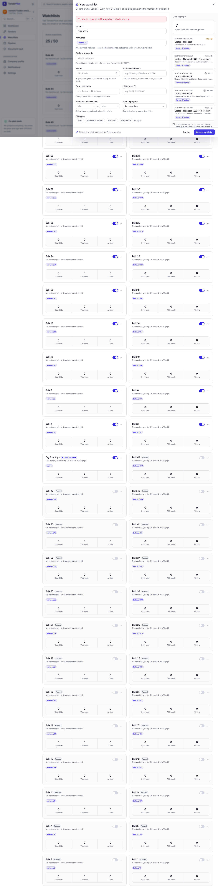 [video](https://github.com/Shashank2577/GEMs/blob/9e29f1eff83b41de56f1af5fa643474cfcc81325/qa/evidence/003/US2/s14-fr-027-org-with-50-watchlists-paused-count-409-watchlist-desktop.webm) |
| S15 | More than 5,000 open tenders satisfy the pre-filter: preview/back-fill still find every match | met | Test S15: 5,200 SQL-arranged tenders → preview count 5200 (sample 5), create → matchCount = openCount = 5200 = rows in `tender_matches`; UI shows 5,200. | 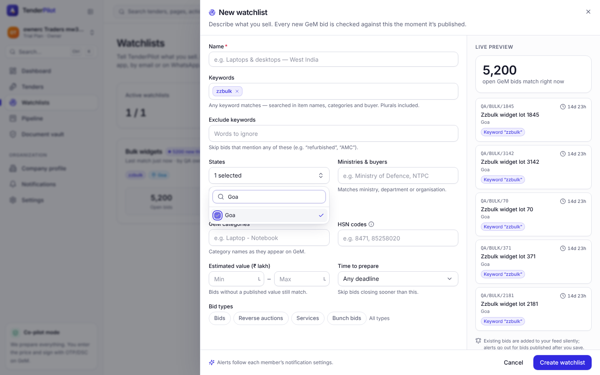 [video](https://github.com/Shashank2577/GEMs/blob/9e29f1eff83b41de56f1af5fa643474cfcc81325/qa/evidence/003/US2/s15-fr-028-5-000-open-tenders-match-preview-count-and-back-f-desktop.webm) |
| FR-020 | Analyst+ create/edit/pause/resume/delete; all members list; field limits (name 1–80, ≤ 50 values, ≤ 120 chars, HSN 2–8 digits, minDaysToClose 0–365, bid types) | met | Tests S4, S9–S12 (role + CRUD) and FR-020/FR-022 test: 81-char name, empty name, 51 keywords, 121-char keyword, 9- and 1-digit HSN, minDaysToClose 366, negative value, invalid bid type → all 400; boundary values accepted. |  [video](https://github.com/Shashank2577/GEMs/blob/9e29f1eff83b41de56f1af5fa643474cfcc81325/qa/evidence/003/US2/fr-020-fr-022-api-limits-on-criteria-categories-ministries-m-desktop.webm) |
| FR-021 | At least one positive criterion else `400 validation_error` | met | Tests S5 (UI + API). |  [video](https://github.com/Shashank2577/GEMs/blob/9e29f1eff83b41de56f1af5fa643474cfcc81325/qa/evidence/003/US2/s5-empty-name-no-criterion-inline-errors-api-with-empty-crit-desktop.webm) |
| FR-022 | Matcher: AND across dimensions, OR within; keywords (case, word boundary, plural, items/category/buyer); exclude; categories; HSN prefix; states exact; ministries substring; unknown value reason; time-to-prepare; closed/past-deadline never match | met | Tests S2, S7, S8 and FR-020/FR-022 test (category → `Category: zzcat`, ministry → `Buyer: zzland`, closed and past-deadline bids excluded, wrong state → 0). Not exercised end-to-end: phrase separators (space/hyphen/underscore/slash) and exclusions across all fields (covered by core unit tests, not re-run here beyond the API suite). |  [video](https://github.com/Shashank2577/GEMs/blob/9e29f1eff83b41de56f1af5fa643474cfcc81325/qa/evidence/003/US2/s7-matcher-exclude-keyword-plural-word-boundary-hsn-prefix-u-desktop.webm) |
| FR-023 | One stored match per (org, tender, watchlist) with reasons and relevance 0.05–1.00 | met | Test S9: distinct (org,tender,watchlist) = row count; no row with empty reasons or relevance outside 0.05–1; reasons of 6421101 contain `State: Maharashtra`. |  [video](https://github.com/Shashank2577/GEMs/blob/9e29f1eff83b41de56f1af5fa643474cfcc81325/qa/evidence/003/US2/s9-pause-patch-200-paused-badge-toast-no-matches-for-new-ing-desktop.webm) |
| FR-024 | `POST /api/watchlists/preview` returns `{count, sample[≤5]}` ordered by relevance then closing date, with `previewReasons`, saving nothing | met | Tests S2, S15 (sample length 5 of 5,200), FR-020 test (watchlist count unchanged after previews); order 6421010 (closes 11 d) before 6421001 (14 d). |  [video](https://github.com/Shashank2577/GEMs/blob/9e29f1eff83b41de56f1af5fa643474cfcc81325/qa/evidence/003/US2/s2-empty-builder-shows-the-prompt-keyword-laptop-state-mahar-desktop.webm) |
| FR-025 | Create / criteria change / resume back-fill silently and remove matches that no longer satisfy changed criteria | met | Tests S4, S9, S10 (silent, 0 notifications; stale match removed). Positive control S4b: a bid ingested after the watchlist exists produces a match and an in-app notification. | 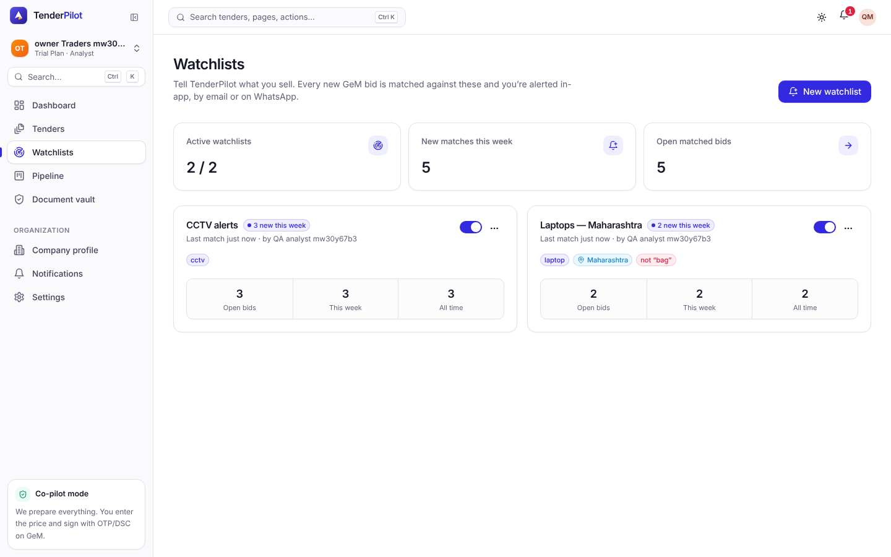 [video](https://github.com/Shashank2577/GEMs/blob/9e29f1eff83b41de56f1af5fa643474cfcc81325/qa/evidence/003/US2/s4b-fr-025-intent-a-matching-bid-ingested-after-the-watchlis-desktop.webm) |
| FR-026 | List returns `matchCount`, `newThisWeek`, `openCount`, `lastMatchAt`, `createdBy` | met | Test S13 (cards show "Last match just now · by <creator>" and the three counts equal API values); API create response of S4. |  [video](https://github.com/Shashank2577/GEMs/blob/9e29f1eff83b41de56f1af5fa643474cfcc81325/qa/evidence/003/US2/s13-3-stat-tiles-links-cards-show-criteria-chips-open-bids-t-desktop.webm) |
| FR-027 | ≤ 50 watchlists per org, paused included | met | Test S14. |  [video](https://github.com/Shashank2577/GEMs/blob/9e29f1eff83b41de56f1af5fa643474cfcc81325/qa/evidence/003/US2/s14-fr-027-org-with-50-watchlists-paused-count-409-watchlist-desktop.webm) |
| FR-028 | Preview and back-fill find all matching open tenders (no 5,000 cap) | met | Test S15. |  [video](https://github.com/Shashank2577/GEMs/blob/9e29f1eff83b41de56f1af5fa643474cfcc81325/qa/evidence/003/US2/s15-fr-028-5-000-open-tenders-match-preview-count-and-back-f-desktop.webm) |
| Mobile | `@mobile` builder at 375 px | met | Test S-mobile (desktop project at 375 px and Pixel 7 project): no horizontal overflow, sheet within 375 px, Create button inside the viewport, preview visible. | 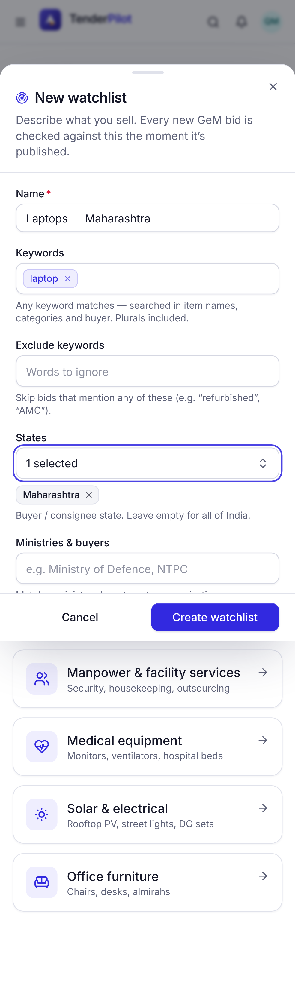 [video](https://github.com/Shashank2577/GEMs/blob/9e29f1eff83b41de56f1af5fa643474cfcc81325/qa/evidence/003/US2/s-mobile-watchlist-builder-at-375-px-mobile-desktop.webm) [video](https://github.com/Shashank2577/GEMs/blob/9e29f1eff83b41de56f1af5fa643474cfcc81325/qa/evidence/003/US2/s-mobile-watchlist-builder-at-375-px-mobile-mobile.webm) |

### Findings

1. **observation** — Live preview latency is slower than the spec's "~1 s".
   - Observed: after selecting the state, the count `2` appeared after 1.47 s (annotation `preview-latency-ms` = 1465 in the Playwright results; debounce is 400 ms in `WatchlistBuilder.tsx`).
   - Expected: "within ~1 s" (scenario 2). The test asserts < 2.5 s. Not treated as a failure.
2. **observation** — Scenario 7 says a bid "is ingested". The mock GeM cannot set bid titles, so the exclusion/plural/word-boundary/HSN bids were inserted with SQL and matched through the real preview endpoint and UI. Real ingestion matching is separately proven in S9 (a bid ingested while paused is not matched) and S4b (a bid ingested after creation matches and notifies).
3. **observation** — The delete dialog promise "Tenders you’ve already analysed or started a bid for are kept" is verified only as copy plus "tenders are kept after deleting a watchlist"; a tender with an analysis or bid workspace was not exercised.
4. **observation** — T032 in tasks.md lists "trace" as evidence; per the playbook rules traces are not committed (they stay in git-ignored `qa/.runs/`).

### Not checked

- Email / WhatsApp delivery of alerts (US4 scope). Only the in-app `notifications` row of S4b.
- Performance targets (NFR-003): the skipped `watchlists-preview.perf` test was not run; S15 shows correctness at 5,200 tenders (3.3 s for the whole test), not a timing budget.
- Phrase-separator keyword semantics (space/hyphen/underscore/slash) and exclusions in every field: left to the core unit tests; the API suite passes.
- Concurrent creates racing past the 50 limit (the org-row lock was read in code, not stress-tested).
- Real GeM (only the mock-gem fixtures); retention of analysed / bid-started tenders on watchlist delete (see finding 3).
- Accessibility audit (axe) of the builder.

### Bug issues filed

- none

### Verdict

`qa:approved` — every criterion in the table is met with the evidence above.
