## QA verdict — REJECTED

**Work item:** #64 · **PR:** #509 · **Reviewer:** qa (claude-code/Sonnet 5.5) · **Session:** https://claude.ai/code/session_01BUi6mGtwn84Qge91FivDUC

**Tested commit:** `fa79dd092d27040d6c350708fc2761962c7a0a2c` (branch `story/GEM-64-feed`, spec `003-identify-ingestion-alerts`, task T044). Test file: [`e2e/003-identify-ingestion-alerts/US3-feed.e2e.ts`](https://github.com/Shashank2577/GEMs/blob/fa79dd092d27040d6c350708fc2761962c7a0a2c/e2e/003-identify-ingestion-alerts/US3-feed.e2e.ts).

### Test results

- **Playwright** `pnpm exec playwright test e2e/003-identify-ingestion-alerts/US3*`: **20 passed, 8 failed, 4 skipped** (32 test runs; the 4 skips are the `@mobile` tests deliberately not re-run in the desktop project). Desktop project: 18 passed, 6 failed. Mobile project (Pixel 7, 375 px forced in-test): 2 passed, 2 failed. Every failure is a product defect listed below (no test was skipped or deleted to get green).
- **API/unit suites on this branch:** `@tp/api` vitest 449 passed, 2 skipped (26 files; includes `views.test.ts` 7/7); `@tp/core` vitest 379 passed; `@tp/web` vitest 167 passed.
- Evidence: 55 PNG + 28 `.webm` (one per test run), ~10 MB, no trace zips.

### Acceptance criteria

| # | Criterion (spec.md US3 / FR) | Verdict | Evidence |
|---|---|---|---|
| 1a | S1: 36 open tenders → 5 skeleton cards while loading, header “Tenders”, “36 tenders”, newest first | met | 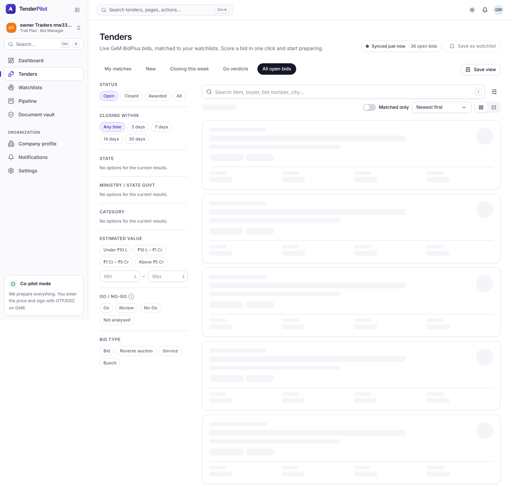 [video](https://github.com/Shashank2577/GEMs/blob/fa79dd092d27040d6c350708fc2761962c7a0a2c/qa/evidence/003/US3/s1-5-skeletons-header-36-tenders-first-25-cards-newest-first-desktop.webm) 5 skeletons (`aria-label=Loading tenders`), count `36 tenders`, card order equals `GET /api/tenders` default order. |
| 1b | S1: “the first 25 cards … and a **Load more (11 left)** button / auto-load sentinel” | **not met** | 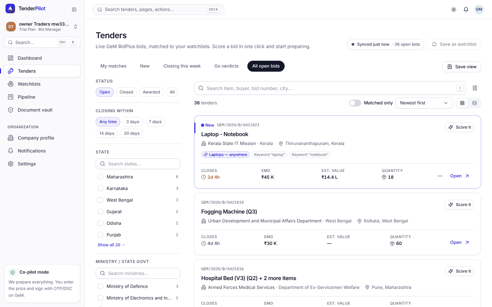 [video](https://github.com/Shashank2577/GEMs/blob/fa79dd092d27040d6c350708fc2761962c7a0a2c/qa/evidence/003/US3/s1-5-skeletons-header-36-tenders-first-25-cards-newest-first-desktop.webm) Observed 20 cards and `Load more (16 left)`. Expected 25 / `(11 left)`. `apps/web/src/features/feed/api.ts:15` `PAGE_SIZE = 20`. |
| 1c | S1: after loading the rest the footer reads “That’s all 36 tenders.” | met | 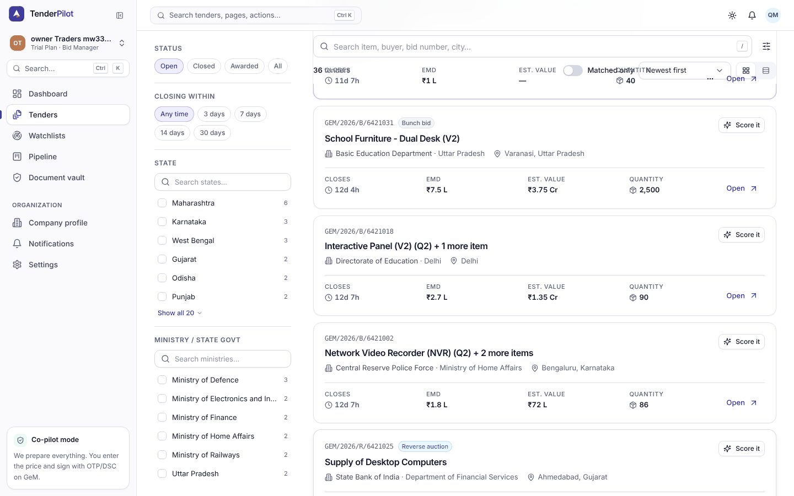 [video](https://github.com/Shashank2577/GEMs/blob/fa79dd092d27040d6c350708fc2761962c7a0a2c/qa/evidence/003/US3/s1b-load-more-auto-load-reaches-all-36-bids-and-the-footer-r-desktop.webm) All 36 cards, footer text present. |
| 2a | S2: “presses `/` to focus it” (the feed search box) | **not met** | 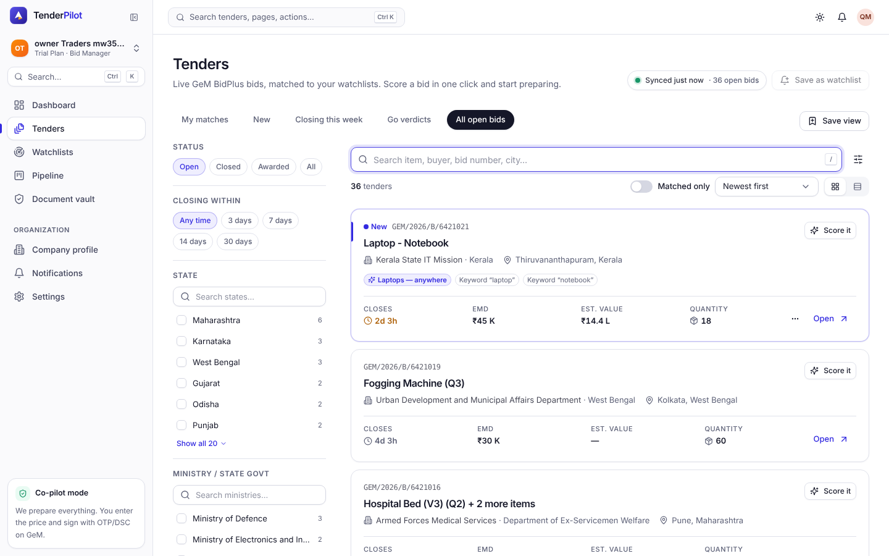 [video](https://github.com/Shashank2577/GEMs/blob/fa79dd092d27040d6c350708fc2761962c7a0a2c/qa/evidence/003/US3/s2a-pressing-focuses-the-feed-search-box-search-item-buyer-b-desktop.webm) Pressing `/` focuses the global command-palette input (“Search pages, actions, or tenders…”), not the feed search. `CommandPalette.tsx:30` handles `/` and calls `preventDefault()`; the feed handler at `FeedPage.tsx:141` never gets to focus its input. |
| 2b | S2: typing `laptop` → after ~350 ms the URL gains `?q=laptop`, list/count update without page reload | met | 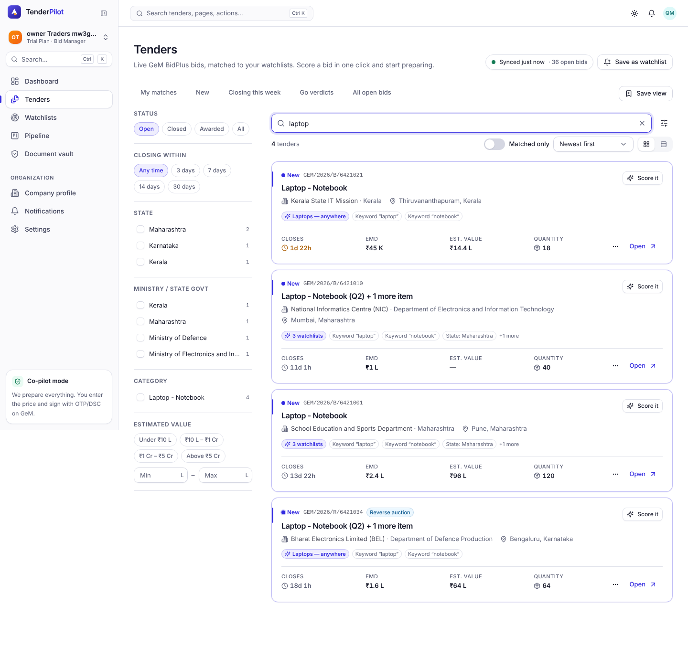 [video](https://github.com/Shashank2577/GEMs/blob/fa79dd092d27040d6c350708fc2761962c7a0a2c/qa/evidence/003/US3/s2-typing-laptop-sets-q-laptop-after-350-ms-without-reload-l-desktop.webm) URL had no `q` immediately after typing, then `?q=laptop`; count = API total (4); `window` marker survived (no reload). |
| 2c | S2: clearing with the × restores 36 | met |  [video](https://github.com/Shashank2577/GEMs/blob/fa79dd092d27040d6c350708fc2761962c7a0a2c/qa/evidence/003/US3/s2-typing-laptop-sets-q-laptop-after-350-ms-without-reload-l-desktop.webm) `q` removed from URL, `36 tenders`. |
| 3a | S3: ticking State “Maharashtra” → URL `state=Maharashtra`, only Maharashtra bids, chip “Maharashtra” (click removes) | met | 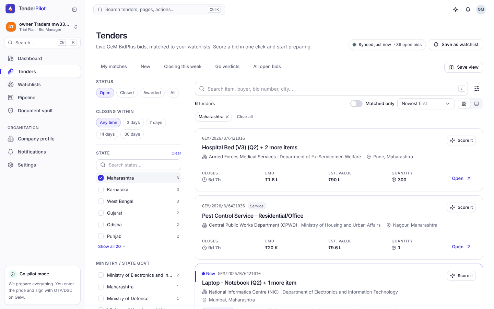 [video](https://github.com/Shashank2577/GEMs/blob/fa79dd092d27040d6c350708fc2761962c7a0a2c/qa/evidence/003/US3/s3-state-maharashtra-url-state-only-mh-bids-chip-other-facet-desktop.webm) 6 cards, all Maharashtra; chip removal restores 36 (`S3b-chip-removed-desktop.png`). |
| 3b | S3: Filters button shows count badge `1` (phone sheet / tablet sheet; rail ≥ 1024 px) | met | 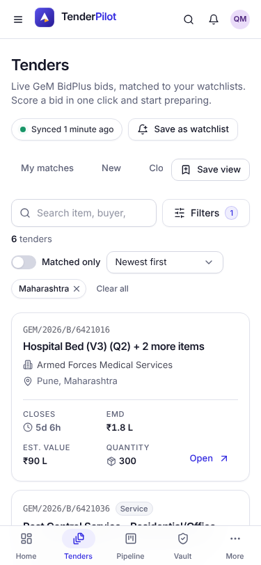 [video](https://github.com/Shashank2577/GEMs/blob/fa79dd092d27040d6c350708fc2761962c7a0a2c/qa/evidence/003/US3/s12-mobile-375-px-layout-toggle-hidden-cards-only-even-if-ta-mobile.webm) Badge `1` verified at 375 px (bottom sheet docked to bottom, `S12c`), right-hand sheet verified at 768 px (`S3c-tablet-right-sheet-desktop.png`). On ≥1024 px the Filters button is replaced by the rail. |
| 3c | S3: other facets show counts computed with the state filter applied while the State facet keeps all states | met |  [video](https://github.com/Shashank2577/GEMs/blob/fa79dd092d27040d6c350708fc2761962c7a0a2c/qa/evidence/003/US3/s3-state-maharashtra-url-state-only-mh-bids-chip-other-facet-desktop.webm) API facets with `state=Maharashtra`: states 20 (unchanged), ministries 29→5, categories 33→5; UI State list still offers Karnataka etc. |
| 4a | S4: closing ≤ 7 d + ₹10 L–₹1 Cr + Reverse auction + Not analysed → API called with `closingWithinDays=7&minValue=1000000&maxValue=10000000&bidType=ra&verdict=none` | met | 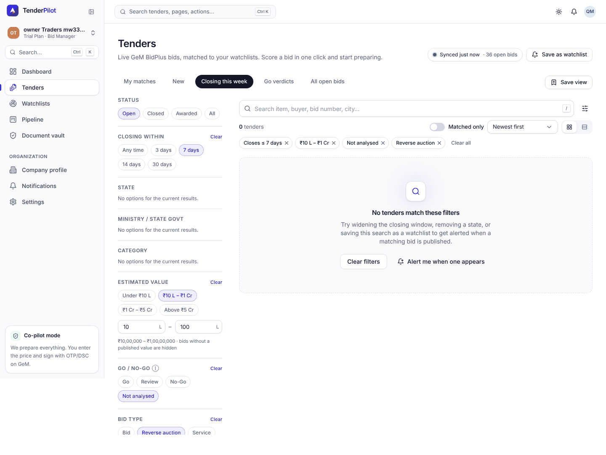 [video](https://github.com/Shashank2577/GEMs/blob/fa79dd092d27040d6c350708fc2761962c7a0a2c/qa/evidence/003/US3/s4-closing-7d-10-l-1-cr-reverse-auction-not-analysed-api-par-desktop.webm) Captured request: `…closingWithinDays=7&minValue=1000000&maxValue=10000000&verdict=none&bidType=ra…`. The dataset has no RA bid closing within 7 d (0 results), so “every listed bid satisfies all” is vacuous for this exact query; verified non-vacuously for the same query without `bidType` (all returned bids satisfy window/value/unanalysed). |
| 4b | S4: **Clear all** resets refinements but keeps the search text and sort | met | 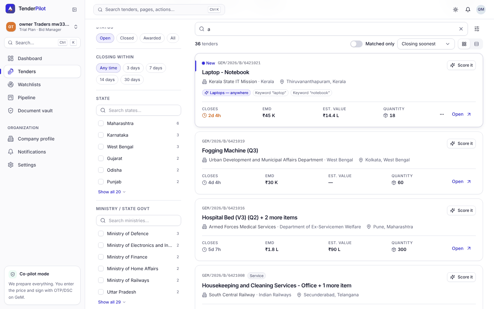 [video](https://github.com/Shashank2577/GEMs/blob/fa79dd092d27040d6c350708fc2761962c7a0a2c/qa/evidence/003/US3/s4-closing-7d-10-l-1-cr-reverse-auction-not-analysed-api-par-desktop.webm) After Clear all: `q=a` and `sort=endAt` remain, `closing/min/max/type/verdict` gone. |
| 5 | S5: five sort options; “Closing soonest” → `sort=endAt`, ascending, unknown dates last | met | 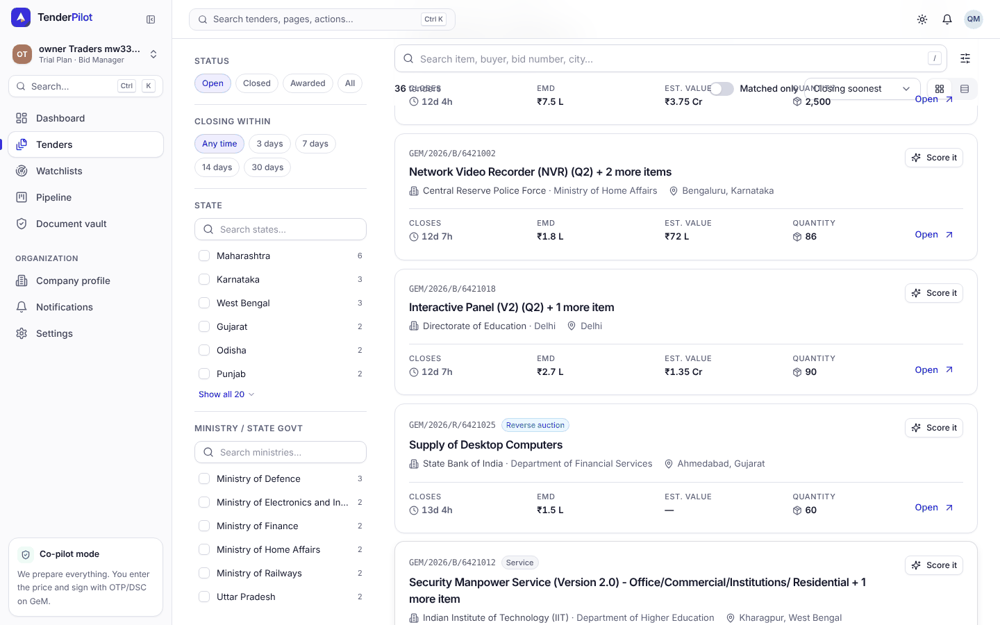 [video](https://github.com/Shashank2577/GEMs/blob/fa79dd092d27040d6c350708fc2761962c7a0a2c/qa/evidence/003/US3/s5-five-sort-options-closing-soonest-sort-endat-end-date-asc-desktop.webm) Options exactly Newest first / Closing soonest / Best match / Highest score / Highest value; UI order = API order; a tender with `end_at` NULL is last in API and UI. |
| 6a | S6: My matches → only matched (not dismissed) tenders sorted by relevance, primary badge naming the watchlist (or “<n> watchlists”) | met | 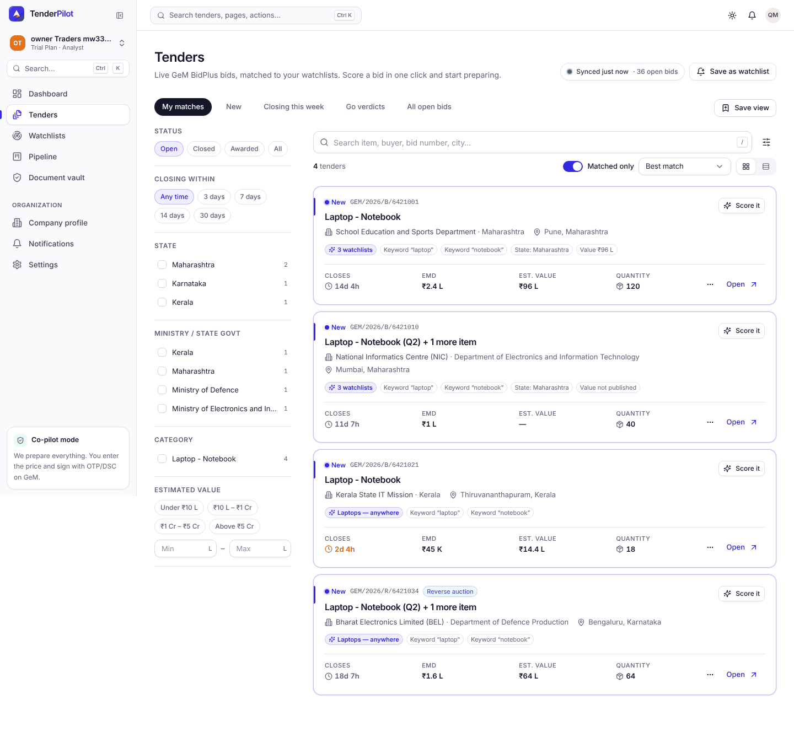 [video](https://github.com/Shashank2577/GEMs/blob/fa79dd092d27040d6c350708fc2761962c7a0a2c/qa/evidence/003/US3/s6-my-matches-only-matched-relevance-sort-watchlist-badge-n--desktop.webm) 4 matches, UI order = `sort=relevance` API order; “3 watchlists” / “Laptops — anywhere” badges. |
| 6b | S6: “up to 3 reason chips plus +<n> more” | **not met** |  [video](https://github.com/Shashank2577/GEMs/blob/fa79dd092d27040d6c350708fc2761962c7a0a2c/qa/evidence/003/US3/s6-my-matches-only-matched-relevance-sort-watchlist-badge-n--desktop.webm) A tender with 4 distinct reasons renders 4 chips and no “+n more” (cap is 4). `apps/web/src/features/feed/TenderCard.tsx` `reasonChips(t, max = 4)`. |
| 7a | S7: unseen matched tender shows a pulsing “New” label and a left accent bar | met | 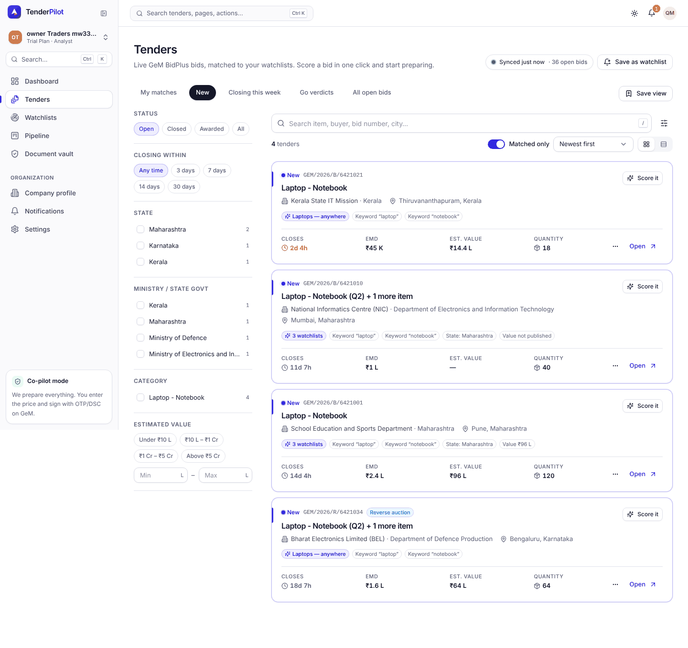 [video](https://github.com/Shashank2577/GEMs/blob/fa79dd092d27040d6c350708fc2761962c7a0a2c/qa/evidence/003/US3/s7-new-label-accent-bar-opening-marks-seen-post-seen-notific-desktop.webm) `animate-ping` dot + `New` + 3 px accent bar on the first card. |
| 7b | S7: opening it → `POST /api/tenders/:id/seen`, related in-app notification becomes read, New view no longer lists it | met |  [video](https://github.com/Shashank2577/GEMs/blob/fa79dd092d27040d6c350708fc2761962c7a0a2c/qa/evidence/003/US3/s7-new-label-accent-bar-opening-marks-seen-post-seen-notific-desktop.webm) Each open returned 200 from `/seen`; unseen count 0 afterwards; an in-app `tender_match` notification (arranged with SQL, because alert creation is US4) went from 1 unread to 0. |
| 7c | S7: empty New view shows “You’re all caught up” | met | 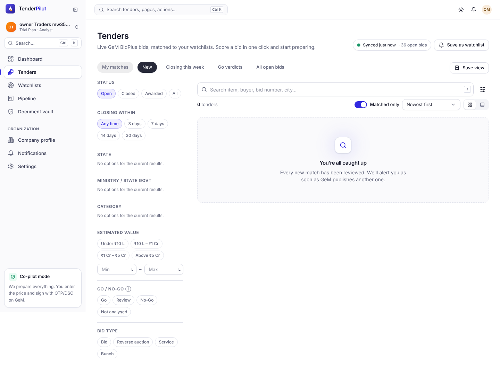 [video](https://github.com/Shashank2577/GEMs/blob/fa79dd092d27040d6c350708fc2761962c7a0a2c/qa/evidence/003/US3/s7-new-label-accent-bar-opening-marks-seen-post-seen-notific-desktop.webm) |
| 8a | S8: “Not relevant — hide” → toast “Hidden from your feed” with Undo, tender disappears; Undo restores | met | 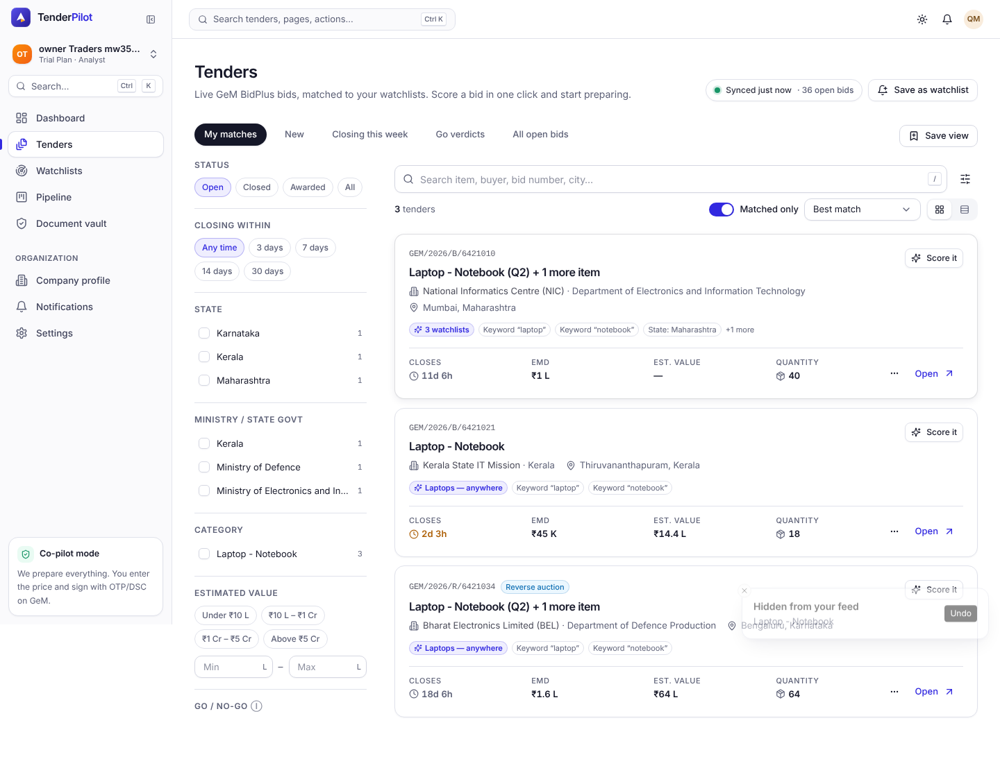 [video](https://github.com/Shashank2577/GEMs/blob/fa79dd092d27040d6c350708fc2761962c7a0a2c/qa/evidence/003/US3/s8-not-relevant-hide-toast-hidden-from-your-feed-undo-card-d-desktop.webm) Matched count N → N-1 → N (API confirms). |
| 8b | S8: `POST /api/tenders/:id/dismiss` on an unmatched tender → `409` “Only tenders that match one of your watchlists can be dismissed” | met | 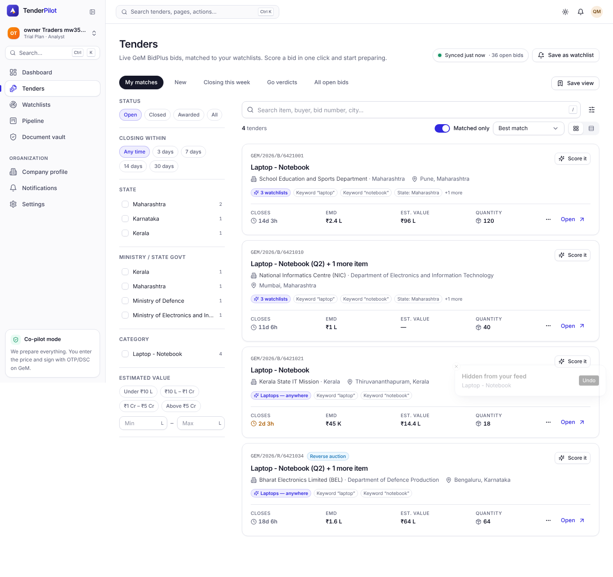 [video](https://github.com/Shashank2577/GEMs/blob/fa79dd092d27040d6c350708fc2761962c7a0a2c/qa/evidence/003/US3/s8-not-relevant-hide-toast-hidden-from-your-feed-undo-card-d-desktop.webm) API: 409 with that exact message; malformed / unknown id → 404 “Tender not found” (dismiss and seen). |
| 9 | S9: `cctv` + Maharashtra → Analyst “Save as watchlist” opens sheet pre-filled “cctv · Maharashtra” (keyword cctv, state MH); hidden for Viewers; disabled when pristine | met | 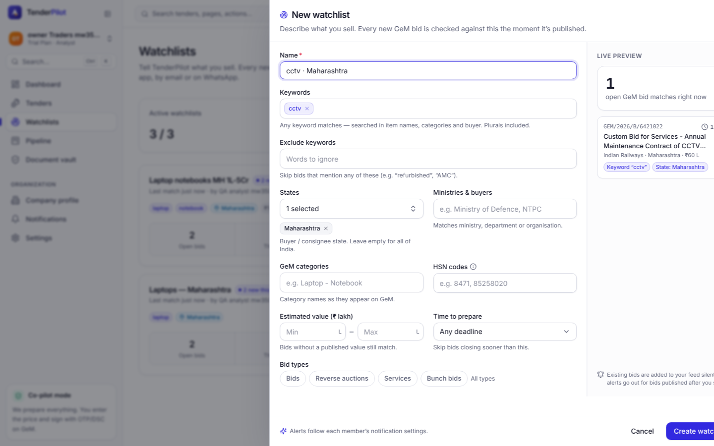 [video](https://github.com/Shashank2577/GEMs/blob/fa79dd092d27040d6c350708fc2761962c7a0a2c/qa/evidence/003/US3/s9-search-cctv-state-mh-analyst-save-as-watchlist-opens-shee-desktop.webm) Disabled when pristine (`S9a`), pre-filled sheet, button absent for Viewer (`S9c`). |
| 10a | S10: no tenders + pristine → “No tenders yet” with **Sync with GeM now** for Bid Managers | met | 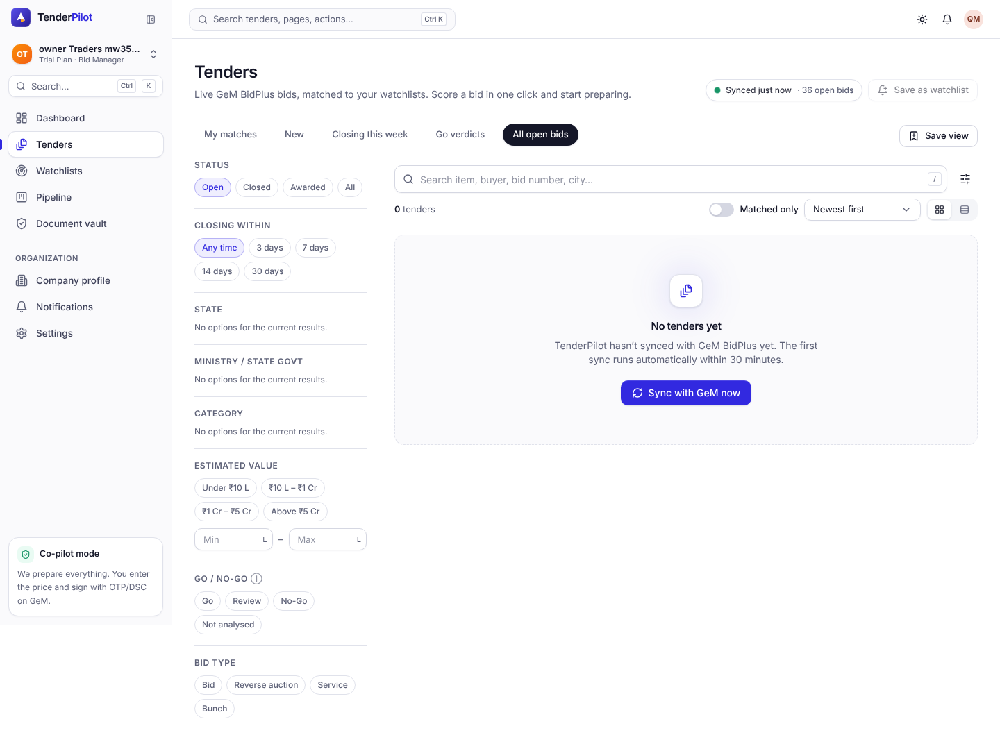 [video](https://github.com/Shashank2577/GEMs/blob/fa79dd092d27040d6c350708fc2761962c7a0a2c/qa/evidence/003/US3/s10-empty-states-no-tenders-yet-sync-only-for-bid-manager-te-desktop.webm) Tenders are global and 36 exist, so the empty list response was stubbed with the genuine empty payload. Analyst sees the title but no Sync button. |
| 10b | S10: Matched only + no watchlists → “Tell us what you sell” with **Create a watchlist** and **Browse all open bids** | met | 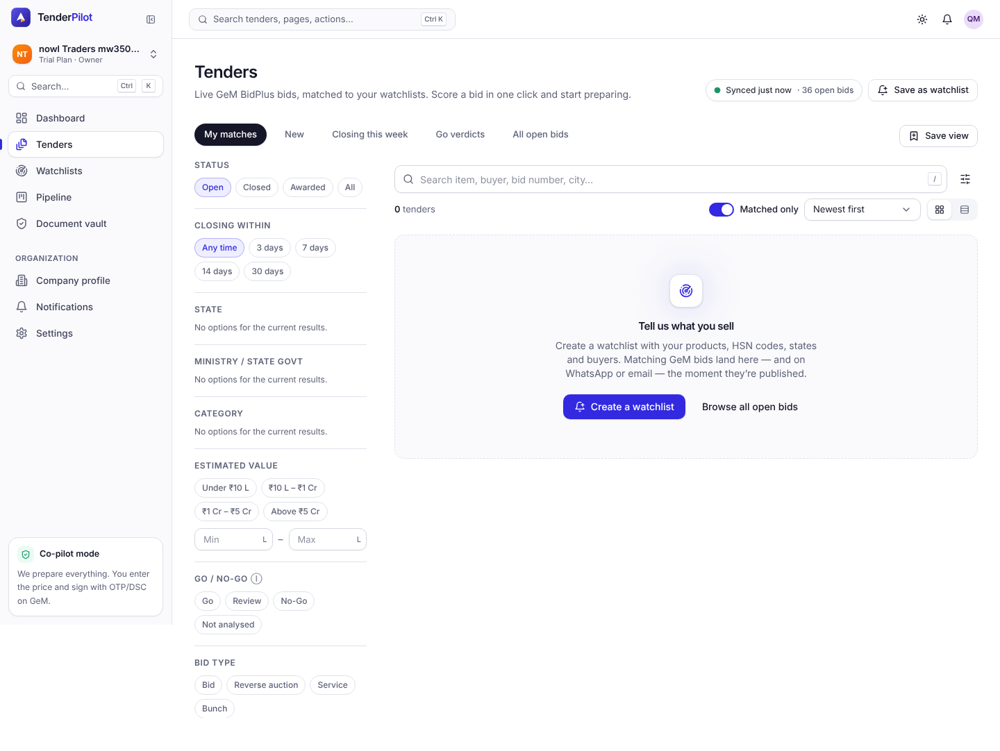 [video](https://github.com/Shashank2577/GEMs/blob/fa79dd092d27040d6c350708fc2761962c7a0a2c/qa/evidence/003/US3/s10-empty-states-no-tenders-yet-sync-only-for-bid-manager-te-desktop.webm) Browse all open bids drops `matched=1`. |
| 10c | S10: filters exclude everything → “No tenders match these filters” with **Clear filters** and **Alert me when one appears** | met | 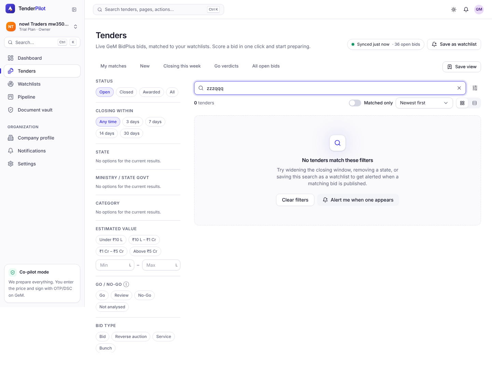 [video](https://github.com/Shashank2577/GEMs/blob/fa79dd092d27040d6c350708fc2761962c7a0a2c/qa/evidence/003/US3/s10-empty-states-no-tenders-yet-sync-only-for-bid-manager-te-desktop.webm) |
| 11 | S11: API 500 → error state with a **Retry** button instead of the list | met | 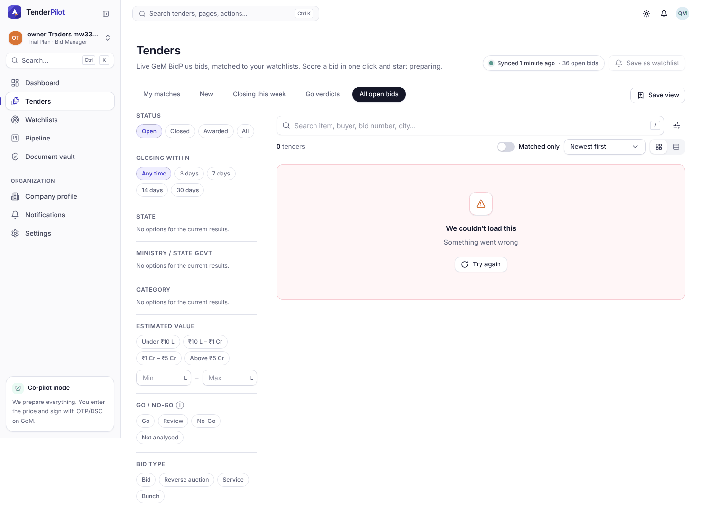 [video](https://github.com/Shashank2577/GEMs/blob/fa79dd092d27040d6c350708fc2761962c7a0a2c/qa/evidence/003/US3/s11-api-500-error-state-with-retry-instead-of-the-list-retry-desktop.webm) Error state shown, list absent, button recovers the list. Observation: the button reads “Try again”, not “Retry”. |
| 12a | S12: desktop layout toggle → table; preference in localStorage `tp.feed.layout` | met | 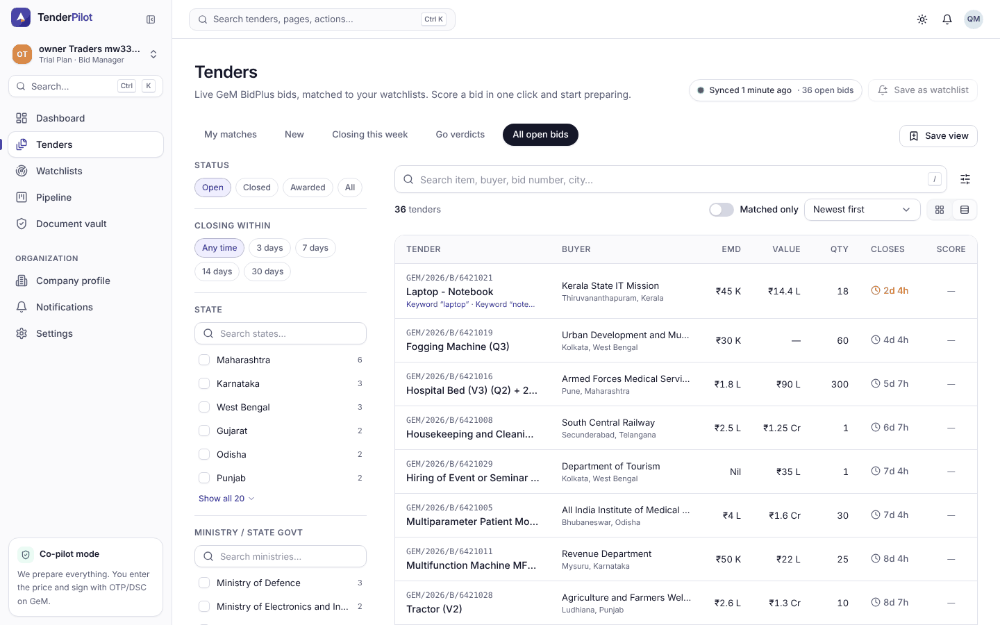 [video](https://github.com/Shashank2577/GEMs/blob/fa79dd092d27040d6c350708fc2761962c7a0a2c/qa/evidence/003/US3/s12-desktop-layout-toggle-table-remembered-in-localstorage-t-desktop.webm) Table renders; `localStorage['tp.feed.layout']` = `"table"`; survives reload. |
| 12b | S12: on 375 px the toggle is hidden, cards always used (even with `table` stored), no horizontal scroll | met | 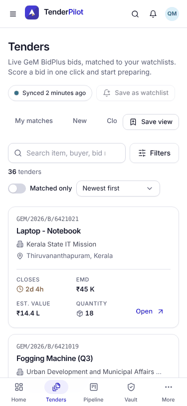 [video](https://github.com/Shashank2577/GEMs/blob/fa79dd092d27040d6c350708fc2761962c7a0a2c/qa/evidence/003/US3/s12-mobile-375-px-layout-toggle-hidden-cards-only-even-if-ta-mobile.webm) scrollWidth ≤ innerWidth; no `table`, no Cards/Table toggle. |
| 13 | S13: `GET /api/tenders?status=bogus` / `pageSize=500` → `400 validation_error` | met | [video](https://github.com/Shashank2577/GEMs/blob/fa79dd092d27040d6c350708fc2761962c7a0a2c/qa/evidence/003/US3/s13-get-api-tenders-status-bogus-and-pagesize-500-400-valida-desktop.webm) Both 400 `validation_error`; also pageSize=0, page=0, sort=bogus, verdict=maybe, bidType=nope, q of 201 chars, closingWithinDays=abc, minValue=-5 → 400. |
| 14a | S14: Save view “MH urgent” → personal tab after the built-in views | met | 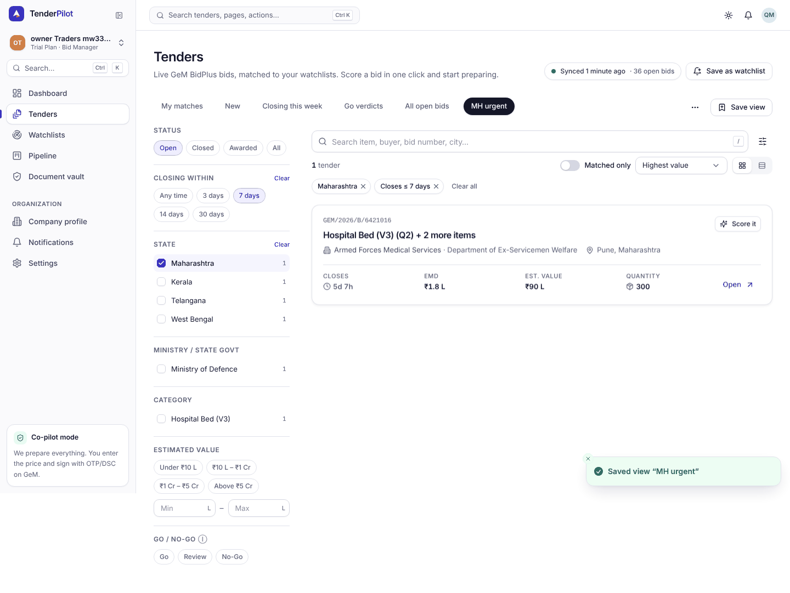 [video](https://github.com/Shashank2577/GEMs/blob/fa79dd092d27040d6c350708fc2761962c7a0a2c/qa/evidence/003/US3/s14-saved-views-mh-urgent-tab-after-built-ins-server-side-re-desktop.webm) Tabs: My matches, New, Closing this week, Go verdicts, All open bids, MH urgent. |
| 14b | S14: persists across devices (server-side); clicking re-applies the exact filters | met | 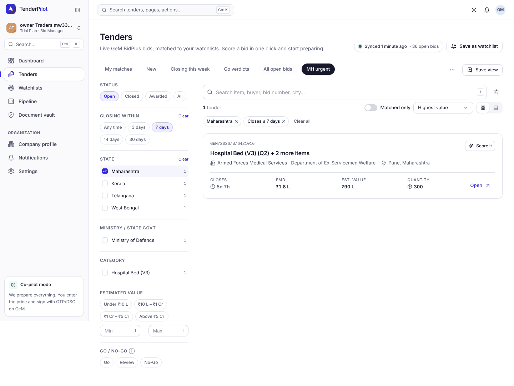 [video](https://github.com/Shashank2577/GEMs/blob/fa79dd092d27040d6c350708fc2761962c7a0a2c/qa/evidence/003/US3/s14-saved-views-mh-urgent-tab-after-built-ins-server-side-re-desktop.webm) Stored via `/api/views`; a fresh browser context (same user) shows the tab; clicking it restores identical query params. Other user sees none; cross-user PATCH/DELETE → 404. |
| 14c | S14: can be renamed or deleted from the tab’s menu | met | 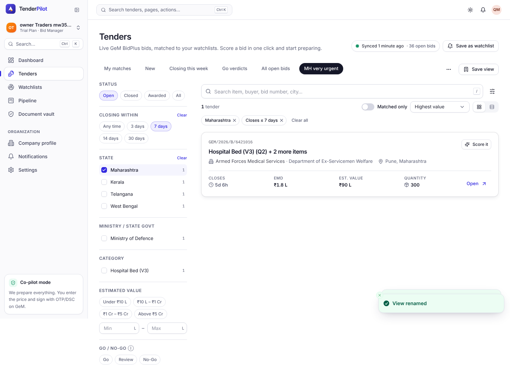 [video](https://github.com/Shashank2577/GEMs/blob/fa79dd092d27040d6c350708fc2761962c7a0a2c/qa/evidence/003/US3/s14-saved-views-mh-urgent-tab-after-built-ins-server-side-re-desktop.webm) Rename and delete (with confirm) both work and are reflected in `/api/views` (`S14e`, `S14f`). |
| 15 | S15: status selector “Closed” / “Awarded” lists bids with that status (Open / All too) | met | 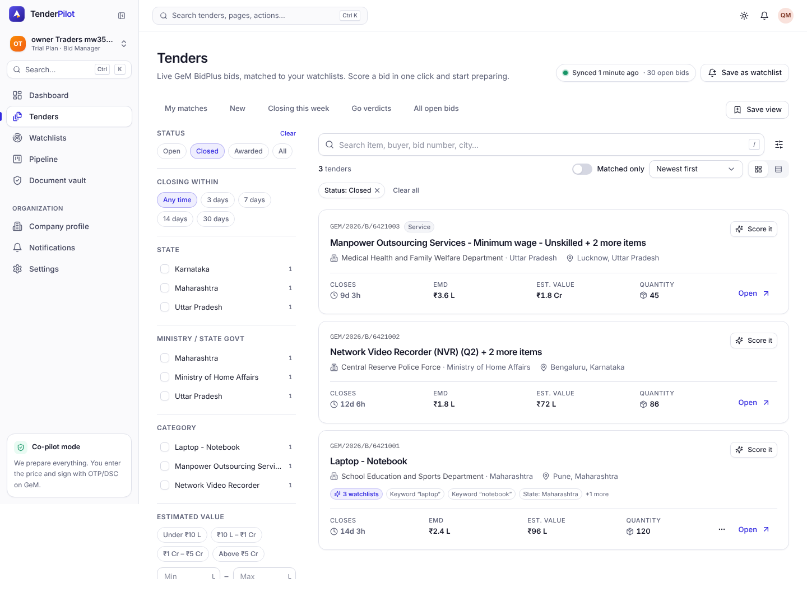 [video](https://github.com/Shashank2577/GEMs/blob/fa79dd092d27040d6c350708fc2761962c7a0a2c/qa/evidence/003/US3/s15-status-selector-open-closed-awarded-all-list-bids-of-tha-desktop.webm) With 3 closed, 2 awarded, 1 cancelled (SQL-arranged): Open 30, Closed 3, Awarded 2, All 36; UI bid numbers = API. Exact bid-number search finds a closed bid. |
| FR-035 | 20 saved views per user per org, name ≤ 40 chars | met | 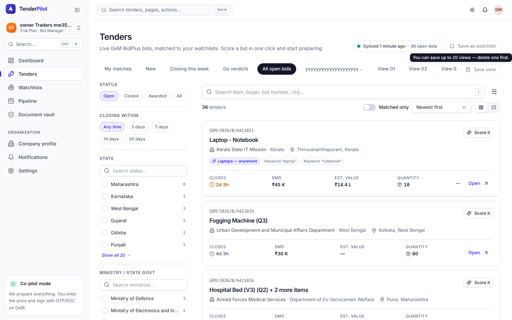 [video](https://github.com/Shashank2577/GEMs/blob/fa79dd092d27040d6c350708fc2761962c7a0a2c/qa/evidence/003/US3/s14-limits-name-40-chars-duplicate-409-view-exists-20-per-us-desktop.webm) 41 chars → 400, 40 → 201, blank → 400, duplicate → 409 `view_exists`; 21st → 409 `view_limit` “You can save up to 20 views — delete one first.”; UI Save view disabled with that tooltip at 20; deleting one re-enables (`S14h`); cap is per user. Mobile 375 px tab strip + dialog fit (`S14i`, `S14j`). |
| FR-037 | Exact bid number + Enter opens that tender when exactly one exists | met | 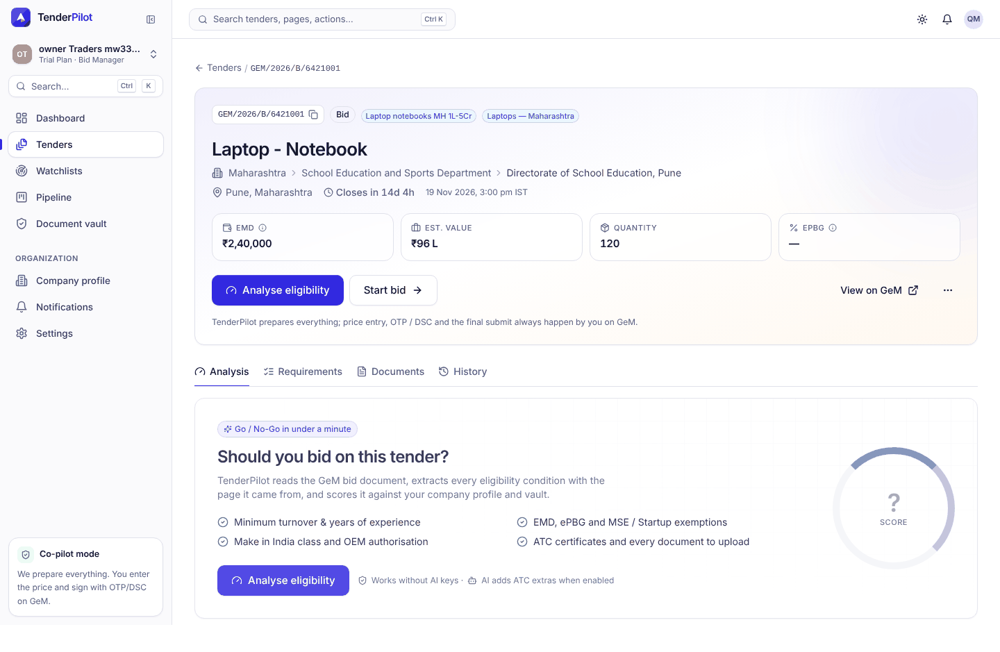 [video](https://github.com/Shashank2577/GEMs/blob/fa79dd092d27040d6c350708fc2761962c7a0a2c/qa/evidence/003/US3/fr-037-bid-number-jump-exact-number-enter-opens-that-tender--desktop.webm) Exact, lower-case/space-padded and closed-status numbers jump to `/tenders/<id>`; unknown or partial number stays on the feed; plain text never navigates. The “two tenders share one number” branch cannot be produced (unique bid numbers): unit-test only. |
| A11y-L | `checkA11y(page)` on /tenders, light theme (WCAG 2.1 A/AA, serious/critical) | **not met** | 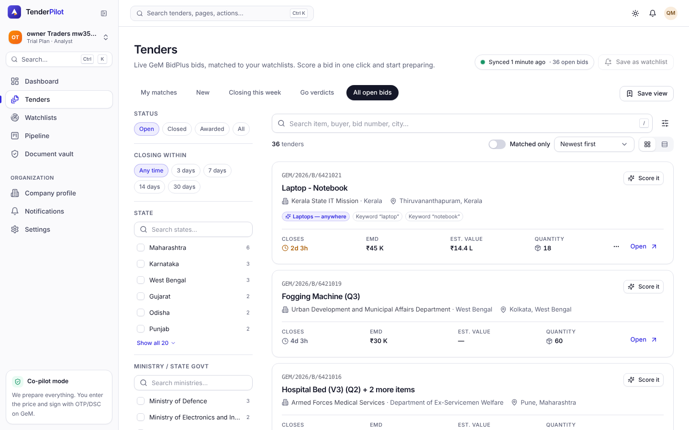 [video](https://github.com/Shashank2577/GEMs/blob/fa79dd092d27040d6c350708fc2761962c7a0a2c/qa/evidence/003/US3/a11y-light-tenders-passes-axe-wcag-2-1-a-aa-serious-critical-desktop.webm) `label-content-name-mismatch` (serious) on the sort control `#radix-:rg:`: accessible name “Sort tenders” does not contain the visible text (“Newest first”). |
| A11y-D | `checkA11y(page)` on /tenders, dark theme | **not met** | 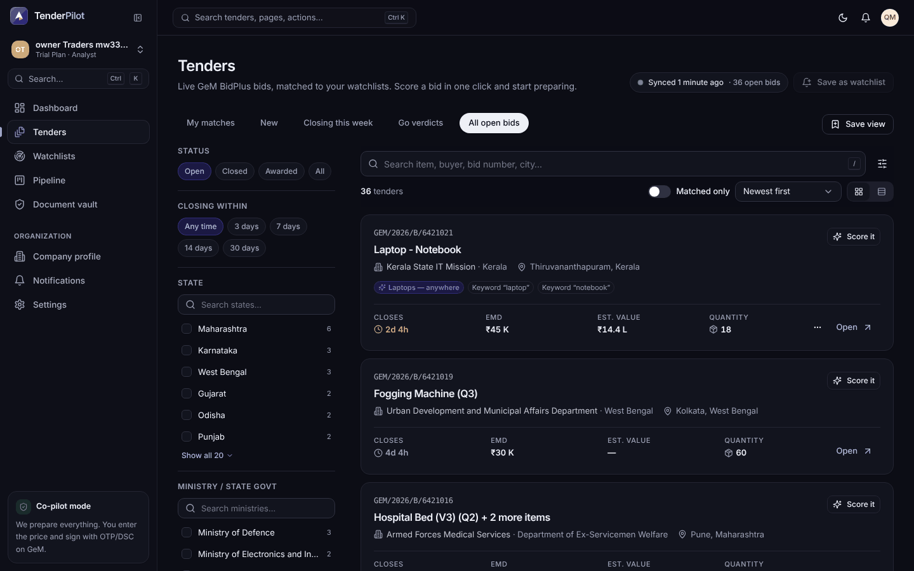 [video](https://github.com/Shashank2577/GEMs/blob/fa79dd092d27040d6c350708fc2761962c7a0a2c/qa/evidence/003/US3/a11y-dark-tenders-passes-axe-wcag-2-1-a-aa-serious-critical--desktop.webm) (1) `label-content-name-mismatch` on the sort control, (2) `color-contrast` (serious) on the primary-soft watchlist badge in cards (`li:nth-child(1)`, `li:nth-child(17)` … `.border-primary/20.bg-primary-soft`). Dark dialog state fails on (2) too (`A11y-dark-save-view-dialog-desktop.png`). |
| A11y-M | `checkA11y(page)` on /tenders at 375 px, light and dark | **not met** | 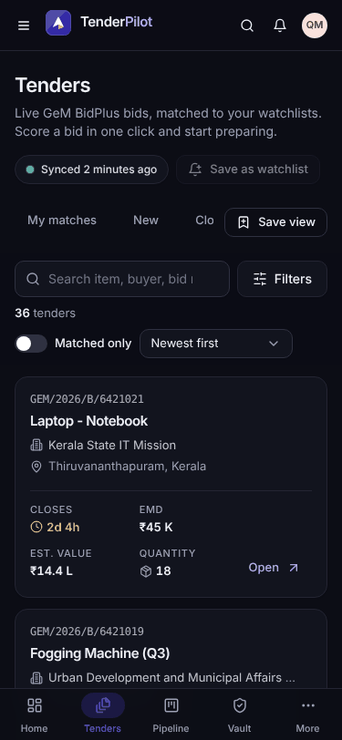 [video](https://github.com/Shashank2577/GEMs/blob/fa79dd092d27040d6c350708fc2761962c7a0a2c/qa/evidence/003/US3/a11y-dark-mobile-tenders-at-375-px-passes-axe-mobile.webm) Light: sort-control label mismatch. Dark: label mismatch + `color-contrast` on the active bottom-nav link `.text-[10.5px][aria-current=page][href$=tenders]`. |

### Findings

1. **major** — Scenario 1: first page is 20 cards / `Load more (16 left)`, spec requires 25 / `(11 left)`.
   - Observed: `S1` test → 20 cards, button text `Load more (16 left)`.
   - Expected: first 25 cards, `Load more (11 left)`.
   - Where: `apps/web/src/features/feed/api.ts:15` (`PAGE_SIZE = 20`).
2. **major** — Scenario 2: `/` does not focus the feed search; it opens/focuses the global command palette.
   - Observed: `S2a` → focused element placeholder “Search pages, actions, or tenders…”.
   - Expected: the “Search item, buyer, bid number, city…” input is focused.
   - Where: `apps/web/src/components/layout/CommandPalette.tsx:30` vs `apps/web/src/features/feed/FeedPage.tsx:141`.
3. **minor** — Scenario 6: reason chips are capped at 4, not 3, and “+n more” is not shown for 4 reasons.
   - Observed: tender GEM/2026/B/6421001 (4 reasons) → 4 chips, no “+1 more”.
   - Expected: 3 chips + “+1 more”.
   - Where: `apps/web/src/features/feed/TenderCard.tsx` `reasonChips(t, max = 4)`.
4. **major** — Accessibility (task requirement, serious axe violations) on /tenders:
   - `label-content-name-mismatch` on the sort control (aria-label “Sort tenders” vs visible value) in light and dark, desktop and 375 px. Where: `FeedPage.tsx` `<Select aria-label="Sort tenders">`.
   - `color-contrast` in dark theme on the primary-soft watchlist badge of matched cards (desktop) and on the active bottom-nav “Tenders” link (375 px).
5. **observation** — Scenario 11 error-state button is labelled “Try again” (spec says “Retry”); functionally satisfied.
6. **observation** — Scenario 4’s exact query returns 0 rows on the mock dataset, so “every listed bid satisfies all” is vacuous there (checked non-vacuously without the bid type).

### Not checked

- “Highest score”, “Best match” sort order and the **Go verdicts** view/`verdict=go|review|no_go` with real analyses: the dataset has no analysed bids, only “Not analysed” was exercised.
- Ministry and Category facet filtering through the UI (facet counts verified via API).
- Corrigendum badge, EMD/quantity formatting on the card (visible in screenshots, not asserted).
- Auto-load-on-scroll (the sentinel) as distinct from the Load more button.
- Tenders for “No tenders yet” were stubbed at the API boundary (tenders are global; a real empty DB would need a second environment).

### Bug issues filed

- None filed; all findings are in-scope defects of #64.

### Verdict

`qa:rejected` — criteria 1b, 2a, 6b and the accessibility requirement (A11y-L / A11y-D / A11y-M) not met. Rejection 1 of 3 on this item.

---
_Generated by [Claude Code](https://claude.ai/code)_
