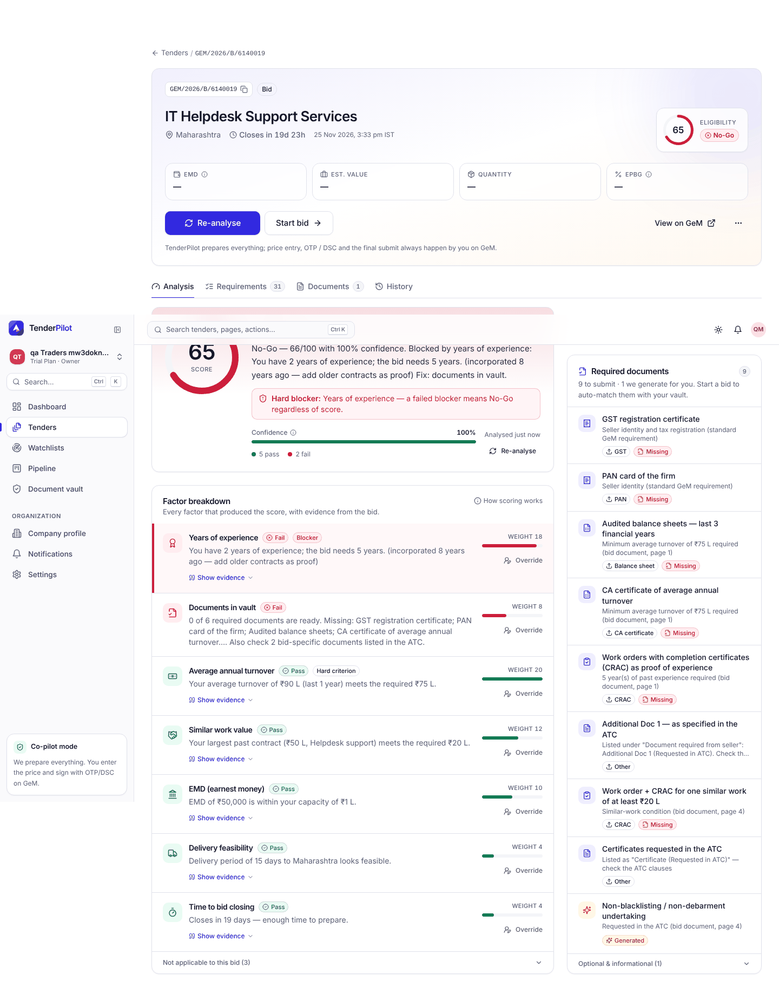

## QA verdict - APPROVED

**Work item:** none (cross-cutting hardening, no story issue) · **PR:** #553 · **Reviewer:** qa (claude-code/Sonnet 5.5) · **Session:** https://claude.ai/code/session_01BUi6mG5jQ8e8oe3shm7NHq

### Claims of the PR

| # | Claim | Verdict | Evidence |
|---|---|---|---|
| 1 | `contracts/api.md § Analyse` matches the live API (routes, role gates, error codes, DTO fields) | met (2 minor mismatches) | `apps/api/test/analyse-contract.test.ts`, 8 tests passed: 14 documented error codes hit over HTTP (`analysis_running`, `analysis_replaced`, `reanalysis_required`, `conflict`, `no_documents`, `not_found`, `forbidden`, `validation_error`, `unsupported_media_type`, `bad_request`, `unreadable_pdf`, `no_gem_document`, `gem_unavailable`, `scanned_document`); `analysis_superseded` is covered by `analyse.test.ts`; fields `staleReason`, `staleAt`, `lastAttempt`, `notes`, `warnings`, `textSource`, `bidNumberFound`, `totalPages` seen in responses |
| 2 | T096 hint `(incorporated N years ago — add older contracts as proof)`; verified US3 sentences unchanged | met | `HARDEN-hint.e2e.ts`: detail "You have 2 years of experience; the bid needs 5 years. (incorporated 8 years ago — add older contracts as proof)"; `pnpm exec playwright test e2e/000-smoke e2e/004-analyse`: 123 passed (122 expected + the new hint test), demo "You have 3 years of experience; the bid needs 3 years." and nogo-experience tests pass |
| 3 | SUMMARY.md counts and links; REVIEWS.md counts | met | Recount US1..US6 = 27, 13, 16, 14, 7, 8 = 85, all met. 12 links (6 VERDICT + 6 evidence trees) resolve with `git cat-file -e` at the pinned squash SHAs, all on `main`, subjects name PRs #478 #501 #517 #528 #535 #542; 2 raw/tree URLs return 200. Reviews fetched for the six PRs: 1+2+2+2+2+2 = 11 rounds, blocking B1+B2 (#517), B1+B2 (#528), B1 (#535), B1 (#542) = 6 |
| 4 | T035a, T095, T099, T100 unticked with reasons; #554 exists | met | `tasks.md` lines 253, 255, 259, 260 are `[ ]`; T035a, T099, T100 carry NOTEs; T095 has no NOTE but the pending US7 section of api.md states it; #554 is open, labelled `needs-human`, `spec:004`, `area:analyse-scoring` |

### Findings

1. **minor** - `documents` differs between POST and GET. api.md: `documents` = "the documents the analysis read". `POST /analyse` returns only the readable file; `GET /analysis` also lists the skipped scan (`['scan.pdf','go-it-services.pdf']`). Asserted as observed in the contract test.
2. **minor** - api.md says override returns 404 for a `factorKey` "not part of the analysis". A key outside the ten-factor enum returns 400 `validation_error`, and every run scores all ten factors, so the 404 is reachable only for a legacy row lacking the factor.
3. **observation** - the T096 hint is followed by the exemption hint when one applies, so the detail "ends with" the hint only for non-exempt companies.
4. **observation** - T095 line in `tasks.md` has no NOTE saying why it is open.
5. **observation** - REVIEWS.md rounds with changes requested are GitHub review state `COMMENTED` (the body says REQUEST_CHANGES).

### Test counts

- Core: 485 passed. Typecheck clean.
- API: 800 passed, 1 failed, 2 skipped (803, 43 files). The failure is `foundation.test.ts` "logs onboarding.completed once with durationSec" (pre-existing, 007, recorded in SUMMARY.md). Includes the 8 new contract tests.
- Playwright (desktop + mobile): 123 passed, 0 failed.

### Not checked

- `analysis_superseded`, `payload_too_large`, `gem_busy`, `rate_limited`, `analysis_failed` were not re-exercised here (existing suites cover the first; the others need load or fault injection).
- Mobile screenshot of the hint; real GeM documents; LLM paths.

### Evidence

### Verdict

Every claim met; findings are minor or observations. No story issue exists, so no `qa:` label is set.
