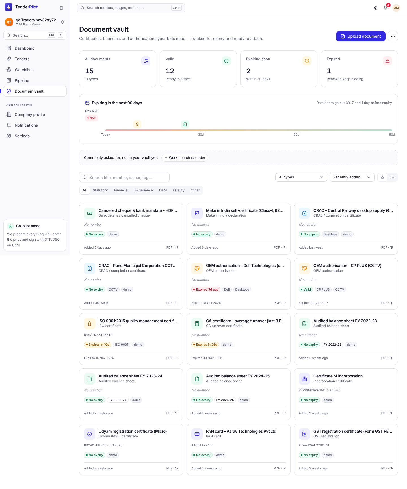
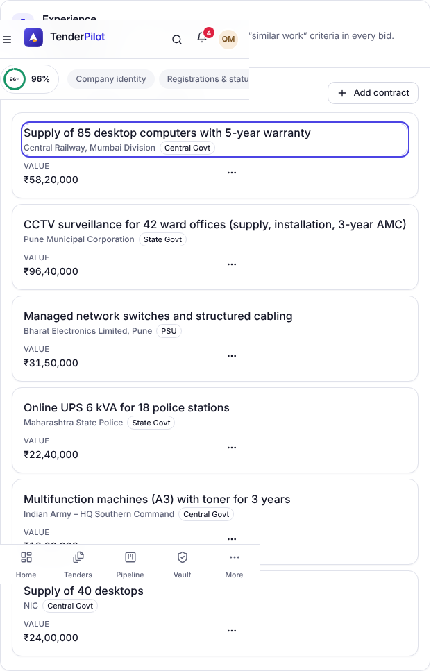

## QA verdict — APPROVED

**Work item:** none (HARDEN tasks T002, T003, T009, T074, T075, T076 of spec 005; epic #113) · **PR:** #504 · **Reviewer:** qa (claude-code / Sonnet 5.5) · **Session:** https://claude.ai/code/session_01BUi6mBnZ5b8CHFfZXzJYb

Reviewed local HEAD c11ec58 (branch + merge of origin/main). Evidence commit: `e627933e8d7ed0b6e4f4f27222a670f7fe8e1eef`.

### Acceptance criteria

| # | Criterion (from tasks.md / spec.md) | Verdict | Evidence |
|---|---|---|---|
| 1 | T002: 005 E2E helpers (`makePdf`, `makePng`, `uploadVaultDoc`, `putProfile`, `addPastContract`, `inviteAs`, `evidence005`) in `e2e/support/fixtures.ts` | met | Helpers are used by the 005 specs: 110 tests ran, 108 passed, 1 skipped, 1 flaky (see Findings). Evidence written via `evidence005` in [HARDEN](https://github.com/Shashank2577/GEMs/blob/e627933e8d7ed0b6e4f4f27222a670f7fe8e1eef/qa/evidence/005/HARDEN) |
| 2 | T003: `@axe-core/playwright` exact version in root devDependencies and `a11y(page, name)` helper that fails on serious/critical and saves JSON | met | `package.json:17` pins `4.14.0`; `e2e/support/fixtures.ts:2,157-174` imports AxeBuilder and writes `<name>-<project>.axe.json`; 28 reports in [HARDEN](https://github.com/Shashank2577/GEMs/blob/e627933e8d7ed0b6e4f4f27222a670f7fe8e1eef/qa/evidence/005/HARDEN) |
| 3 | T009: index `vault_expiry_idx` on `vault_documents(expiry_date)` plus a drizzle migration | met | `packages/db/migrations/0009_vault_expiry_idx.sql` applied on a fresh DB (`pnpm migrate` → "migrations applied"); `pg_indexes` shows `CREATE INDEX vault_expiry_idx ON public.vault_documents USING btree (expiry_date)` |
| 4 | T074: `contracts/api.md` Profile & Vault section and `data-model.md` updated (reminders/run, versions, `expectedUpdatedAt`, `nextReminder`, `content_sha256`, `vault_document_versions`) | met | Present in the PR diff (spec docs only; endpoints behaviour cross-checked by the 96 vault API tests). Not independently proofread line by line (see Not checked) |
| 5 | T075: no serious/critical axe violations on `/profile` and `/vault` (labels, contrast, focus order) | met | `a11y.e2e.ts` 6 passed (3 tests × desktop + mobile); parsed all 28 `*.axe.json` reports: 0 violations with impact serious or critical. Videos: [desktop 1](https://github.com/Shashank2577/GEMs/blob/e627933e8d7ed0b6e4f4f27222a670f7fe8e1eef/qa/evidence/005/HARDEN/a11y-f2346-desktop.webm) [desktop 2](https://github.com/Shashank2577/GEMs/blob/e627933e8d7ed0b6e4f4f27222a670f7fe8e1eef/qa/evidence/005/HARDEN/a11y-8031a-desktop.webm) [desktop 3](https://github.com/Shashank2577/GEMs/blob/e627933e8d7ed0b6e4f4f27222a670f7fe8e1eef/qa/evidence/005/HARDEN/a11y-6e595-desktop.webm) [mobile 1](https://github.com/Shashank2577/GEMs/blob/e627933e8d7ed0b6e4f4f27222a670f7fe8e1eef/qa/evidence/005/HARDEN/a11y-f2346-mobile.webm) [mobile 2](https://github.com/Shashank2577/GEMs/blob/e627933e8d7ed0b6e4f4f27222a670f7fe8e1eef/qa/evidence/005/HARDEN/a11y-8031a-mobile.webm) [mobile 3](https://github.com/Shashank2577/GEMs/blob/e627933e8d7ed0b6e4f4f27222a670f7fe8e1eef/qa/evidence/005/HARDEN/a11y-6e595-mobile.webm) |
| 6 | T076 / NFR-001 / SC-005: every query org-scoped; table-driven cross-org 404 test for every vault, version and past-contract route | met | `apps/api/test/vault.test.ts:1311` "tenant isolation sweep": 14/14 pass (12 route rows all 404 for another org's Owner, plus list/summary/profile/reminder no-leak and victim-untouched checks). `reminders.ts` scopes by `orgId` |
| 7 | NFR-005: inputs labelled, no nested-interactive in shared `ResponsiveTable` mobile card (#493) | met | a11y spec passes on mobile; 006 US1, 002 US2 callers pass (below) |

### Gate results (run independently)

| Check | Result |
|---|---|
| `pnpm -r typecheck` | exit 0 (after `pnpm install --frozen-lockfile`) |
| core vitest | 21 files, 379 passed |
| API vitest (`tenderpilot_test_qa`) | 451 passed, 2 skipped |
| `vault.test.ts` | 96 passed |
| web vitest | 23 files, 165 passed |
| Playwright `e2e/005-profile-vault` (desktop + mobile) | 110 run: 108 passed, 0 failed, 1 skipped, 1 flaky |
| Playwright `e2e/005-profile-vault/a11y` | 6 passed, 0 failed |
| Playwright 003 US2 | 20 passed, 0 failed (fresh DB) |
| Playwright 006 US1 + 002 US2 (ResponsiveTable callers) | 13 passed, 0 failed |

### Screenshots

| | |
|---|---|
| Profile, filled, mobile |  |
| Vault grid, desktop |  |
| Vault drawer expired, mobile |  |
| Contract cards 375px after fix |  |

### Findings

1. **observation (flaky, not failing)** — `US3 vault › AC2 file name guesses type/title/FY` (desktop) failed once in the full run: after Cancel and re-open, the type select still showed "Audited balance sheet" instead of "ISO certificate" (`US3-vault.e2e.ts:91`). Rerun alone 3/3 passed. Known-flaky ones (US5 AC10c, AC10b) did not fail this run.
2. **observation** — Running 003 US2 against a DB already used by other specs fails its setup (`tenders` count 76, expected 36); it passes on a fresh DB. Test isolation assumption, not a regression.
3. **observation** — PR body says 30 axe scans; 28 report files exist (14 per viewport). Zero serious/critical in all of them.
4. **observation** — Out of scope per PR: label-content-name-mismatch on 002/007 shell Account menu and org switcher.

### Not checked

- Prose accuracy of the T074 doc changes beyond cross-checking with API tests.
- Moderate/minor axe findings (only serious/critical gate).
- US5 AC10b/AC10c flake rates, and full e2e suites of other teams beyond the named callers.

An approval covers what is in the table above. It is not a statement that the change is free of defects.

### Bug issues filed

- none

### Verdict

`qa:approved` — every criterion met, evidence above.

---
_Generated by [Claude Code](https://claude.ai/code)_
