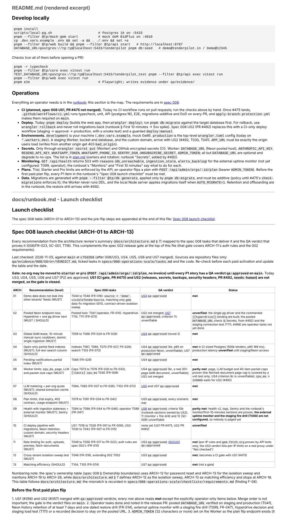

## QA verdict — APPROVED

**Work item:** #355 (cross-cutting tasks T005, T008, T009, T114, T115, T116; no story issue) · **PR:** #558 · **Reviewer:** qa (claude-code/Sonnet 5.5) · **Session:** https://claude.ai/code/session_01BUi6mFf2769n2HrbTB4UYT

Checked against `origin/main` c75d2b6 (`main-sha.txt`), branch head after rework c2c47ef. Docs-only PR (plus commented placeholders and a quoted `MAIL_FROM` in `.dev.vars.example`), so "acceptance criteria" are: every factual claim is true on main, ticks are honest, paths/commands exist, README dev instructions work.

### Acceptance criteria

| # | Criterion | Verdict | Evidence |
|---|---|---|---|
| 1 | README Operations: CI, deploy, environments, secrets, monitoring, plans and data claims are true against main (no unmerged feature described as shipped) | met | `ops-claims-main.txt` (only apply-branch-protection, project-board, wiki-sync workflows; `deploy` script and `# Deploy: pnpm deploy` present; no `[env.*]`; APP_URL workers.dev), `rollback-claim.txt` (runbook:159 `wrangler rollback`), `code-claims.txt` (AUTO_MIGRATE in node.ts, env vars in env.ts) |
| 2 | README runbook pointers resolve (Monitors, First 10 minutes, retention, offboarding exist; "Secrets"/restore drill are labelled as added by #492) | met | `ops-claims-main.txt` runbook headings |
| 3 | README dev instructions work as written (env loading, scripts, `pnpm db:migrate` target) | met | `env-loading.txt` (documented form loads `MAIL_FROM` with spaces; old form fails), `code-claims.txt` + `paths.txt` (`db:migrate` -> `packages/db/src/migrate.ts`), `install-typecheck.txt` |
| 4 | `pnpm install --frozen-lockfile` and `pnpm -r typecheck` pass | met | `install-typecheck.txt` (all packages Done) |
| 5 | contracts/api.md additions: health v2 (success/partial counts, stale-with-no-success, unreachable body), `/ingestion/runs` fields, `sync_cooldown`/`ingestion_running`, rate-limit exception | met | `apps/api/src/routes/health.ts` lines 30-35, 73-101, 107-108; `routes/ingestion.ts:36-49`; `code-claims.txt` (TEST_ALERT_LIMIT via `hit`, `rateLimited` default rule) |
| 6 | data-model.md additions: `trial_ends_at` wording, index table scope and titles | met | `code-claims.txt` (migration 0022 backfill `greatest(created_at+14d, now()+7d)`) |
| 7 | plan.md secrets list matches `env.ts`; `.dev.vars.example` placeholders | met | `code-claims.txt` (UNSUBSCRIBE_SECRET, SENTRY_DSN, ADMIN_TOKEN min 32 in env.ts) |
| 8 | Runbook launch checklist and requirements.md: statuses honest, links/paths exist, F-05 Open, sync_cooldown ownership, F-15 and #559 | met | `paths.txt` (all linked VERDICT.md and code paths ok); rendered excerpt below |
| 9 | tasks.md ticks honest (T114 is `[~]`, `Part of #371`) | met | PR body and `specs/008-operations-scale/tasks.md` |
| 10 | Rendered README Operations and launch checklist read correctly | met | `readme-operations-and-launch-checklist.png`, `render-readme-ops-launch-checklist.webm` |

### Findings

1. **observation** — `scripts/local-pg.sh`, `pnpm db:migrate` and `pnpm dev` were not run (Postgres already on :5433; the migrate target script exists and was read, not executed).

### Not checked

- Production/Neon behaviour, the planned CI and deploy workflows (#475, #492): not on main, so nothing to verify; the README labels them planned.
- Full test suites (core/api/web): diff has no code changes; typecheck run only.

An approval covers what is in the table above. It is not a statement that the change is free of defects.

### Bug issues filed

- #559 — [008] test-alert 429 reports wrong details.rule (found in review; out of scope for this PR)

### Verdict

`qa:approved` — every criterion met, evidence above.
