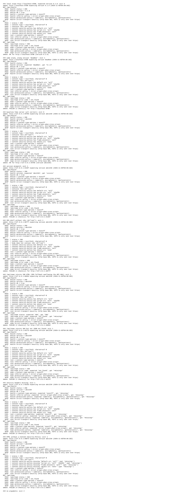
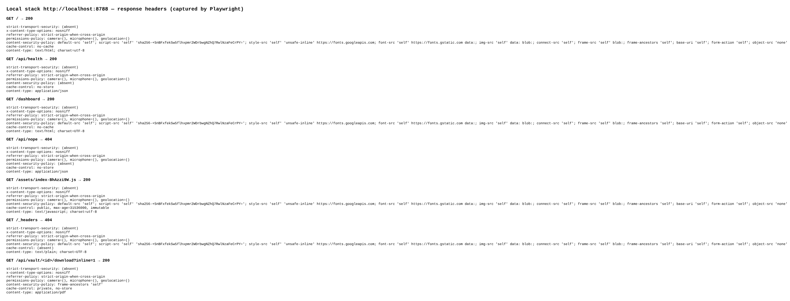
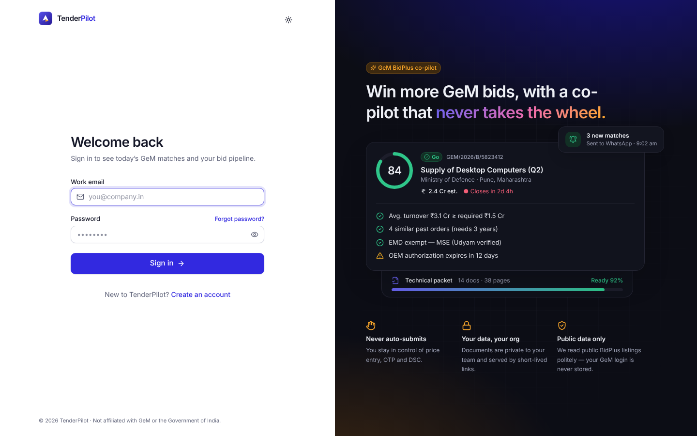
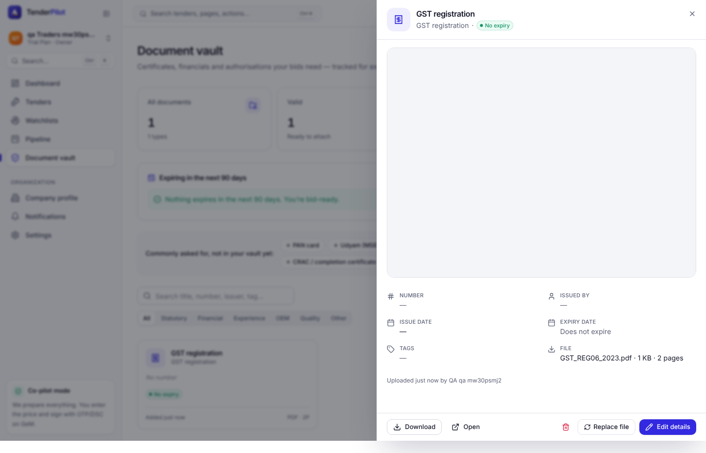
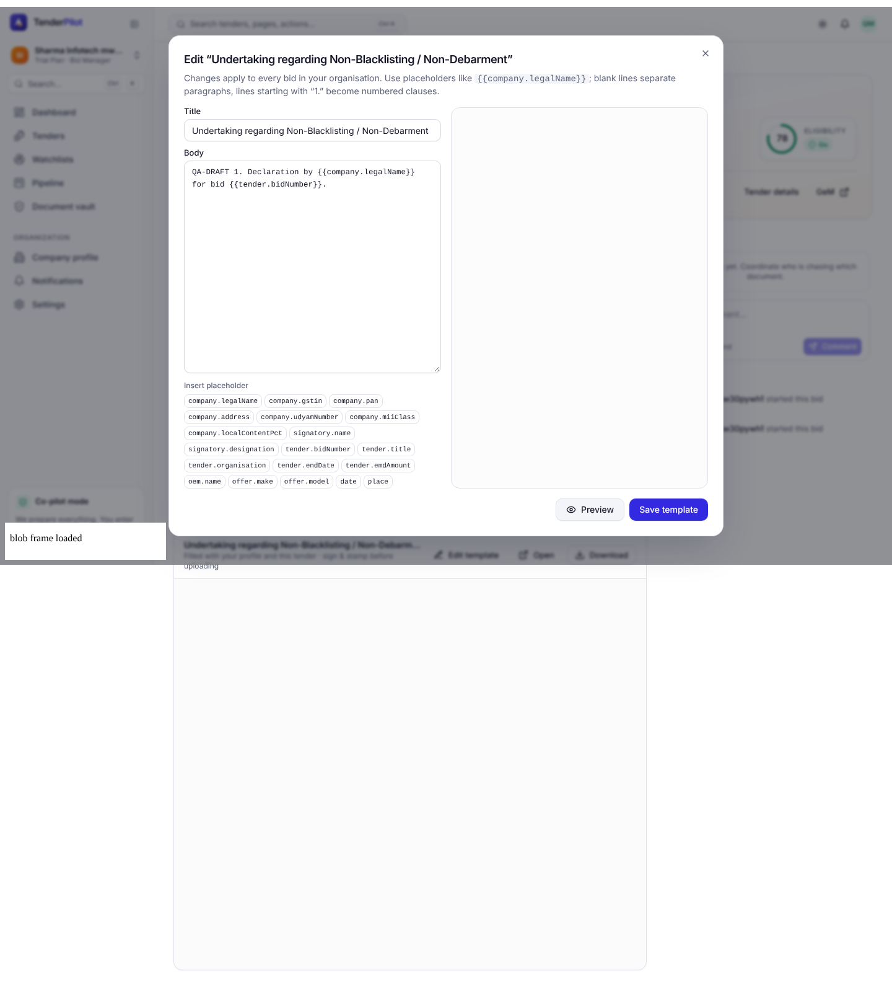

## QA verdict — REJECTED

**Work item:** #357 · **PR:** #492 · **Reviewer:** qa (claude-code/Sonnet 5.5) · **Session:** https://claude.ai/code/session_01BUi6mJsfhPsYf5Epv2QfEt

Evidence commit: `28d94f4024a2afaab6cbb7b71deb7c83401694dc` (all links pinned to it). Base URL: `https://github.com/Shashank2577/GEMs/blob/28d94f4024a2afaab6cbb7b71deb7c83401694dc/qa/evidence/008/US2/`.

Run summary: Playwright `13 passed, 0 failed` (`e2e/008-operations-scale/US2-headers-smoke.e2e.ts`: 7 desktop + 6 `@mobile`). API: `16 files passed, 1 skipped; 249 passed, 1 skipped, 0 failed` (24/24 in `foundation.test.ts` + `worker.test.ts`). Web `csp.test.ts`: 4 passed.

### Acceptance criteria

| # | Criterion (spec US2) | Verdict | Evidence |
|---|---|---|---|
| 1a | `deploy` log shows, in order: web build → `db:migrate` (staging secret) → `wrangler deploy --env staging` → `smoke (staging)` | **unverifiable** | Step order is correct in `deploy.yml` ([S1-deploy-workflow-step-order.txt](https://github.com/Shashank2577/GEMs/blob/28d94f4024a2afaab6cbb7b71deb7c83401694dc/qa/evidence/008/US2/S1-deploy-workflow-step-order.txt)), `wrangler deploy --dry-run --env staging` resolves ([S6-wrangler-dry-run.txt](https://github.com/Shashank2577/GEMs/blob/28d94f4024a2afaab6cbb7b71deb7c83401694dc/qa/evidence/008/US2/S6-wrangler-dry-run.txt)). But no run exists: `deploy.yml` is not on the default branch, the `ci.yml` `deploy` caller lives only in unmerged #475, and PR #492 has 0 check runs. Needs: the `deploy` run log from a merge to `main`. |
| 1b | pending `production` environment approval, then `db:migrate` (prod secret) → `wrangler deploy` → `smoke (production)` | **unverifiable** | Job `production` has `environment: production` and `needs: staging`, but a required reviewer is a GitHub setting (T041 open, #396). Needs: Settings → Environments screenshot, or a run showing "Waiting for approval". |
| 1c | a failure in any step stops all later steps | met (by construction) | No `if:`/`continue-on-error` on any step; production `needs: staging`; `smoke` step propagates the script exit via PIPESTATUS. Not observed in a live failing run. |
| 2a | smoke calls `GET /api/health` expecting 200 and `version` = `APP_VERSION` | met | [smoke-local-stack.txt](https://github.com/Shashank2577/GEMs/blob/28d94f4024a2afaab6cbb7b71deb7c83401694dc/qa/evidence/008/US2/smoke-local-stack.txt): `PASS health version = 0.1.0`; wrong version `deadbee` → `FAIL`, exit 1. Worker injects `APP_VERSION` (`worker.test.ts`, and workerd `/api/health` returned `"version":"abc1234"` in [wrangler-dev-workerd-headers.txt](https://github.com/Shashank2577/GEMs/blob/28d94f4024a2afaab6cbb7b71deb7c83401694dc/qa/evidence/008/US2/wrangler-dev-workerd-headers.txt)). |
| 2b | `GET /` 200 `text/html` containing `
` | met | same transcript; e2e mismatch case "no root div" → exit 1 ([S2-smoke-local-desktop.txt](https://github.com/Shashank2577/GEMs/blob/28d94f4024a2afaab6cbb7b71deb7c83401694dc/qa/evidence/008/US2/S2-smoke-local-desktop.txt)) |
| 2c | `GET /api/nope` 404 JSON `not_found` | met | same; mismatch cases "200 HTML" and "404 non-JSON" both exit 1 |
| 2d | any mismatch fails the job | met | 7 fake-server cases + wrong version + no-args (exit 2) in [S2-smoke-local-desktop.txt](https://github.com/Shashank2577/GEMs/blob/28d94f4024a2afaab6cbb7b71deb7c83401694dc/qa/evidence/008/US2/S2-smoke-local-desktop.txt); screenshot  |
| 3 | `migrations-additive` fails on DROP COLUMN / DROP TABLE / ALTER TYPE / RENAME / SET NOT NULL without default, naming file + statement, unless `-- tp:allow-destructive <reason>` | met (on #475, not this PR) | I ran `scripts/check-migrations.ts` from `origin/story/GEM-356-ci-gate` on 5 destructive files (each exit 1 with file:line + statement), an additive file (exit 0) and an allow-marker file (exit 0): [S3-check-migrations-us1-branch.txt](https://github.com/Shashank2577/GEMs/blob/28d94f4024a2afaab6cbb7b71deb7c83401694dc/qa/evidence/008/US2/S3-check-migrations-us1-branch.txt). `ci-gate` needs `migrations-additive` there. Not seen as a green/red CI run; depends on #475 merging. |
| 4a | headers on `/` and `/api/health`: nosniff, referrer-policy, permissions-policy; CSP (FR-013) on HTML | met (local) | [S4-headers-local-desktop.txt](https://github.com/Shashank2577/GEMs/blob/28d94f4024a2afaab6cbb7b71deb7c83401694dc/qa/evidence/008/US2/S4-headers-local-desktop.txt) (also `/dashboard` fallback, `/api/nope`, hashed asset immutable, `/_headers` 404, PDF stream `frame-ancestors 'self'`). Real workerd run honours `_headers` too: [wrangler-dev-workerd-headers.txt](https://github.com/Shashank2577/GEMs/blob/28d94f4024a2afaab6cbb7b71deb7c83401694dc/qa/evidence/008/US2/wrangler-dev-workerd-headers.txt).  |
| 4b | no CSP violations: `/`, `/login` | met | 0 violations, desktop + mobile; detector proven by negative control ([control-detector-desktop.txt](https://github.com/Shashank2577/GEMs/blob/28d94f4024a2afaab6cbb7b71deb7c83401694dc/qa/evidence/008/US2/control-detector-desktop.txt)).  |
| 4c | no CSP violations: `/dashboard`, `/vault` incl. PDF preview iframe | met | 0 violations, desktop + mobile; iframe fetched `200 application/pdf csp=frame-ancestors 'self'` ([S4-csp-vault-desktop.txt](https://github.com/Shashank2577/GEMs/blob/28d94f4024a2afaab6cbb7b71deb7c83401694dc/qa/evidence/008/US2/S4-csp-vault-desktop.txt)). Caveat: headless Chromium has no PDF viewer, so the frame paints blank; verified by response + zero violations, not by rendered pages.  |
| 4d | no CSP violations: annexure template editor Preview (blob: PDF iframe) | met | 0 violations desktop + mobile; preview POST `200 application/pdf`, iframe `src=blob:http…`; positive control: an HTML blob frame loads under `frame-src blob:` ([S4-csp-annexure-preview-desktop.txt](https://github.com/Shashank2577/GEMs/blob/28d94f4024a2afaab6cbb7b71deb7c83401694dc/qa/evidence/008/US2/S4-csp-annexure-preview-desktop.txt)). Same caveat on PDF rendering.  |
| 4e | production: `curl -sI https://<APP_DOMAIN>/` and `/api/health` include `strict-transport-security: max-age=31536000; includeSubDomains` | **unverifiable** | HSTS is correctly absent over http locally and present for https in `foundation.test.ts` / `worker.test.ts`; workerd `/` returned HSTS. No real domain reachable (T041 open). Needs: `curl -sI` transcript from `app.tenderpilot.in`. |
| 4f | `https://tenderpilot.<account>.workers.dev` returns 404/disabled | **unverifiable** | `workers_dev = false`, `preview_urls = false` in `wrangler.toml`; no live check possible. |
| 5a | production `DATABASE_URL` host contains `-pooler.` | **unverifiable** | Worker secrets cannot be read here; runbook documents the check. Needs operator output / Neon screenshot (T041). |
| 5b | 50 concurrent `GET /api/tenders` from `scripts/load/feed.sh`: 0 responses ≥ 500, `/api/health` p50 < 150 ms [staging] | **not met** | `scripts/load/feed.sh` does not exist on this branch (`ls scripts/load` → no such directory) and there is no staging. |
| 6a | `[limits] cpu_ms = 120000` | met | [S6-S8 config check](https://github.com/Shashank2577/GEMs/blob/28d94f4024a2afaab6cbb7b71deb7c83401694dc/qa/evidence/008/US2/S6-S8-repo-config-desktop.txt); wrangler dry-run parses it. |
| 6b | `[env.staging]` name `tenderpilot-staging`, R2 `tenderpilot-blobs-staging`, own `APP_URL`, cron identical | met | same file; dry-run `--env staging` bindings show `tenderpilot-blobs-staging` and `https://staging.tenderpilot.in` ([S6-wrangler-dry-run.txt](https://github.com/Shashank2577/GEMs/blob/28d94f4024a2afaab6cbb7b71deb7c83401694dc/qa/evidence/008/US2/S6-wrangler-dry-run.txt)). |
| 6c | runbook states Workers Paid is required | met | `docs/runbook.md` § Deploy & rollback; asserted in the e2e. |
| 7a | Neon history retention ≥ 7 days [staging] | **unverifiable** | Setting only exists in Neon console (T041). Needs: retention screenshot. |
| 7b | runbook § Restore drill records a dated drill (timestamp, row counts, swap rehearsed, minutes) | **not met** | The drill log's only row reads `_pending operator_` ([S6-S8-repo-config-desktop.txt](https://github.com/Shashank2577/GEMs/blob/28d94f4024a2afaab6cbb7b71deb7c83401694dc/qa/evidence/008/US2/S6-S8-repo-config-desktop.txt), `docs/runbook.md` § Drill log). Procedure is written; no drill recorded. |
| 8a | secret scanning and push protection enabled | **unverifiable** | GitHub settings not readable with the available access. Needs: `security_and_analysis` output or a Settings screenshot. |
| 8b | runbook § Secrets lists every secret with location, owner, rotation | met | all 9 named secrets have complete rows ([S6-S8-repo-config-desktop.txt](https://github.com/Shashank2577/GEMs/blob/28d94f4024a2afaab6cbb7b71deb7c83401694dc/qa/evidence/008/US2/S6-S8-repo-config-desktop.txt)). |
| 8c | `specs/001…/plan.md` no longer mentions `SESSION_SECRET` | met | asserted in the e2e (the only mention is in the runbook, saying it was removed). |
| 9 | `scheduled()` awaits the job; a thrown error fails the cron invocation | met | `worker.test.ts` x4 "worker scheduled() (FR-012)": settles only after the job, rejects when all steps fail, pool still closed ([api-tests-worker-foundation.txt](https://github.com/Shashank2577/GEMs/blob/28d94f4024a2afaab6cbb7b71deb7c83401694dc/qa/evidence/008/US2/api-tests-worker-foundation.txt)). Real Cloudflare Cron events not observed. |

### Findings

1. **blocking** — US2's staging/production proof does not exist yet (scenarios 1, 4e/4f, 5, 7, 8a). All depend on operator task T041 (#396), intentionally open. Unverifiable is a rejection reason. Evidence that would satisfy: a green `deploy` run log with the step order; `curl -sI` + `scripts/smoke.sh` transcripts for staging and production; Neon retention + pooler screenshots; filled drill-log row; secret-scanning settings.
2. **blocking** — Scenario 5 names `scripts/load/feed.sh` which is not delivered on this branch (and not in the PR diff).
3. **major** — `.github/workflows/deploy.yml` is added by both this PR and #475 (placeholder). Whichever merges second gets an add/add conflict; merge #475 first and resolve in favour of this PR's file. `ci.yml` is not on this branch, so `deploy.yml` is dead until #475 lands.
4. **observation** — The branch is 9 commits behind `main`; I did not rebase.
5. **observation** — `wrangler deploy --dry-run` passes for staging, `--env ""` and top-level; the empty-string env targets production as the warning text prescribes. Under workerd locally, Postgres is unreachable from the sandbox so `/api/health` is 503; headers and `APP_VERSION` still correct on the 503.

### Not checked

- Anything needing Cloudflare, Neon or GitHub-admin access (see findings 1-2). `gh` was not used; GitHub was read through MCP only.
- A real HTTPS/HSTS response from a deployed host; rendered PDF pages (headless Chromium has no PDF viewer).
- A live `ci`/`deploy` Actions run (PR #492 has 0 check runs).

### Bug issues filed

- none

### Verdict

`qa:rejected` — criteria 1, 4e, 4f, 5, 7, 8a unverifiable and 5b, 7b not met; everything checkable locally (2, 3, 4a-d, 6, 8b-c, 9) is met. Rejection 1 of 3 on this item. Re-review when T041 evidence is attached; no product-code change is required for the locally met criteria, except delivering `scripts/load/feed.sh` (or restating scenario 5).
