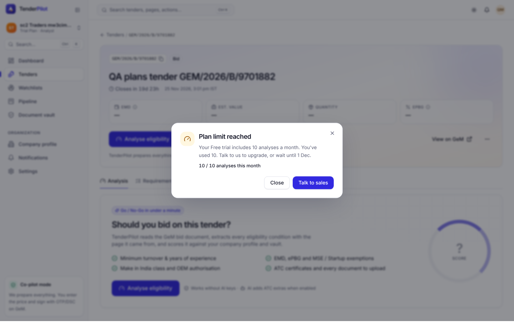
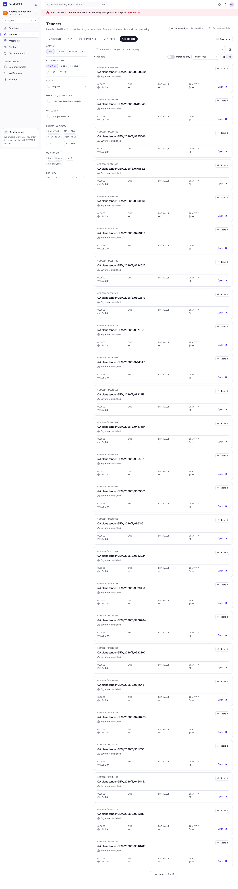
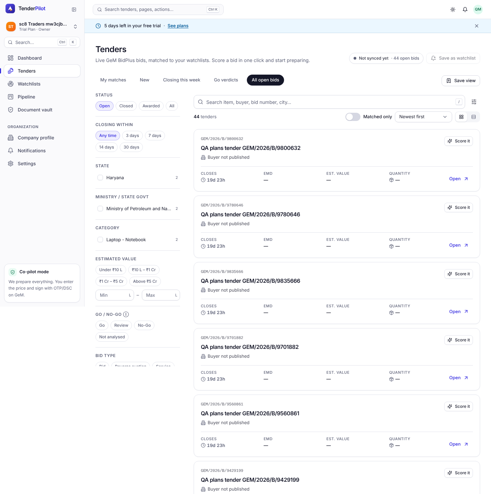
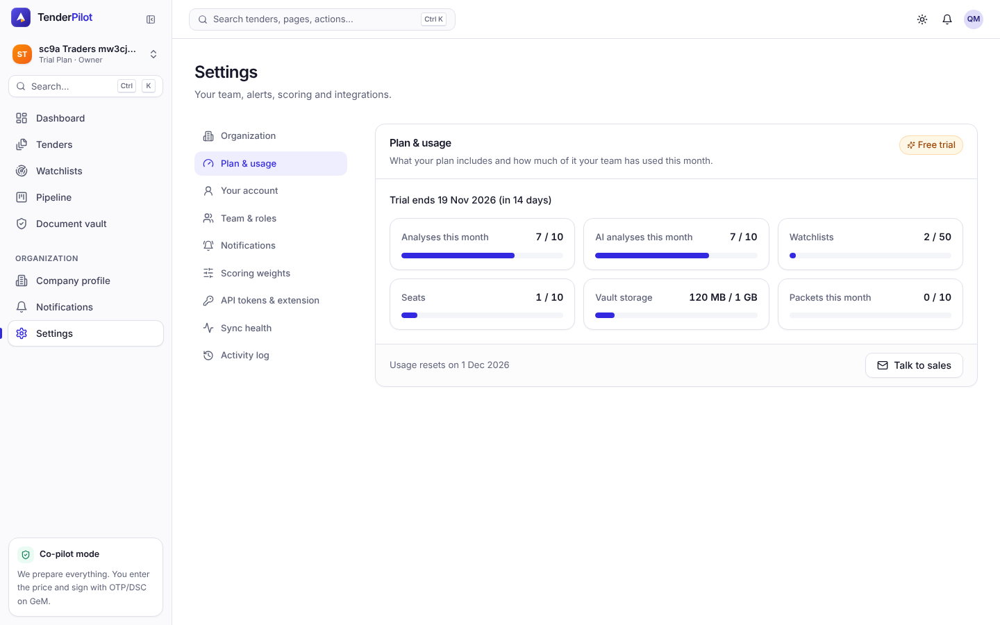
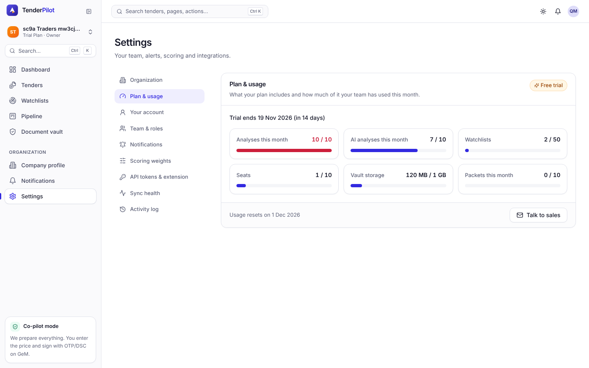
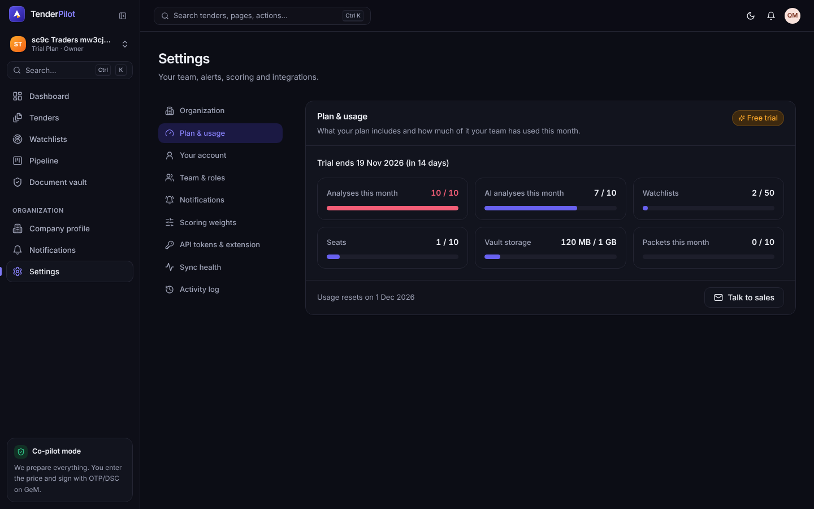
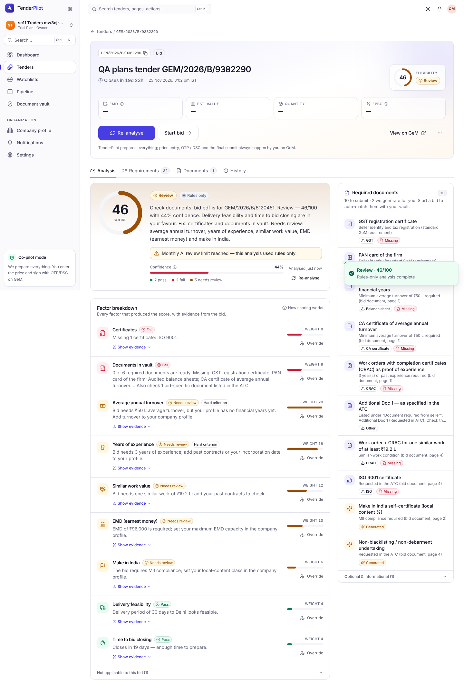
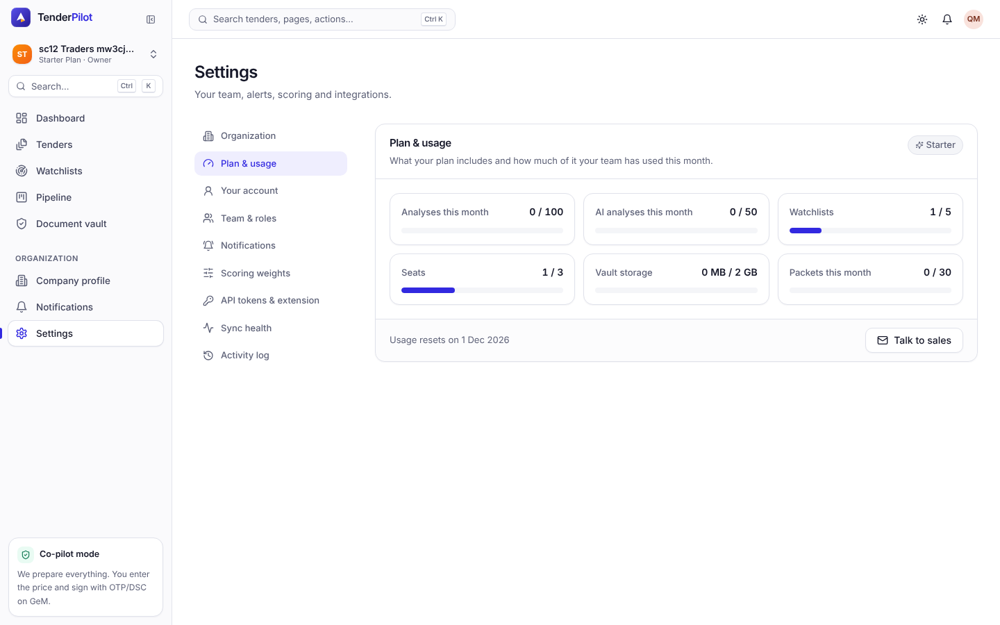
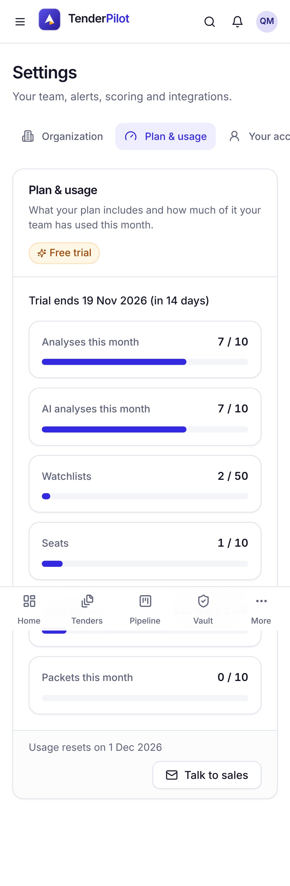

## QA verdict — APPROVED

**Work item:** #360 · **PR:** #540 · **Reviewer:** qa (claude-code/Sonnet 5.5) · **Session:** https://claude.ai/code/session_01BUi6mFf2769n2HrbTB4UYT

Tested: the branch after merging `origin/main` (dca373e); tests and evidence at `3a54348b8fe0fdbae6a09c4cddf619d1f7aa28d1`. Fresh servers (API :8792, mock-gem :4015, fresh Postgres `tenderpilot_e2e_us5`, `ADMIN_TOKEN` set, counting fake Anthropic API on :4115). Spec: `e2e/008-operations-scale/US5-plans.e2e.ts`.

### Acceptance criteria (specs/008-operations-scale/spec.md, US5, scenarios 1–12)

| # | Criterion | Verdict | Evidence |
|---|---|---|---|
| 1a | `org.plan = "trial"` on `GET /api/auth/me` (and `/api/org`) | met | [`sc1-trial-dates-desktop.txt`](https://github.com/Shashank2577/GEMs/blob/3a54348b8fe0fdbae6a09c4cddf619d1f7aa28d1/qa/evidence/008/US5/sc1-trial-dates-desktop.txt) |
| 1b | `org.trialEndsAt` = created + 14 × 24 h (example 2026-11-05 10:00 IST → 2026-11-19T04:30:00.000Z) | met | [`sc1-trial-dates-desktop.txt`](https://github.com/Shashank2577/GEMs/blob/3a54348b8fe0fdbae6a09c4cddf619d1f7aa28d1/qa/evidence/008/US5/sc1-trial-dates-desktop.txt): `trial_ends_at - created_at` = 336 h to the ms, equal on `/auth/me` and `/org`; the worked example is checked arithmetically (a live server clock cannot be set to 2026-11-05 10:00 IST) · [`sc1-trial-line-desktop.png`](https://github.com/Shashank2577/GEMs/blob/3a54348b8fe0fdbae6a09c4cddf619d1f7aa28d1/qa/evidence/008/US5/sc1-trial-line-desktop.png) |
| 2a | 11th analysis → 402 `plan_limit_reached`, message and `details {limit, used, max, plan, resetsAt}` as specified | met | [`sc2-analysis-limit-desktop.txt`](https://github.com/Shashank2577/GEMs/blob/3a54348b8fe0fdbae6a09c4cddf619d1f7aa28d1/qa/evidence/008/US5/sc2-analysis-limit-desktop.txt): message "Your Free trial includes 10 analyses a month. You've used 10. Talk to us to upgrade, or wait until 1 Dec.", details `analysesPerMonth/10/10/trial/2026-11-30T18:30:00.000Z` |
| 2b | no `analyses` row is inserted | met | row count stays 10 after the API call and after the UI attempt (asserted in the test) |
| 2c | web app shows the "Plan limit reached" dialog with "Talk to sales" and "Close" | met | [`sc2-plan-limit-dialog-desktop.png`](https://github.com/Shashank2577/GEMs/blob/3a54348b8fe0fdbae6a09c4cddf619d1f7aa28d1/qa/evidence/008/US5/sc2-plan-limit-dialog-desktop.png), [`sc2-plan-limit-dialog-mobile.png`](https://github.com/Shashank2577/GEMs/blob/3a54348b8fe0fdbae6a09c4cddf619d1f7aa28d1/qa/evidence/008/US5/sc2-plan-limit-dialog-mobile.png) (bottom sheet at 375 px, no horizontal overflow) |
| 3a | Starter, 5 watchlists: 6th → 402 (`limit:"watchlists"`, `max:5`) | met | [`sc3a-starter-watchlists-desktop.txt`](https://github.com/Shashank2577/GEMs/blob/3a54348b8fe0fdbae6a09c4cddf619d1f7aa28d1/qa/evidence/008/US5/sc3a-starter-watchlists-desktop.txt); UI dialog [`sc3a-watchlist-dialog-desktop.png`](https://github.com/Shashank2577/GEMs/blob/3a54348b8fe0fdbae6a09c4cddf619d1f7aa28d1/qa/evidence/008/US5/sc3a-watchlist-dialog-desktop.png) |
| 3b | Starter, 3 members + pending invites: 4th invite → 402 (`limit:"seats"`, `max:3`) | met | [`sc3b-starter-seats-desktop.txt`](https://github.com/Shashank2577/GEMs/blob/3a54348b8fe0fdbae6a09c4cddf619d1f7aa28d1/qa/evidence/008/US5/sc3b-starter-seats-desktop.txt); UI dialog [`sc3b-seat-dialog-desktop.png`](https://github.com/Shashank2577/GEMs/blob/3a54348b8fe0fdbae6a09c4cddf619d1f7aa28d1/qa/evidence/008/US5/sc3b-seat-dialog-desktop.png) |
| 4a | Pro, vault 9.99 GB: 20 MB-class upload → 402 (`limit:"vaultBytes"`) | met | [`sc4a-pro-vault-desktop.txt`](https://github.com/Shashank2577/GEMs/blob/3a54348b8fe0fdbae6a09c4cddf619d1f7aa28d1/qa/evidence/008/US5/sc4a-pro-vault-desktop.txt) (9.99 GB seeded; an 11 MB file is refused, a file that fits is accepted, no row created) · [`sc4a-vault-meter-desktop.png`](https://github.com/Shashank2577/GEMs/blob/3a54348b8fe0fdbae6a09c4cddf619d1f7aa28d1/qa/evidence/008/US5/sc4a-vault-meter-desktop.png). The spec's 20 MB file was replaced by an 11 MB one to keep the run fast; the rule tested is the same (used + size > max). |
| 4b | Pro, 200 packets this month: 201st → 402 (`limit:"packetsPerMonth"`) | met | [`sc4b-pro-packets-desktop.txt`](https://github.com/Shashank2577/GEMs/blob/3a54348b8fe0fdbae6a09c4cddf619d1f7aa28d1/qa/evidence/008/US5/sc4b-pro-packets-desktop.txt): 402, no packet row created, ledger stays 200; UI [`sc4b-packet-dialog-desktop.png`](https://github.com/Shashank2577/GEMs/blob/3a54348b8fe0fdbae6a09c4cddf619d1f7aa28d1/qa/evidence/008/US5/sc4b-packet-dialog-desktop.png) |
| 5 | Enterprise at 10× the Pro numbers (5 000 analyses, 100 pending invites, ~100 GiB vault, 2 000 packets): none returns 402 | met | [`sc5-enterprise-desktop.txt`](https://github.com/Shashank2577/GEMs/blob/3a54348b8fe0fdbae6a09c4cddf619d1f7aa28d1/qa/evidence/008/US5/sc5-enterprise-desktop.txt): analyse 201, invite 201, vault upload 201, packet 201, watchlist 201; `/api/org/usage` limits all null · [`sc5-enterprise-usage-desktop.png`](https://github.com/Shashank2577/GEMs/blob/3a54348b8fe0fdbae6a09c4cddf619d1f7aa28d1/qa/evidence/008/US5/sc5-enterprise-usage-desktop.png). Pro watchlists are unlimited, so there is no 10× number for them. |
| 6a | Expired trial: writes outside the FR-038 allow-list → 402 `plan_expired` "Your free trial ended on 3 Nov 2026. Your data is safe and read-only — talk to us to choose a plan." | met | [`sc6-expired-api-desktop.txt`](https://github.com/Shashank2577/GEMs/blob/3a54348b8fe0fdbae6a09c4cddf619d1f7aa28d1/qa/evidence/008/US5/sc6-expired-api-desktop.txt): watchlist, invitation, analyse, packet, profile PUT and vault upload all 402 with exactly that message; allow-listed `PATCH /me`, `read-all`, `logout` pass |
| 6b | Any GET (feed, analysis, vault download, packet download) → 200 | met | [`sc6-expired-api-desktop.txt`](https://github.com/Shashank2577/GEMs/blob/3a54348b8fe0fdbae6a09c4cddf619d1f7aa28d1/qa/evidence/008/US5/sc6-expired-api-desktop.txt): 10 GETs incl. `/vault/:id/download` and `/packets/:id/download` → 200 |
| 7a | Non-dismissible top banner "Your free trial has ended. TenderPilot is read-only until you choose a plan." + "Talk to sales" link, for any member | met | [`sc7-expired-banner-desktop.png`](https://github.com/Shashank2577/GEMs/blob/3a54348b8fe0fdbae6a09c4cddf619d1f7aa28d1/qa/evidence/008/US5/sc7-expired-banner-desktop.png), [`sc7-expired-banner-mobile.png`](https://github.com/Shashank2577/GEMs/blob/3a54348b8fe0fdbae6a09c4cddf619d1f7aa28d1/qa/evidence/008/US5/sc7-expired-banner-mobile.png); no button inside the banner, survives reload; seen as analyst, viewer and owner |
| 7b | Write buttons (Analyse, Save watchlist, Upload, Build packet, Invite) open the plan dialog instead of calling the API | met | [`sc7-expired-ui-desktop.txt`](https://github.com/Shashank2577/GEMs/blob/3a54348b8fe0fdbae6a09c4cddf619d1f7aa28d1/qa/evidence/008/US5/sc7-expired-ui-desktop.txt): all five opened "Your trial has ended"; 0 mutating `/api` requests observed · [`sc7-analyse-dialog-desktop.png`](https://github.com/Shashank2577/GEMs/blob/3a54348b8fe0fdbae6a09c4cddf619d1f7aa28d1/qa/evidence/008/US5/sc7-analyse-dialog-desktop.png), [`sc7-packet-dialog-desktop.png`](https://github.com/Shashank2577/GEMs/blob/3a54348b8fe0fdbae6a09c4cddf619d1f7aa28d1/qa/evidence/008/US5/sc7-packet-dialog-desktop.png), [`sc7-analyse-dialog-mobile.png`](https://github.com/Shashank2577/GEMs/blob/3a54348b8fe0fdbae6a09c4cddf619d1f7aa28d1/qa/evidence/008/US5/sc7-analyse-dialog-mobile.png) |
| 8a | 5 days left: dismissible (per day) banner "5 days left in your free trial" with "See plans" | met | [`sc8-five-days-banner-desktop.png`](https://github.com/Shashank2577/GEMs/blob/3a54348b8fe0fdbae6a09c4cddf619d1f7aa28d1/qa/evidence/008/US5/sc8-five-days-banner-desktop.png), [`sc8-five-days-banner-mobile.png`](https://github.com/Shashank2577/GEMs/blob/3a54348b8fe0fdbae6a09c4cddf619d1f7aa28d1/qa/evidence/008/US5/sc8-five-days-banner-mobile.png); dismissal persists across reload; a dismissal stamped with an older day no longer hides it; a viewer sees no banner |
| 8b | At ≤ 1 day it reads "Your trial ends today" | met | [`sc8-last-day-banner-desktop.png`](https://github.com/Shashank2577/GEMs/blob/3a54348b8fe0fdbae6a09c4cddf619d1f7aa28d1/qa/evidence/008/US5/sc8-last-day-banner-desktop.png) |
| 9a | Settings → Plan & usage shows the plan badge and "Trial ends 19 Nov 2026 (in 14 days)" for trials | met | [`sc9a-usage-7-of-10-desktop.png`](https://github.com/Shashank2577/GEMs/blob/3a54348b8fe0fdbae6a09c4cddf619d1f7aa28d1/qa/evidence/008/US5/sc9a-usage-7-of-10-desktop.png) (date computed from `/api/org.trialEndsAt` in IST) |
| 9b | Meters "Analyses 7 / 10", "AI analyses 7 / 10", "Watchlists 2 / …", "Seats 1 / 10", "Vault storage 120 MB / 1 GB", "Packets 0 / 10", each `role="progressbar"` with `aria-valuenow`/`aria-valuemax` | met | [`sc9a-usage-7-of-10-desktop.png`](https://github.com/Shashank2577/GEMs/blob/3a54348b8fe0fdbae6a09c4cddf619d1f7aa28d1/qa/evidence/008/US5/sc9a-usage-7-of-10-desktop.png): 6 progressbars, texts and aria values asserted. Watchlists reads "2 / 50", not "2 / Unlimited": FR-034 (note on the 50 cap) says the meter shows N / 50 and the scenario text predates it (Finding 2). |
| 9c | Meters ≥ 80 % are amber, 100 % red | met | [`sc9a-usage-amber-80-desktop.png`](https://github.com/Shashank2577/GEMs/blob/3a54348b8fe0fdbae6a09c4cddf619d1f7aa28d1/qa/evidence/008/US5/sc9a-usage-amber-80-desktop.png), [`sc9a-usage-red-100-desktop.png`](https://github.com/Shashank2577/GEMs/blob/3a54348b8fe0fdbae6a09c4cddf619d1f7aa28d1/qa/evidence/008/US5/sc9a-usage-red-100-desktop.png): `data-tone` ok → warning → danger; computed bar colours differ (amber, red) |
| 9d | NFR-011: 375 px, dark theme, a11y | met | [`sc9b-usage-375-mobile.png`](https://github.com/Shashank2577/GEMs/blob/3a54348b8fe0fdbae6a09c4cddf619d1f7aa28d1/qa/evidence/008/US5/sc9b-usage-375-mobile.png), [`sc9c-usage-dark-desktop.png`](https://github.com/Shashank2577/GEMs/blob/3a54348b8fe0fdbae6a09c4cddf619d1f7aa28d1/qa/evidence/008/US5/sc9c-usage-dark-desktop.png), [`sc9c-usage-dark-red-desktop.png`](https://github.com/Shashank2577/GEMs/blob/3a54348b8fe0fdbae6a09c4cddf619d1f7aa28d1/qa/evidence/008/US5/sc9c-usage-dark-red-desktop.png); axe serious/critical = 0: [`sc9a-usage-light-desktop.axe.json`](https://github.com/Shashank2577/GEMs/blob/3a54348b8fe0fdbae6a09c4cddf619d1f7aa28d1/qa/evidence/008/US5/sc9a-usage-light-desktop.axe.json), [`sc9a-usage-red-light-desktop.axe.json`](https://github.com/Shashank2577/GEMs/blob/3a54348b8fe0fdbae6a09c4cddf619d1f7aa28d1/qa/evidence/008/US5/sc9a-usage-red-light-desktop.axe.json), [`sc9b-usage-375-mobile.axe.json`](https://github.com/Shashank2577/GEMs/blob/3a54348b8fe0fdbae6a09c4cddf619d1f7aa28d1/qa/evidence/008/US5/sc9b-usage-375-mobile.axe.json), [`sc9c-usage-dark-desktop.axe.json`](https://github.com/Shashank2577/GEMs/blob/3a54348b8fe0fdbae6a09c4cddf619d1f7aa28d1/qa/evidence/008/US5/sc9c-usage-dark-desktop.axe.json), [`sc9c-usage-dark-red-desktop.axe.json`](https://github.com/Shashank2577/GEMs/blob/3a54348b8fe0fdbae6a09c4cddf619d1f7aa28d1/qa/evidence/008/US5/sc9c-usage-dark-red-desktop.axe.json); 375 px: one column, no horizontal scroll |
| 10a | One `llm_usage` row per LLM call with `org_id`, `analysis_id`, `model`, `input_tokens`, `output_tokens` equal to the fake LLM's usage | met | [`sc10-llm-usage-desktop.txt`](https://github.com/Shashank2577/GEMs/blob/3a54348b8fe0fdbae6a09c4cddf619d1f7aa28d1/qa/evidence/008/US5/sc10-llm-usage-desktop.txt): fake LLM served 1 call (1074 in / 222 out); 1 row with the same tokens, `analysis_id` = the analysis, `reserved = f` |
| 10b | `GET /api/org/usage` returns those totals for the month | met | [`sc10-llm-usage-desktop.txt`](https://github.com/Shashank2577/GEMs/blob/3a54348b8fe0fdbae6a09c4cddf619d1f7aa28d1/qa/evidence/008/US5/sc10-llm-usage-desktop.txt): `llmTokensThisMonth {input:1074, output:222}`, `llmAnalysesThisMonth 1` · [`sc10-usage-after-llm-analysis-desktop.png`](https://github.com/Shashank2577/GEMs/blob/3a54348b8fe0fdbae6a09c4cddf619d1f7aa28d1/qa/evidence/008/US5/sc10-usage-after-llm-analysis-desktop.png) |
| 11 | All AI analyses used, analyses left: completes rules-only (no LLM call) and shows "Monthly AI review limit reached — this analysis used rules only." | met | [`sc11-llm-quota-desktop.txt`](https://github.com/Shashank2577/GEMs/blob/3a54348b8fe0fdbae6a09c4cddf619d1f7aa28d1/qa/evidence/008/US5/sc11-llm-quota-desktop.txt): 201, `method: rules`, `warnings [llm_quota_reached]`, fake LLM calls 0, no `llm_usage` row for it · [`sc11-rules-only-message-desktop.png`](https://github.com/Shashank2577/GEMs/blob/3a54348b8fe0fdbae6a09c4cddf619d1f7aa28d1/qa/evidence/008/US5/sc11-rules-only-message-desktop.png) |
| 12a | Without or with a wrong `ADMIN_TOKEN` → 404 | met | [`sc12-admin-plan-flip-desktop.txt`](https://github.com/Shashank2577/GEMs/blob/3a54348b8fe0fdbae6a09c4cddf619d1f7aa28d1/qa/evidence/008/US5/sc12-admin-plan-flip-desktop.txt): no token, wrong token, truncated token, unknown org → 404 `not_found`; org unchanged |
| 12b | With the token: plan `starter`, `trial_ends_at` cleared, `subscriptions` row written | met | [`sc12-admin-plan-flip-desktop.txt`](https://github.com/Shashank2577/GEMs/blob/3a54348b8fe0fdbae6a09c4cddf619d1f7aa28d1/qa/evidence/008/US5/sc12-admin-plan-flip-desktop.txt): 200, DB `starter|NULL`, subscriptions `starter|active|Invoice INV-0012` |
| 12c | `activity_log` row `org.plan_changed {from:"trial",to:"starter",note}` visible in the org's activity | met | [`sc12-admin-plan-flip-desktop.txt`](https://github.com/Shashank2577/GEMs/blob/3a54348b8fe0fdbae6a09c4cddf619d1f7aa28d1/qa/evidence/008/US5/sc12-admin-plan-flip-desktop.txt); `GET /api/activity` lists it; UI [`sc12-activity-plan-changed-desktop.png`](https://github.com/Shashank2577/GEMs/blob/3a54348b8fe0fdbae6a09c4cddf619d1f7aa28d1/qa/evidence/008/US5/sc12-activity-plan-changed-desktop.png) |
| 12d | Writes succeed again | met | `POST /api/watchlists` 402 before, 201 after; expired banner gone · [`sc12-before-flip-expired-desktop.png`](https://github.com/Shashank2577/GEMs/blob/3a54348b8fe0fdbae6a09c4cddf619d1f7aa28d1/qa/evidence/008/US5/sc12-before-flip-expired-desktop.png) → [`sc12-after-flip-starter-desktop.png`](https://github.com/Shashank2577/GEMs/blob/3a54348b8fe0fdbae6a09c4cddf619d1f7aa28d1/qa/evidence/008/US5/sc12-after-flip-starter-desktop.png) |

Every `Then`/`And` clause of the 12 scenarios has a row. None is unmet or unverifiable.

### Key screenshots

| 2 plan limit dialog | 7 expired banner | 8 five days left | 9 meters 7/10 |
|---|---|---|---|
|  |  |  |  |

| 9 red at 100 % | 9 dark | 11 rules-only | 12 after plan flip |
|---|---|---|---|
|  |  |  |  |

| 375 px meters | 375 px plan dialog (expired trial) |
|---|---|
|  |  |

Videos (one per test): [sc1](https://github.com/Shashank2577/GEMs/blob/3a54348b8fe0fdbae6a09c4cddf619d1f7aa28d1/qa/evidence/008/US5/sc1-sign-up-gives-plan-trial-and-trialendsat-created-14-24-h-desktop.webm) · [sc2 desktop](https://github.com/Shashank2577/GEMs/blob/3a54348b8fe0fdbae6a09c4cddf619d1f7aa28d1/qa/evidence/008/US5/sc2-trial-org-with-10-analyses-this-month-analyse-402-plan-l-desktop.webm) · [sc2 mobile](https://github.com/Shashank2577/GEMs/blob/3a54348b8fe0fdbae6a09c4cddf619d1f7aa28d1/qa/evidence/008/US5/sc2-trial-org-with-10-analyses-this-month-analyse-402-plan-l-mobile.webm) · [sc3a](https://github.com/Shashank2577/GEMs/blob/3a54348b8fe0fdbae6a09c4cddf619d1f7aa28d1/qa/evidence/008/US5/sc3a-starter-org-with-5-watchlists-a-bid-manager-saving-a-6t-desktop.webm) · [sc3b](https://github.com/Shashank2577/GEMs/blob/3a54348b8fe0fdbae6a09c4cddf619d1f7aa28d1/qa/evidence/008/US5/sc3b-starter-org-with-3-members-pending-invites-the-owner-in-desktop.webm) · [sc4a](https://github.com/Shashank2577/GEMs/blob/3a54348b8fe0fdbae6a09c4cddf619d1f7aa28d1/qa/evidence/008/US5/sc4a-pro-org-whose-vault-holds-9-99-gb-uploading-a-11-mb-fil-desktop.webm) · [sc4b](https://github.com/Shashank2577/GEMs/blob/3a54348b8fe0fdbae6a09c4cddf619d1f7aa28d1/qa/evidence/008/US5/sc4b-pro-org-with-200-packets-this-month-building-the-201st--desktop.webm) · [sc5](https://github.com/Shashank2577/GEMs/blob/3a54348b8fe0fdbae6a09c4cddf619d1f7aa28d1/qa/evidence/008/US5/sc5-enterprise-org-at-10-the-pro-numbers-analyse-invite-vaul-desktop.webm) · [sc6](https://github.com/Shashank2577/GEMs/blob/3a54348b8fe0fdbae6a09c4cddf619d1f7aa28d1/qa/evidence/008/US5/sc6-expired-trial-writes-outside-the-allow-list-402-plan-exp-desktop.webm) · [sc7 desktop](https://github.com/Shashank2577/GEMs/blob/3a54348b8fe0fdbae6a09c4cddf619d1f7aa28d1/qa/evidence/008/US5/sc7-expired-trial-non-dismissible-banner-for-every-role-anal-desktop.webm) · [sc7 mobile](https://github.com/Shashank2577/GEMs/blob/3a54348b8fe0fdbae6a09c4cddf619d1f7aa28d1/qa/evidence/008/US5/sc7-expired-trial-non-dismissible-banner-for-every-role-anal-mobile.webm) · [sc8 desktop](https://github.com/Shashank2577/GEMs/blob/3a54348b8fe0fdbae6a09c4cddf619d1f7aa28d1/qa/evidence/008/US5/sc8-trial-with-5-days-left-dismissible-per-day-banner-5-days-desktop.webm) · [sc8 mobile](https://github.com/Shashank2577/GEMs/blob/3a54348b8fe0fdbae6a09c4cddf619d1f7aa28d1/qa/evidence/008/US5/sc8-trial-with-5-days-left-dismissible-per-day-banner-5-days-mobile.webm) · [sc9a](https://github.com/Shashank2577/GEMs/blob/3a54348b8fe0fdbae6a09c4cddf619d1f7aa28d1/qa/evidence/008/US5/sc9a-plan-usage-desktop-light-plan-badge-trial-ends-in-14-da-desktop.webm) · [sc9b 375 px](https://github.com/Shashank2577/GEMs/blob/3a54348b8fe0fdbae6a09c4cddf619d1f7aa28d1/qa/evidence/008/US5/sc9b-plan-usage-on-a-375-px-phone-one-meter-per-row-no-horiz-mobile.webm) · [sc9c dark](https://github.com/Shashank2577/GEMs/blob/3a54348b8fe0fdbae6a09c4cddf619d1f7aa28d1/qa/evidence/008/US5/sc9c-plan-usage-in-the-dark-theme-meters-tones-and-contrast--desktop.webm) · [sc10](https://github.com/Shashank2577/GEMs/blob/3a54348b8fe0fdbae6a09c4cddf619d1f7aa28d1/qa/evidence/008/US5/sc10-an-analysis-that-used-the-llm-writes-one-llm-usage-row--desktop.webm) · [sc11](https://github.com/Shashank2577/GEMs/blob/3a54348b8fe0fdbae6a09c4cddf619d1f7aa28d1/qa/evidence/008/US5/sc11-ai-analyses-used-up-but-analyses-left-the-analysis-comp-desktop.webm) · [sc12](https://github.com/Shashank2577/GEMs/blob/3a54348b8fe0fdbae6a09c4cddf619d1f7aa28d1/qa/evidence/008/US5/sc12-post-api-admin-orgs-id-plan-404-without-with-a-wrong-to-desktop.webm)

### Test results

- Playwright `pnpm exec playwright test e2e/008-operations-scale/US5`: **19 passed, 0 failed** (15 desktop 1440×900 + 4 mobile Pixel 7 / 375 px), 4 skipped (each desktop/@mobile twin runs only in its own project).
- API `pnpm --filter @tp/api exec vitest run`: 819 passed, 2 skipped (41 files + 2 skipped files), 0 failed.
- Core vitest 525 passed; web vitest 311 passed; `pnpm -r typecheck` clean.

### Findings

1. **minor (observation)** — on an expired trial the watchlist builder's live-preview request (a POST outside the FR-038 allow-list) opens the "Your trial has ended" dialog by itself while the user is still typing a keyword, before they press Save. This follows FR-038 to the letter, so no criterion fails; allow-listing the preview endpoint would avoid the unprompted dialog.
   - Observed: [`sc7-expired-ui-desktop.txt`](https://github.com/Shashank2577/GEMs/blob/3a54348b8fe0fdbae6a09c4cddf619d1f7aa28d1/qa/evidence/008/US5/sc7-expired-ui-desktop.txt) ("the plan dialog opened by itself when the watchlist builder requested its live preview").
2. **observation** — scenario 9 says "Watchlists 2 / Unlimited"; FR-034 in the same spec says the meter shows `N / 50` because the 003/FR-027 cap of 50 applies. The product shows "2 / 50". Accepted as the spec's resolved wording; the scenario text could be updated.
3. **observation** — scenario 1's calendar example cannot be reproduced against a live server clock; the rule (created + 14 × 24 h to the millisecond) is verified on real data and the example's arithmetic is asserted.
4. **observation** — the cairn round-3 nits (N-1…N-4, tracked in #549) concern crash/timeout edge cases of reservation release and the packet ledger; they were not exercised here.

### Not checked

- Concurrent quota races and the crash-recovery paths of the AI-slot reservation: covered by the API suite (819 passed), not by Playwright.
- FR-041(d) 429 "Try again in N s/min" rendering and the `contracts/api.md` documentation of the new codes (FR-040).
- The mailto target is checked as an `href`; no mail client was opened.
- Starter WhatsApp gating (#545).

An approval covers what is in the table above. It is not a statement that the change is free of defects.

### Bug issues filed

- none (finding 1 is a UX observation; #549 already tracks the cairn nits)

### Verdict

`qa:approved` — every criterion met, evidence above.

---
_Generated by [Claude Code](https://claude.ai/code)_
