## QA verdict — APPROVED

**Work item:** #361 · **PR:** #518 · **Reviewer:** qa (claude-code / Sonnet 5.5) · **Session:** https://claude.ai/code/session_01BUi6mFf2769n2HrbTB4UYT

Tested head: `b711bfe` (product code) + QA commit `f2c7915`. Rejection count on this item: 0. Task: T100 (#450).

### Acceptance criteria (specs/008-operations-scale/spec.md, US6)

| # | Criterion (quoted from the work item) | Verdict | Evidence |
|---|---|---|---|
| 1 | Given a healthy system (last success 25 min ago, no old pending alerts), `GET /api/health` returns 200 `{"ok":true,"db":true,"version","ingestion":{"lastSuccessAt","ageMinutes":25,"lastStatus":"success"},"alerts":{"pendingOlderThan30m":0},"reasons":[]}` with `cache-control: no-store` | met | SC1: exact key set, ageMinutes 25, 200, `no-store`; also healthy after a real mock-gem sync (`state:"ok"`). 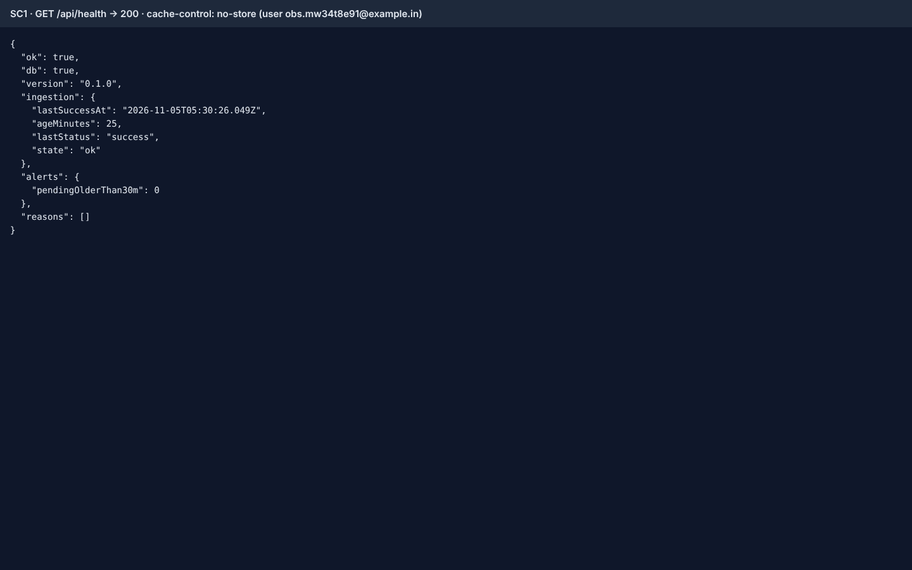 [sc1-health-healthy-desktop.txt](https://github.com/Shashank2577/GEMs/blob/f2c7915c7da4131759c9635b159d7586b57f6570/qa/evidence/008/US6/sc1-health-healthy-desktop.txt) [video](https://github.com/Shashank2577/GEMs/blob/f2c7915c7da4131759c9635b159d7586b57f6570/qa/evidence/008/US6/sc1-healthy-system-200-with-the-full-v2-shape-and-no-store-a-desktop.webm) |
| 1b | Settings → Sync health shows the healthy state (desktop and 375 px, no horizontal overflow) (T100) | met | 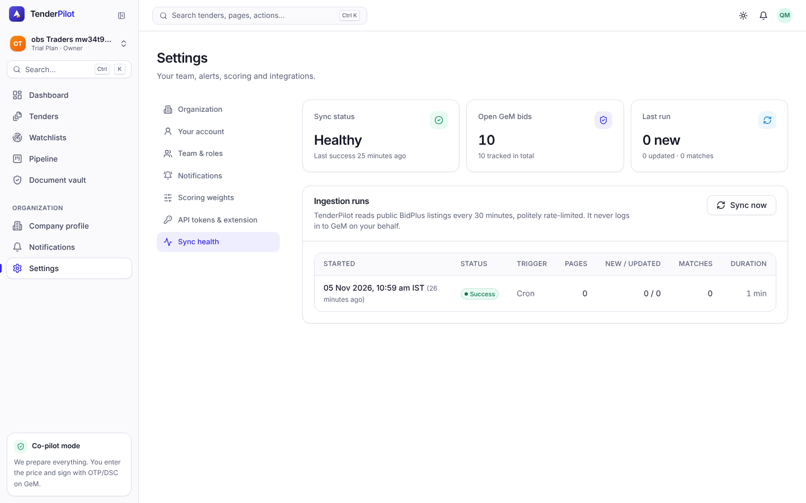 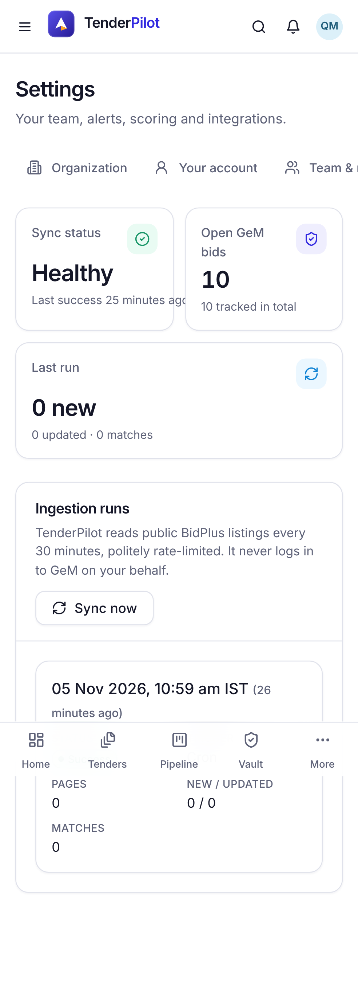 [video](https://github.com/Shashank2577/GEMs/blob/f2c7915c7da4131759c9635b159d7586b57f6570/qa/evidence/008/US6/sc1b-settings-sync-health-shows-the-healthy-state-desktop--desktop.webm) [video](https://github.com/Shashank2577/GEMs/blob/f2c7915c7da4131759c9635b159d7586b57f6570/qa/evidence/008/US6/sc1c-settings-sync-health-at-375-px-has-no-horizontal-overfl-mobile.webm) |
| 2 | Last successful run finished 3 hours ago → 503, `ok:false`, `reasons:["ingestion_stale"]`, `ingestion.ageMinutes: 180` | met | 503, reasons `["ingestion_stale"]`, state `stale`, ageMinutes 180. 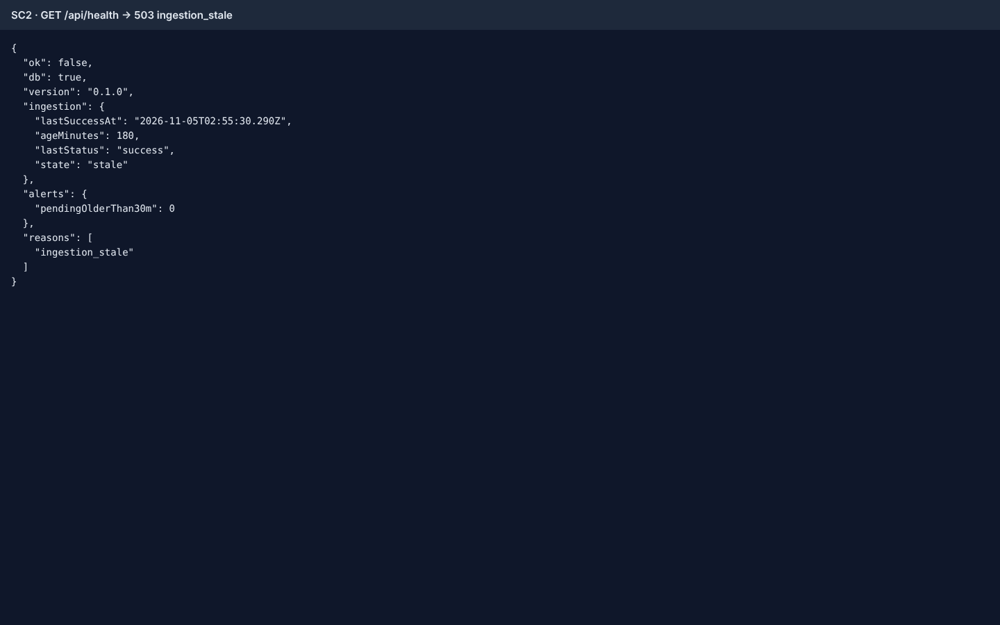 [sc2-health-stale-desktop.txt](https://github.com/Shashank2577/GEMs/blob/f2c7915c7da4131759c9635b159d7586b57f6570/qa/evidence/008/US6/sc2-health-stale-desktop.txt) [video](https://github.com/Shashank2577/GEMs/blob/f2c7915c7da4131759c9635b159d7586b57f6570/qa/evidence/008/US6/sc2-last-success-3-h-ago-503-ingestion-stale-ageminutes-180-desktop.webm) |
| 3 | Fresh database with no ingestion runs → 200, `ingestion.lastSuccessAt: null`, `ingestion.state: "never"` | met | `ingestion_runs` empty → 200, null/null/null, state `never`. 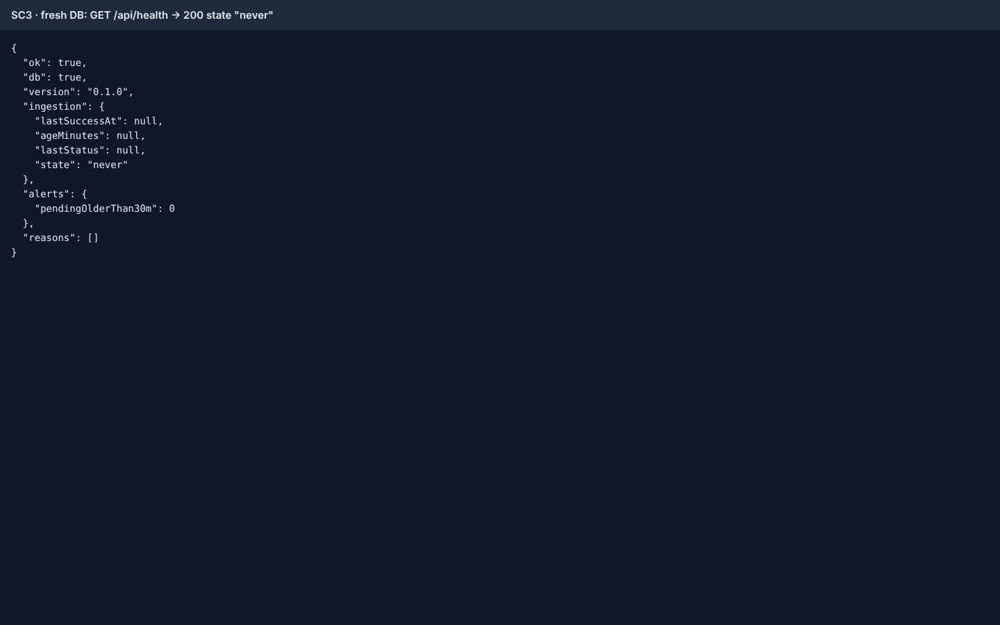 [sc3-health-never-desktop.txt](https://github.com/Shashank2577/GEMs/blob/f2c7915c7da4131759c9635b159d7586b57f6570/qa/evidence/008/US6/sc3-health-never-desktop.txt) [video](https://github.com/Shashank2577/GEMs/blob/f2c7915c7da4131759c9635b159d7586b57f6570/qa/evidence/008/US6/sc3-fresh-database-no-runs-ever-200-state-never-lastsuccessa-desktop.webm) |
| 4 | 3 email notifications pending for 45 minutes → 503, `reasons:["alerts_backlog"]`, `alerts.pendingOlderThan30m: 3` | met | Controls (in-app 90 min, email 10 min) → 200/0; then 3 emails 45 min → 503, count 3, only reason `alerts_backlog`. 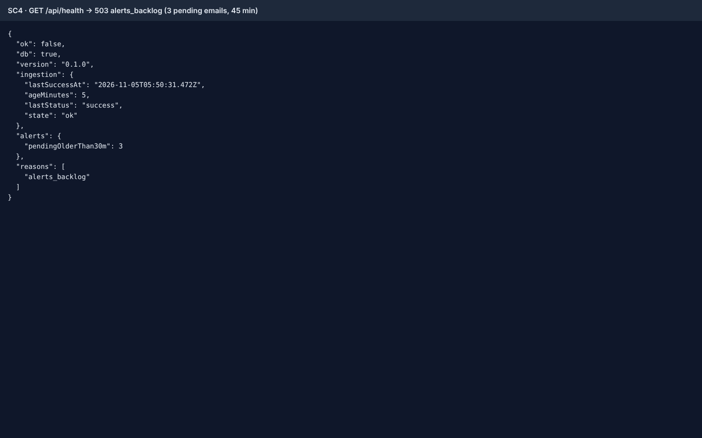 [sc4-health-alerts-backlog-desktop.txt](https://github.com/Shashank2577/GEMs/blob/f2c7915c7da4131759c9635b159d7586b57f6570/qa/evidence/008/US6/sc4-health-alerts-backlog-desktop.txt) [video](https://github.com/Shashank2577/GEMs/blob/f2c7915c7da4131759c9635b159d7586b57f6570/qa/evidence/008/US6/sc4-three-emails-pending-45-min-503-alerts-backlog-in-app-an-desktop.webm) |
| 5 | Database unreachable → 503, `db:false`, `reasons:["db_unreachable"]` within 3 s | met | Simulated a hung database (ACCESS EXCLUSIVE lock on `ingestion_runs`, 9 s): 503 after 3011 ms, `db:false`, body leaks no SQL; health recovers to 200 afterwards. The hard connection-refused path is covered by the API test "db down → 503 db_unreachable". 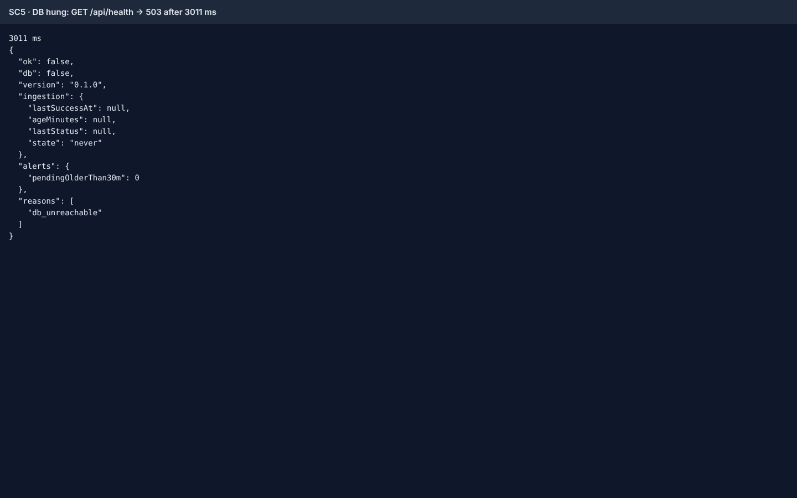 [sc5-health-db-unreachable-desktop.txt](https://github.com/Shashank2577/GEMs/blob/f2c7915c7da4131759c9635b159d7586b57f6570/qa/evidence/008/US6/sc5-health-db-unreachable-desktop.txt) [video](https://github.com/Shashank2577/GEMs/blob/f2c7915c7da4131759c9635b159d7586b57f6570/qa/evidence/008/US6/sc5-database-not-answering-503-db-false-reasons-db-unreachab-desktop.webm) |
| 6 | Any API request by a signed-in user → exactly one stdout JSON line with `ts`, `level:"info"`, `msg:"request"`, `rid`, `method`, `path` (no query string), `status`, `ms`, `orgId`, `userId`; no line ever contains password, cookie, authorization, a session token or a request body | met | `GET /api/tenders?q=…&token=tp_…`: one line, exactly the 10 keys, path `/api/tenders`, ids are UUIDs, query value absent. Whole server log scanned after signup, login, bearer-token request: no password, bearer, session-cookie value, query value or credential-named key. 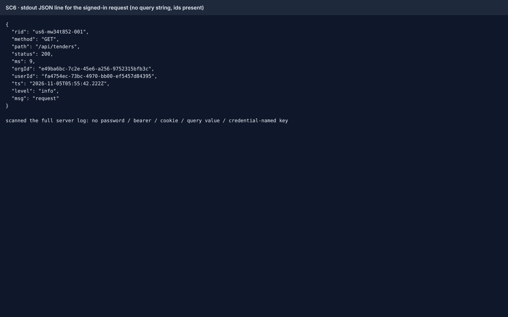 [sc6-request-log-desktop.txt](https://github.com/Shashank2577/GEMs/blob/f2c7915c7da4131759c9635b159d7586b57f6570/qa/evidence/008/US6/sc6-request-log-desktop.txt) [video](https://github.com/Shashank2577/GEMs/blob/f2c7915c7da4131759c9635b159d7586b57f6570/qa/evidence/008/US6/sc6-one-json-request-line-per-request-with-rid-orgid-userid--desktop.webm) |
| 7a | A route throws an unexpected error → 500 `internal_error` with `details.requestId` = `x-request-id`; JSON log line `level:"error"`, `rid`, `orgId`, `stack` | met | Real driver error (table renamed for the request): 500, requestId = header = sent rid; one error line with rid, orgId, userId, stack; response leaks no SQL. 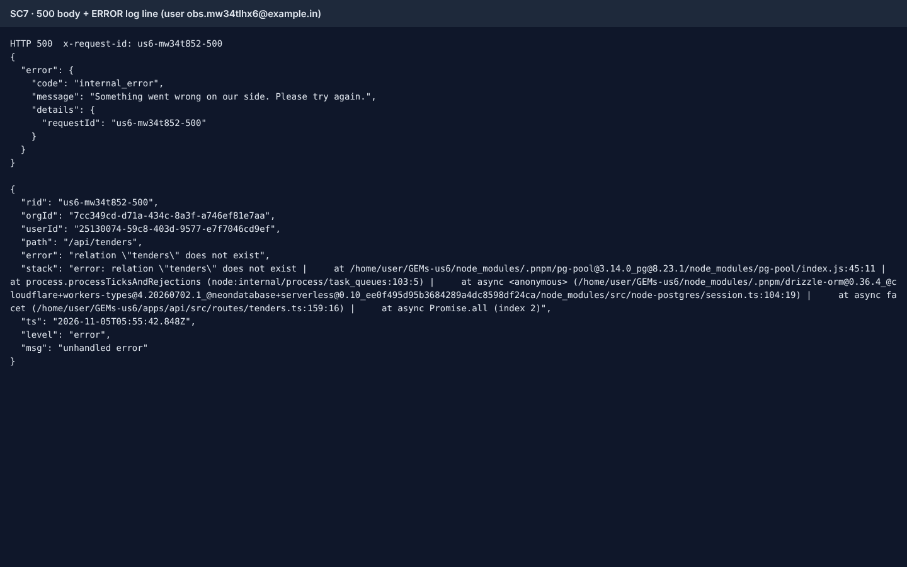 [sc7-unhandled-error-desktop.txt](https://github.com/Shashank2577/GEMs/blob/f2c7915c7da4131759c9635b159d7586b57f6570/qa/evidence/008/US6/sc7-unhandled-error-desktop.txt) [video](https://github.com/Shashank2577/GEMs/blob/f2c7915c7da4131759c9635b159d7586b57f6570/qa/evidence/008/US6/sc7-unexpected-route-error-500-internal-error-with-requestid-desktop.webm) |
| 7b | …and `deps.errors.capture()` is called once with the same `rid`, `orgId`, route and release | met (API suite) | Not observable in E2E (no DSN; the E2E server has the no-op reporter). Asserted by `apps/api/test/health.test.ts` "captures unhandled errors with rid/orgId/userId/route, matching the x-request-id of the 500" (passes; suite counts below). |
| 8 | `SENTRY_DSN` not set, an error occurs → reporter is a no-op and nothing crashes | met | E2E server started without `SENTRY_DSN`: 3 consecutive 500s, then health 200 and the same route 200; no "sentry" in the log. 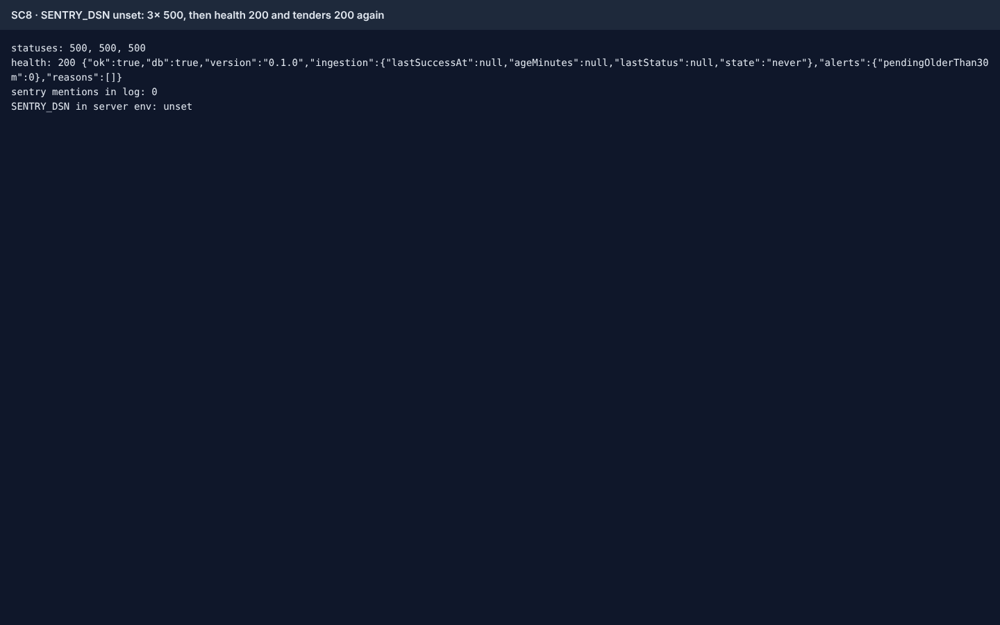 [sc8-no-dsn-noop-desktop.txt](https://github.com/Shashank2577/GEMs/blob/f2c7915c7da4131759c9635b159d7586b57f6570/qa/evidence/008/US6/sc8-no-dsn-noop-desktop.txt) [video](https://github.com/Shashank2577/GEMs/blob/f2c7915c7da4131759c9635b159d7586b57f6570/qa/evidence/008/US6/sc8-without-sentry-dsn-the-reporter-is-a-no-op-errors-do-not-desktop.webm) |
| 9 | Scheduled run where `alerts` throws → `ingestion` and `reminders` still ran, error reported with `job:"alerts"`, JSON summary line `scheduled run finished` lists each step's ok/ms | met (API suite) | Cannot be induced in the running Node server without product changes (QA does not edit `src/`); verified by the API test "runScheduledJobs reports each failed step with its job name" (re-run in SC9). 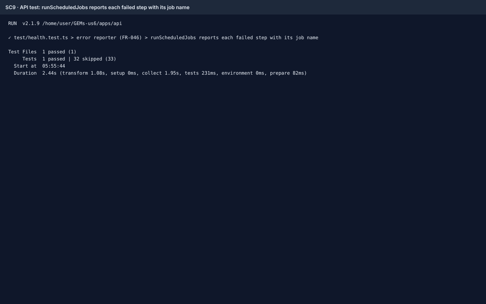 [sc9-scheduled-step-failure-api-desktop.txt](https://github.com/Shashank2577/GEMs/blob/f2c7915c7da4131759c9635b159d7586b57f6570/qa/evidence/008/US6/sc9-scheduled-step-failure-api-desktop.txt) |
| 10a | `docs/runbook.md` has sections "Monitors" (uptime monitor on `/api/health` every 5 min, alert after 2 consecutive failures) and "First 10 minutes" for each reason (`db_unreachable`, `ingestion_stale`, `alerts_backlog`, 5xx spike, GeM blocking us) | met | All five subsections and the 5-min / 2-consecutive wording present. 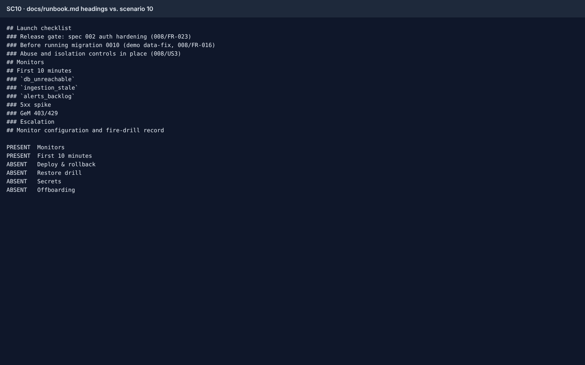 [sc10-runbook-sections-desktop.txt](https://github.com/Shashank2577/GEMs/blob/f2c7915c7da4131759c9635b159d7586b57f6570/qa/evidence/008/US6/sc10-runbook-sections-desktop.txt) [video](https://github.com/Shashank2577/GEMs/blob/f2c7915c7da4131759c9635b159d7586b57f6570/qa/evidence/008/US6/sc10-docs-runbook-md-has-monitors-and-first-10-minutes-for-e-desktop.webm) |
| 10b | …and sections "Deploy & rollback" (`wrangler rollback`, migration policy), "Restore drill", "Secrets" and "Offboarding" | **unverifiable on this branch (owned by US2)** | Absent from this branch. `tasks.md` assigns them to US2 (T038–T040, #393 etc.), which is open PR #492 (`Closes #393`) and is not on `main`. Not US6 work; satisfied once #492 merges (runbook add/add conflict expected, as #492 notes). Re-check after that merge. |
| 11 | FR-047 / T099: external uptime monitor configured (prod every 5 min, alert after 2 failures; separate staging monitor) and staging fire drill with detection time recorded | **unverifiable (operator)** | Needs a vendor account and a human. `docs/runbook.md` "Monitor configuration and fire-drill record" table is all `_TBD_`. Evidence that would satisfy: filled table + monitor/fire-drill screenshots. |
| 12 | SC-009: ingestion failure detected within 15 minutes | **unverifiable (operator)** | Depends on T099 monitor and a Sentry `job` alert rule; the runbook itself notes health alone only turns red after 120 min. |

### Test runs

- Playwright: `pnpm exec playwright test e2e/008/US6*` → **13 passed, 0 failed** (12 desktop + 1 mobile @375 px), 27.7 s. Spec: `e2e/008/US6-observability.e2e.ts`. Server on :8793, mock-gem :4016, DB `tenderpilot_e2e_us6`, started without `SENTRY_DSN`, stdout captured to a file the tests read.
- API: `pnpm --filter @tp/api exec vitest run` → **581 passed, 2 skipped (32 files passed, 2 skipped files)**, 0 failed ([api-suite-summary.txt](https://github.com/Shashank2577/GEMs/blob/f2c7915c7da4131759c9635b159d7586b57f6570/qa/evidence/008/US6/api-suite-summary.txt)). `health.test.ts`: 33 tests incl. R2-1..R2-3 scrubbing.
- Gate on b711bfe: typecheck clean; core 393 passed; web 172 passed.

### Findings

1. **minor** — runbook sections "Deploy & rollback", "Restore drill", "Secrets", "Offboarding" (scenario 10) are not on this branch; they ship with US2 (#492). Not a US6 defect; verify after #492 merges.
   - Observed: [sc10-runbook-sections-desktop.txt](https://github.com/Shashank2577/GEMs/blob/f2c7915c7da4131759c9635b159d7586b57f6570/qa/evidence/008/US6/sc10-runbook-sections-desktop.txt)
   - Where: `docs/runbook.md`
2. **observation** — health polls log at `debug` only: no `/api/health` lines in the captured info-level server log, as the runbook states.
3. **observation** — unhandled-error log line has no `method`/`status`; the following `request` line (status 500) carries them under the same `rid`.
4. **observation** — follow-ups already filed in #522 (dispatcher limit(500) starvation, unused `MANUAL_SYNC_COOLDOWN_MIN`, mailer logs recipient email).

### Not checked

- Real Sentry delivery (no DSN/network); the scrubbing is covered by API tests only.
- The Cloudflare Worker runtime (E2E runs the Node entry point); Worker Sentry behaviour was verified by code review against `@sentry/cloudflare` 9.47.2.
- Real DB outage by stopping Postgres (shared instance); simulated with a lock, plus the API test for connection failure.
- External monitor, fire drill, SC-009 (operator).

An approval covers what is in the table above. It is not a statement that the change is free of defects.

### Verdict

`qa:approved` — every criterion that can be verified in this PR is met with evidence above. **Story #361 must stay open**: T099 (external monitor + staging fire drill) and SC-009 are operator-only and unverified, and scenario 10b waits on US2 #492.
